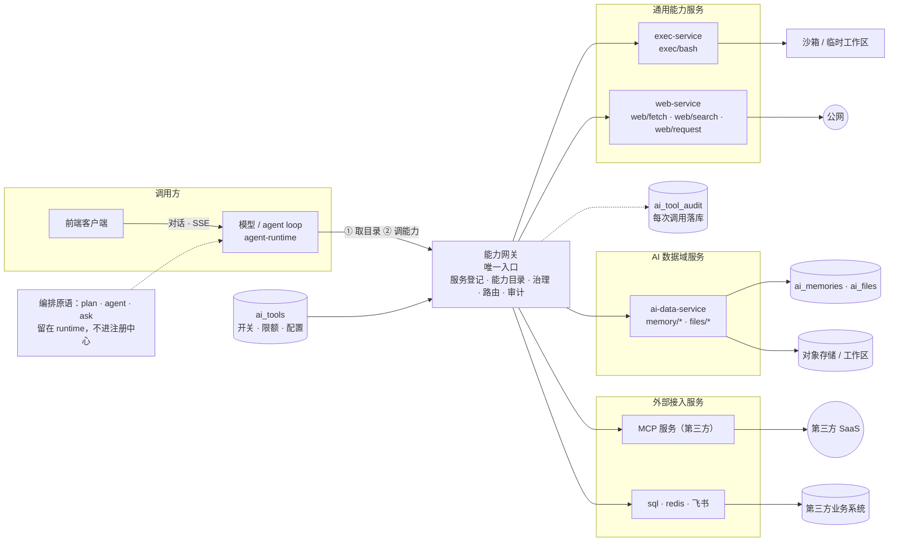
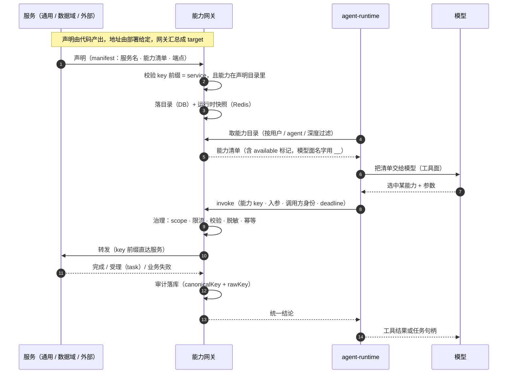

# 能力网关与能力域服务（设计评审稿 v0）

> **落地进度（2026-11-18）**：阶段 1–3 已完成——两个 app 改名、能力契约、网关登记/调用/任务接口、
> `common-capability` 四个服务身份（exec / web / files / memory，共 17 个能力）自注册、runtime 切
> `/v1/capabilities/*`、旧 `/v1/tools/*` 与 `@repo/tool-catalog` 全部下线；后台 `/main/ai/capabilities`
> 可登记外部服务。剩余：把 files/memory 抽成独立 data-service（当前同进程多身份）。
>
> 状态：**草案，待评审**（2026-11-18）。只回答「为什么这么改、改成什么样、怎么迁」，接口细节见
> [capability-protocol.md](capability-protocol.md)。
> 拍板项集中在 §8，评审时逐条确认。
>
> **命名已定（2026-11-18）**：网关 `tool-gateway` → **`capability-gateway`**；通用能力服务
> `tool-worker` → **`common-capability`**。代码标识（目录、包名、`TOOL_GATEWAY_URL`、k8s 清单）
> 已在阶段 1 落地（2026-11-18）：目录、包名、k8s 清单一并改名；环境变量
> `TOOL_GATEWAY_URL` / `TOOL_WORKER_URL` 暂留一个发布周期再改。见 §8。
>
> 相关：
> [distributed-ai-architecture.md](distributed-ai-architecture.md)（D5 工具执行、§10.5 服务发现）、
> [ai-connector.md](ai-connector.md)（连接器现状）、
> [ai-agent-tool-engine.md](ai-agent-tool-engine.md)（工具引擎与 `ai_tools`）。

## 0. 一页结论

**改什么**：

1. **能力网关**从「工具目录 + 治理 + 选 worker」升级为「**服务登记 + 能力治理 + 能力路由**」；
2. **服务**从「一个装全部执行器的 worker」拆成「按安全边界划分的域服务」：通用能力、AI 数据域、外部接入；
3. **连接器模块退役**，sql / redis / 飞书变成「外部接入服务」，与 MCP 服务走同一条接入路径；
4. **协议**对外只有一份：扁平工具名作 key + `POST /invoke` + `task` 三形态（见协议稿）。

**不改什么**：agent loop 仍在 `agent-runtime`；`ai_tools` 仍是开关 / 限额 / 配置的事实源；模型侧只能看到派生名，不感知服务拓扑。

**一句话判断**：「网关 + 服务、治理在网关」这个结构是对的（市面主流做法一致）；但**服务自注册、心跳、provider 表那一套要砍掉**——部署给地址、代码给能力，网关维护 target。

## 1. 问题

现在「系统里有哪些能力可用」这个问题**有三个地方在回答，谁都不服谁**：

| 事实 | 位置 | 现状 |
| --- | --- | --- |
| 能力长什么样（参数 / 描述 / scope） | `@repo/tool-catalog`（32 个 manifest，由各工具的 zod 声明生成） | 定义在 pkg 里、实现要反过来 import pkg；改一个工具要动两处，容易漂移 |
| 能力开不开、限额多少、配置是啥 | `ai_tools` | 后台可改，5s 缓存 |
| 谁活着、忙不忙、会哪几个工具 | Redis（worker 自己写） | gateway 只读 |

上游 `agent-runtime` 要把三份自己拼起来，还得自己记住「哪些工具走网关、哪些本地执行」——`gateway-tool-catalog.ts` 的 `filterToolFace` 就是这段分流逻辑，也是 2026-11-15 那次「后台在册、模型调不到」的现场。

另外三处结构性毛病：

1. **`ToolManifest.executor` 已经失真**：它写着 `worker / server / facade`，但 `server` 那一档里 7 个是技能控制面、3 个是子助手编排，根本不是一类东西。这个字段描述的是「代码放在哪」，不是「这东西归谁管」。
2. **注册表在 worker 手里**：worker 启动直接往 Redis 写 `ai:tool-worker:<id>` 与 `ai:tool-workers:alive`，网关只是只读方。没有登记入口，没有事实源，加一种能力只能改代码。
3. **连接器完全绕开网关**：sql / redis / lark-cli 在 `agent-runtime` 里执行（约 2700 行），产出的工具写进 `ai_tools`（`origin=connector`）。它既不是通用能力，也不受网关治理。

**主要矛盾**：能力目录没有单一权威，执行方没有登记入口。

## 2. 与市面对标

| 类型 | 代表 | 服务怎么进来 | 治理在哪 | 有注册中心吗 |
| --- | --- | --- | --- | --- |
| 托管网关 | [AWS Bedrock AgentCore Gateway](https://docs.aws.amazon.com/bedrock-agentcore/latest/devguide/gateway.html) | 网关配 target：OpenAPI / Lambda / Smithy / MCP 端点 | 网关：双向鉴权、OAuth 换 token、限流、策略、审计、语义搜工具 | 没有，配置 + 主动拉清单 |
| 托管工具箱 | [Azure Foundry Toolbox](https://learn.microsoft.com/en-us/azure/foundry/agents/concepts/toolbox-overview) | 工具收进 toolbox，出口一个 MCP 兼容端点 | toolbox 层：身份透传、护栏、版本、tool search | 没有，人工策展 |
| 模型厂商 | [OpenAI Responses API](https://developers.openai.com/api/docs/guides/tools-connectors-mcp) | 工具是请求里的数组；远程 MCP 一等公民 | 每请求带 token，**不落库** | 没有 |
| 模型厂商 | [Claude connectors](https://claude.com/docs/connectors/building/authentication) | MCP server + 标准 OAuth | 按 MCP 授权规范 | 官方 [MCP Registry](https://blog.modelcontextprotocol.io/posts/2025-09-08-mcp-registry-preview/) 是**分发目录**，不是路由表 |
| 网关基础设施 | [agentgateway](https://agentgateway.dev/docs/standalone/latest/) / [kgateway](https://www.cncf.io/blog/2025/11/18/kgateway-v2-1-is-released/) | 普通 HTTP/gRPC 后端 + MCP/LLM/A2A 流量 | 网关策略 | 没有，K8s 服务发现 |

四条结论：

1. **「网关 + 服务」被验证**：AWS 的定位原话是「agentic 流量的单一安全入口」，工具、agent、模型都从这一个口进。
2. **没人让服务自注册**：全是「网关里配 target、网关去拉清单」；服务不该知道网关存在。
3. **没人按业务域给工具分组**：分的是来源 / 协议（OpenAPI、Lambda、MCP、内置托管工具）；「工具多了找不到」用**语义检索**解决（Azure 的 `tool_search` + `call_tool`、AWS 的语义工具搜索），不是目录学。
4. **凭据是网关存在的第一理由**：AWS 主打「唯一同时提供 ingress 与 egress 鉴权」，Azure 做身份透传，OpenAI 干脆每请求传 token 不落库。我们这轮把凭据后置，但**必须留注入点**。

## 3. 被否掉的方案（写下来防重走）

| 方案 | 为什么否 |
| --- | --- |
| 自研注册中心：`ai_tool_providers` 表 + `register` / `heartbeat` / `deregister` + 双读 | worker 是个位数、生命周期由平台管，Redis 那套心跳已在跑且没出过事；再加一张表和多一条心跳通道，收益是「可审计」，代价是网关成为注册单点、多一套要同步的状态。业界也都不这么做 |
| 能力 / 提供者 / 域 三层模型 | 每加一个工具要同步三处，抽象税。提供者这一层对路由没有额外信息量 |
| 把 `main` 的 `skill-*` 登记成 control 域 provider | 同进程内的调用硬要绕一圈注册 + 路由，教科书级分布式单体 |
| 按业务分类学划 6 个能力域（exec / web / files / memory / connector / control） | 自上而下先分域再找场景。真正的划分依据是**安全边界**（沙箱 / 出网 / 业务数据），域只是部署与权限标签 |
| 自创工具描述格式 | MCP 的 `name` / `description` / `inputSchema` 已是事实标准；自创等于重新发明并给外部 MCP 写适配 |
| 把所有长耗时都做成异步任务 | 命令类任务要的是「输出 + 退出码 + 能杀」，业务作业要的是「受理 + 查询 + 取消」；合成一个大抽象会得到中台式的空转 |

## 4. 目标架构

### 4.1 组件



### 4.2 登记与调用



### 4.3 三类服务

| 类别 | 判据 | 现在包含 | 部署特征 |
| --- | --- | --- | --- |
| **通用能力** | 输入输出只取决于参数，不碰业务数据，无业务规则 | `exec/bash`、`web/*` | 需要沙箱 / 出网；可独立扩容 |
| **业务域能力** | 有自己的表、权限、业务规则 | `memory/*`、`files/*`（领域层是 `@repo/ai-data`） | 不出网；只连自己的库 |
| **外部接入** | 能力属于别人的系统 | sql / redis / 飞书、MCP 服务 | 出网策略独立；凭据由网关代持 |
| **编排原语** | 需要 run 状态或客户端交互 | `plan/*`、`agent/*` | 留在 runtime，**不进注册中心** |

按这个划分，`apps/common-capability`（原 `tool-worker`）瘦到只剩 `exec/bash` 与 `web/*`（4 个能力），不再持有数据库账号和对象存储权限。

**外部接入这一类不需要在我们的仓库里有代码**：B 团队的订单服务跑在自己的集群里，在自己服务里挂一个 `POST /invoke` 路由（约 30 行），管理员在后台填地址、鉴权与能力清单就能接进来（协议 §4.1–§4.5）。模型侧与内部服务完全一样，对方也不需要把服务改造成 MCP。

## 5. 关键决策

**D1 网关只做三件事：登记、治理、路由。**
它不执行任何能力、不碰业务数据。理由：治理只有一处才不打架；代价：网关是链路必经点，它挂了全链路不可用（现状已如此）。

**D2 登记有两条路径，但都是「一次性声明」，不是心跳。**
内部服务：地址由部署给，能力清单由代码给（构建期生成 JSON）；外部服务：在自己服务里挂一个 `POST /invoke` 路由，再在后台表单里填地址、鉴权与能力清单（可表单逐条填 / 交 JSON / 拉 manifest，见协议 §4.1–§4.5）。两条路径的终点相同——网关里一条服务记录，之后目录、治理、路由完全一致。理由：集群外的团队不可能跑我们的构建，也不该被要求改造成 MCP；**反向心跳与服务发现不做，健康靠网关每 30 秒主动探活**。代价：手工登记要审核、要测连通、要留版本。

**D3 能力 key 就是工具名（扁平 `xxx-xxx`），服务是工具的分组（1:N）。**
服务声明「服务名 + 一堆工具名」，登记后网关建 `key → 服务` 索引；key 全局唯一，跨服务重名在登记时拒绝。
模型面名字 = key（扁平字符集本来就满足 OpenAI / Anthropic），不做 `服务名__工具名` 派生。
理由：两层名字会让同一个能力出现两个身份（登记/审计/模型面各一套），加能力要同步多处；服务本来就是工具的集合，不是 key 的前缀。
代价：外部团队的工具名要自己保证全局唯一（建议自带业务前缀），冲突在登记期暴露，不加自动后缀。

**D4 协议不自创描述格式，对齐 MCP 三件套。**
`name` / `description` / `inputSchema` 直接沿用；代价：MCP 的会话、通知、资源语义我们不全支持，接外部 MCP 时要显式裁剪。

**D5 执行形态三种：纯同步、受理即完成、受理未完成（task）。**
默认同步；「下单」这类返回业务 id 就结束，查状态另开能力；只有「结果必须回到当前对话」才用 task。理由：默认 task 会让所有服务都做成异步；代价：服务作者要想清楚自己的语义，选错会返工。

**D6 任务状态分两层：`state` 六态固定，业务状态放 `data`。**
理由：网关只关心「结束了没有」，不该理解「已支付」；代价：查询方要看两处。

**D7 回调是加速，轮询是真相。**
回调打网关、带 `eventId` 去重、按 `occurredAt` 只进不退；外部服务默认不支持回调。理由：回调丢一次任务就永远挂着；代价：多一条要维护的端点。

**D8 任务归属 `owner` 决定网关存什么。**
`session`（命令类）→ 网关存句柄与日志引用；`user` / `tenant`（业务类）→ 网关只存索引，真相在业务服务库里。理由：防止网关变成业务状态的第二份真相；代价：查任务多一跳。

**D9 目录不按「当前可执行」过滤。**
能力在册但没有健康提供者时，目录保留它并带 `available: false`，调用时明确报 `no-provider`。理由：2026-11-15 那次「后台在册、模型调不到」就是过滤出来的；代价：模型可能选到暂时不可用的能力。

**D10 凭据由网关注入，服务不持有第三方密钥。**
v1 只做服务令牌与网关注入，用户级 OAuth 后置，但协议里保留注入点（`caller` + `auth.header`）。理由：这是网关存在的第一理由，也是后面接多租户不返工的前提；代价：网关要管凭据生命周期与脱敏。

**D11 连接器模块退役，能力并入「外部接入服务」。**
执行搬成 sql / redis / 飞书三个服务（或 MCP target），凭据与后台配置搬到服务管理。理由：它既不是通用能力也不是数据域能力；代价：`ai_connectors` 表与配置页要改语义，凭据这块不能跟着模块一起删。

**D12 不把网关叫 registry。**
叫 registry 会诱导后来的人把它做成注册中心。名字塑造行为。

**D13 外部服务要按我们的协议实现，但协议必须轻到「一个路由」。**
B 团队已有自己的 API，接入方式是在他们的服务里挂一个 `POST /invoke`（约 30 行：验令牌、按 `tool` 分发、回 JSON），再在后台填服务信息与能力清单。不引入 JSON-RPC、会话、握手、SDK，也不要求他们改造成 MCP 服务。理由：MCP 的复杂度（握手 / 会话 / 能力协商 / SSE）对外部团队是劝退项，而他们真正要做的只是「`tool` 名到方法的映射」；代价：能力清单要由对方或管理员录入，长期要靠 `POST /manifest` 或版本检查防漂移。

**D14 负载均衡只给内部服务，判据是「谁闲」。**
内部服务登记实例（`endpoint` / `maxConcurrency` / `active` 心跳），网关每次调用选 `active / maxConcurrency` 最低的实例，失败换一个；task 调用额外记一行 `taskId → 实例`。外部服务只有一个 `baseUrl`，不做 LB，多实例由对方的 LB 吸收。理由：内部实例是我们自己部署的，知道谁在哪、谁闲；外部团队用自己的 LB 更合理。代价：网关多一套实例心跳与一行任务映射——注册的只是地址，不是能力。

**D15 能力定义留在服务内，pkg 只放机制。**
`@CapabilityGroup` / `@CapabilityDecl` 装饰器 + 扫描器 + zod→JSON Schema 转换 + 注册客户端，下沉成一个机制包；具体能力（zod 参数 + 方法）写在服务自己的 `*.tool.ts` 里，定义与实现同文件。`@repo/tool-catalog` 从「定义唯一来源」降为「构建期快照 / 退役」，`gen:tool-catalog` 随之退役或改成校验脚本。理由：现在定义在 pkg、实现又要反过来 import pkg，改一个工具动两处还会漂移；装饰器写法在 runtime 已经验证过，团队不用学新东西。代价：一次性搬 32 条；机制包要支持「声明了但注册时跳过」（编排原语）。

## 6. 服务拆分（现状 → 目标）

### 6.1 拆分后的服务

| 服务 | 工具 | 现在在哪 | 部署（脚手架期） |
| --- | --- | --- | --- |
| `exec` | `exec/bash` | tool-worker | `common-capability`（先和 web 同进程） |
| `web` | `web/fetch` · `web/search` · `web/request` | tool-worker | 同上；出网吃紧时先拆出去 |
| `files` | `files/append` · `read` · `replace` · `write` · `list` · `search` · `submit` · `download` · `workspace`（9 个） | tool-worker | `data-service`（先和 memory 同进程） |
| `memory` | `memory/save` · `search` · `forget`（3 个） | tool-worker | 同上 |
| `skill` | `skill/list` · `save` · `delete` · `enable` · `import` · `file-save` · `file-append`（7 个） | main | 留 main（控制面，不单独出进程） |
| `gateway` | `read-result` + `wait-task` + `cancel-task` | gateway | 网关内建，不走服务登记 |
| `plan` / `agent` | `plan/*`（4）· `agent/*`（4） | agent-runtime | 不登记，留 runtime（编排原语） |

合计：**登记 23 条**（1 + 3 + 9 + 3 + 7）+ **网关内建 3 条** + **不登记 8 条**（plan 4 + agent 4）。

部署上只需要 **3 个进程**：`capability-gateway`（原 `tool-gateway`）、`common-capability`（原 `tool-worker`，承载 exec + web 两个服务身份）、`data-service`（承载 files + memory 两个服务身份）。脚手架期**不按服务拆进程**——一个进程承载多个服务身份是允许的（协议 §2.1），等安全边界或负载真顶到再拆。**内部服务可以多副本，网关按实例做负载均衡；外部服务固定一个地址，不做 LB**（见 §6.5）。

### 6.2 现状对照

| 旧归属 | 数量 | 目标归属 |
| --- | --- | --- |
| `apps/tool-worker`（bash / web / memory / file / read-tool-result） | 17 | `exec/bash`、`web/*` 留通用能力服务；`memory/*`、`files/*` 去 AI 数据域服务 |
| `apps/main`（skill-*、wait/cancel/list-sub-agent） | 10 | `skill/*` 归技能服务（控制面）；`agent/*` 归编排原语，不进注册中心 |
| `apps/agent-runtime`（plan-*、run-sub-agent） | 5 | 编排原语，不进注册中心 |
| `agent-runtime` 连接器（sql / redis / lark-cli） | 动态 | 外部接入服务，按协议登记 |

完整的 32 条新旧 key 对照见协议稿附录 A。

### 6.3 工具配置怎么配（两层）

现在是一张 `ai_tools` + 一个后台页，key 是工具名。加了服务之后拆成两层：**服务管接入与默认值，工具管具体开关**。

**服务层（新表 `ai_capability_services`）**

| 字段 | 说明 |
| --- | --- |
| `service` | 唯一（服务是工具的分组，1:N） |
| `title` / `description` / `owner` | 展示与追责 |
| `source` | `code`（内部，构建期声明）/ `manual`（后台登记） |
| `baseUrl` / `healthPath` | 接入地址 |
| `authMode` / `authHeader` / `credential` | 出站鉴权，**服务级密钥只存这一层** |
| `allowHttp` | 联调开关，开了打不安全标记 |
| `status` | `draft` / `active` / `disabled` |
| `defaultScope` / `defaultLimits` | 给这一层所有工具兜底的默认值 |
| `manifestPath` | 可选，`POST /manifest` 拉清单的地址 |
| `lastProbedAt` / `probeState` | 探活结果（30 秒一次） |

**工具层（沿用 `ai_tools`）**：字段全保留（`enabled` / `scope` / `allowedAgents` / `limits` / `config` / `secrets` / 标题描述覆盖 / `paramSchema` 镜像）；`tool_key` 就是工具名，另加一列冗余 `service`（登记归属，便于按服务筛选与批量操作）。

**继承与短路**

```
服务 status = disabled      → 其下所有工具不可用（不看工具行）
服务 status = active
  ├─ 工具 enabled = false   → 该工具单独不可用
  ├─ scope                  → 工具有值用工具的，否则继承服务默认
  └─ limits                 → 取两者更严的
探活失败                    → 只影响 available（调用报 no-provider），不影响 enabled
```

「下线一个服务」只有**一个开关**（服务 `disabled`），不做成挨个关工具。

**密钥分两层，别混**：服务级 `credential` 是我们调对方的暗号（网关注入）；工具级 `secrets` 是工具自己要用的第三方 key（随 `x-capability-config` 下发）。两者都沿用现有口径：明文入库、接口只回掩码、日志与审计脱敏。

**页面**

1. **服务列表**（新增）：服务名、状态、探活灯、工具数、owner；操作 = 登记 / 编辑 / 测试连通 / 拉清单 / 启停；
2. **服务详情**：基本信息 + 该服务的工具列表（开关 / scope / 限额 / 配置 / 密钥）；
3. **全部工具**（现有 `/ai-tool/*` 保留）：加「所属服务」筛选，避免两套入口功能重叠。

**生效路径**：写 = main 后台 API → 落库 → 删缓存 → 发 `ai.capability.changed`；读 = 网关 5s TTL、runtime 目录 30s TTL + 收到事件立即刷新。

**覆盖规则**

| | `source=code` | `source=manual` |
| --- | --- | --- |
| 标题 / 描述 / 参数 schema | 构建期覆盖，页面只读 | 后台可编辑，留版本 |
| 开关 / scope / 限额 / 配置 / 密钥 | **不覆盖**，人工优先 | 后台可编辑 |
| 重新拉 manifest | — | diff 后人工确认，不静默覆盖人工改动 |

### 6.4 健康检查（心跳）怎么跑

**方向是网关主动敲门，不是服务反向报活。**

| 项 | 取值 |
| --- | --- |
| 周期 | 30 秒，**只对外部服务**；`draft` / `disabled` 不探 |
| 探测对象 | 外部服务按入口探；内部服务不探活，靠实例心跳（§6.5） |
| 请求 | `GET {baseUrl}{healthPath}`（默认 `/healthz`），3 秒超时，不跟随重定向，响应体最多读 1KB |
| 成功判定 | HTTP 2xx；body 是 JSON 且带 `status` 时只认 `ok` / `healthy` / `up` |
| 抖动 | 连续 3 次失败 → `down`；连续 2 次成功 → `up` |
| 多实例 | 用 `RedisStore.acquireLock` 选主，只有持锁实例探，避免 N 个网关重复敲同一个服务 |
| 实时状态 | Redis `ai:svc:probe:<service>` = `{ state, fails, at }`，TTL 90 秒 |
| 落库 | 只在状态变化时写 `last_probed_at` / `probe_state` / `consecutive_failures`，不做每 30 秒一条 |
| 失败表现 | 目录里 `available:false`（**能力不消失**）、后台红灯、一条事件；调用报 `no-provider` |
| 恢复 | 自动，不需要人工干预 |
| 没有 healthPath | 不探活；`available` 由最近一次调用结果兜底，失败后 60 秒冷却再允许调用 |
| 调用失败 | 不直接改 `available`，只触发一次「立即探活」确认——偶发失败不算服务挂了 |
| 告警 | 可选：连续 `down` 5 分钟走 `Notifier` |
| 成本 | 10 个服务约每分钟 20 次探测，探测并发上限 5 |

熔断（连续调用失败就暂停派发若干秒）是另一件事，本期不做。

### 6.5 内部服务做负载均衡，外部服务不做

内部多副本，路由就一句话：**哪个实例负载低去哪个**。

| | 内部（`source=code`） | 外部（`source=manual`） |
| --- | --- | --- |
| 地址 | 多个实例 | 一个 `baseUrl` |
| 负载均衡 | 网关做：按 `active / maxConcurrency` 选 | 不做 |
| 存活 | 实例心跳（10s，30s 失联） | 网关 30s 探活 |
| 能力清单 | 代码声明 | 表单 / JSON / `POST /manifest` |

一个服务对应多个实例，能力挂在**服务**上，不挂在实例上：

```
exec                              ← service（一组工具，服务名全局唯一）
├── cc-7d9f   http://10.0.1.7:9994   active 3/32
├── cc-2a11   http://10.0.1.8:9994   active 1/32
└── cc-9c02   http://10.0.1.9:9994   draining
```

`instanceId` 只需在**同一服务内**唯一（建议 `hostname:pid` 或 k8s pod 名）。

**实例只报三样东西**：`endpoint`、`maxConcurrency`、`active`（心跳带上）。不报能力——能力由声明给，所以这是实例池，不是注册中心。

**不做的**：zone、weight、在途计数、实例级探活。等真有跨可用区或负载明显倾斜再加。

**任务多一行映射**：`mode:"task"` 的调用成功后记 `taskId → 实例`（Redis，TTL = 任务寿命），`wait` / `cancel` 回原实例。命令类任务必须记；任务状态共享的服务可以不记。

**命令任务与滚动重启**：重启会杀掉在跑的命令（任务标 `lost`），脚手架期接受。

**外部服务**：一个地址，不拆实例、不做 LB，多实例由对方的 LB 吸收；对方要保证任务状态与幂等键共享存储、健康检查只代表入口。

### 6.6 登记走一个接口，网关是唯一写方

```
POST /v1/services/register    body = 服务声明 + 能力清单 + 自己的 instance
```

接口一律 **POST + JSON body，不用路径参数**（`service` / `instanceId` / `taskId` 都在 body 里），只有 `GET /healthz`、`GET /readyz` 两个探针例外。

| 谁调 | 典型时机 |
| --- | --- |
| 内部服务自己 | 进程启动时一次（全量覆盖），随后只发实例心跳 |
| main 的后台 API | 管理员提交外部服务表单时代为调用 |

- **网关是服务与能力登记的唯一写方**；后台页只读目录。`ai_tools` 的开关 / 限额 / 配置 / 密钥仍是 main 写、网关读——两边分工不混；
- **全量覆盖 + diff 留痕**：不在清单里的能力转 `deprecated`（保留配置行，时间线还在引用），返回 `added / changed / removed`；
- 内容没变 = no-op，不刷版本；
- 滚动发布的窗口期（目录已有新能力、老实例还不支持）本期接受，不做按实例能力过滤。

**服务侧的完整生命周期**（都调网关接口，走 `@repo/internal-sdk` 的 `CapabilityRegistryClient`，不自己拼 HTTP）：

| 时机 | 调用 |
| --- | --- |
| 启动（每个实例） | `POST /v1/services/register` 交清单 + 自己的 `instance`（幂等；失败退避重试，不阻塞启动） |
| 运行中 | `POST /v1/instances/heartbeat`，10 秒一次，心跳即注册 |
| 优雅停机 | `POST /v1/instances/deregister` 摘流量；在跑任务靠 `taskId` 映射仍可达 |
| 服务退役 | `POST /v1/services/deregister`，能力全转 `deprecated` |

`kill -9` 不调 `deregister` 也没关系：心跳 30 秒过期自动摘。

## 7. 迁移路径

| 阶段 | 内容 | 影响面 | 可回滚 |
| --- | --- | --- | --- |
| 0 | 协议定稿（本轮） | 只有文档 | — |
| 1 | 契约与命名：两个 app 改名；`@repo/contracts` 加扁平 key 校验与全局唯一约束；**能力定义搬进各服务 + 注册客户端下沉成机制包** | contracts / 机制包 / 各服务 / 两个 app / k8s / 测试 | 是 |
| 2 | 目录：网关汇总服务声明（构建期收集 + 后台登记），产出模型面目录；`ai_tools` 就地改名 | gateway / main 后台 / admin 页 | 是（旧 key 双读） |
| 3 | 执行形态与路由：`exec/bash` 支持 `yieldMs` + `task` 三形态；`gateway/wait-task`、`gateway/cancel-task`；时间线合并；内部实例心跳 + 按负载选实例 + task 映射 | gateway / common-capability / runtime / admin 时间线 | 是（开关控制） |
| 4 | 服务拆分：`memory/*`、`files/*` 搬到 AI 数据域服务；`common-capability` 去掉 DB 与 OSS 权限 | 新 app + common-capability + 配置 | 是（旧路径保留一版） |
| 5 | 连接器并入；删除 worker 直写 Redis、删除 runtime 的 `filterToolFace` 分流、删除网关静态 fallback | connectors / worker / runtime / gateway | 否（终态） |

阶段 1–2 可以并行；阶段 4 是唯一需要新部署单元的。

## 8. 决策记录（2026-11-18 评审）

| # | 事项 | 决定 |
| --- | --- | --- |
| 1 | 网关名 / 服务名 | 网关 `tool-gateway` → **`capability-gateway`**；通用能力服务 `tool-worker` → **`common-capability`**。代码标识（目录 / 包名 / k8s 清单）**已改（2026-11-18）**；env 名暂留一版 |
| 2 | `tool_search` | **先不做**（脚手架阶段工具数还可控）；协议里的 `tags` 留给它 |
| 3 | 对外 MCP 端点 | **不做**——只服务自家 agent，不把网关做成对外产品 |
| 4 | 凭据 | 服务级出站凭据进 v1（后台填 header + 密钥，网关注入）；用户级 OAuth 不上（协议 §15） |
| 5 | worker 拆域 | 见 §6.1：3 个进程；一个进程可承载多个服务身份 |
| 6 | 任务完成后 | **自动唤醒**会话（结果回灌；用户不在线只落时间线） |
| 7 | 停止对话 | **级联取消**该轮发起的 `owner=session` 任务；`owner=user` 只解除等待 |
| 8 | http | **支持**（默认 https，联调可显式勾选 http 并标记为不安全） |
| 9 | 外部清单与健康 | 推荐 `POST /manifest` 拉清单 + 网关每 30s 探活；**不做反向心跳** |
| — | 仍未定 | 外部服务的出口策略（公共出口 / 专线、白名单谁批）；自检要不要给可执行脚本 |

## 9. 验收标准

- 接入一个新的「通知服务」**不改网关一行代码**；
- 能力清单能从 `POST /manifest` 一键拉到；探活失败时能力变 `available:false` 但**不从目录消失**，恢复后自动回来；
- http 链路能跑通（联调环境），且日志与审计里能看出这是不安全来源；
- 停止一轮对话，会取消这一轮发起的命令任务；`owner=user` 的任务不受影响；
- 任务进入终态后，发起它的会话能被唤醒并拿到结果；用户不在线时结果落在时间线；
- 用后台表单接入一个**集群外**的服务（B 团队的订单服务）：对方只加一个 `/invoke` 路由，我们侧不改代码、不发版，模型就能调用；
- 模型面下发的工具名全部满足 `^[a-zA-Z0-9_-]{1,64}$`，接真实 provider 不报错；
- 一次 `pnpm install` 级别的长命令，时间线上只有**一张**卡片，能看到最新输出与最终退出码；
- 回调丢失时，任务仍能靠轮询拿到终态；
- 网关重启后目录不空（DB 是事实源，Redis 只是快照）；
- 后台停用一个能力后，模型面在 5 秒内消失；恢复后回来，且**不会**因为「暂时没有健康提供者」而消失。

## 附录：与现有代码的对应

| 现在 | 角色 | 目标 |
| --- | --- | --- |
| `apps/tool-gateway`（9993） | 目录 / 策略 / 选 worker / 审计 | `capability-gateway`：服务登记 + 能力目录 + 三形态执行 + 治理 |
| `apps/tool-worker`（9994） | 全部执行器 + 自注册 Redis | `common-capability`：只跑 `exec` / `web`，不再自注册、不持 DB |
| `packages/tool-catalog` | 32 个能力的定义 + 生成的 manifest | 退役（或只留构建期快照供 review）；定义搬进各服务，pkg 只留装饰器 / 扫描 / 转换 / 注册客户端 |
| `packages/contracts` | `ToolManifest` / `ToolInvoke*` | 协议契约：扁平能力 key、服务登记 / 实例 / 目录 / 任务 |
| `apps/main` 的 `ai_tools` 后台 | 开关 / scope / 限额 / 配置 | 不变，key 改名 |
| `agent-runtime` 的 `connectors/**` | sql / redis / lark-cli 执行 | 退役，变成外部接入服务 |
| `agent-runtime` 的 `gateway-tool-catalog.ts` | 用网关目录过滤本地工具面 | 简化：目录即工具面，删掉 `filterToolFace` 分流 |
| Redis `ai:tool-worker:*` | worker 注册表 | 网关的服务快照（不是身份来源） |
