# 监控引擎设计（自监控：指标 / 规则 / 评估 / 通知 / 告警记录）

> 状态：已实现（2026-10-22，P1/P2/P3）：系统自监控、AI 用量日表与规则、指标历史、恢复通知、stream 示例均已接入。
>
> 2026-11-13 核对（本文与代码对齐后的口径，正文按此理解）：
> - **接口就是 §11.1 这 13 条**（`rule/definitions|list|update|reset`、`alert/page-query|detail`、
>   `metric/definitions|series|latest`、`engine/status`、`log/page-query`、`test`、`health`）；
>   旧的 `rule/create|page-query|remove|detail` 已删除，SDK 同步为 `client.monitor.*`；
> - **`MonitorEngine` 的职责只有三件**：启动对账（`seed.sync()` → `timeline.start()`）、
>   槽位编排（`runSlot`：所有实例采集 → 抢 `monitor:eval:<slot>` 锁 → leader 采全局 + 逐规则评估
>   + 事件扫描 + 清理）、异常入口（`ingestError`）；静默 / 告警记录 / 投递 / 清理各自是独立 service，
>   不在引擎里；
> - 目录结构以 §5 的现行清单为准（新增 `definitions/aggregate.ts`、`definitions/version.ts`、
>   `engine/instance.service.ts`、`engine/monitor.registry.ts`、`engine/monitor-rule.repository.ts`、
>   `api/monitor-health.controller.ts`、`api/monitor-test.service.ts`、`rules/system/http-error-streak.rule.ts`；
>   本文原列的 `definitions/schema.ts`、`api/schema.ts`、`sources/metric-source.ts` 实际不存在 ——
>   校验 schema 在 `@repo/shared` 的 `monitor.schema.ts`，`MetricSource` 接口在
>   `definitions/metric.types.ts`）；
> - 规则清单见 §7.7（系统 5 条 + AI 4 条），其中 `system.http.error-rate.streak` 是 stream 驱动的示例规则
>   （默认关闭）；
> - Redis key 见 §9.6（stream 规则状态的实际 key 是 `monitor:stream:<ruleKey>`，一个 hash）；
> - 错误码以 `AppErrorCodes` 为准：`MonitorRuleNotFound`=3103、`MonitorRuleConfigInvalid`=3104、
>   `MonitorMetricNotFound`=3105、`MonitorAlertNotFound`=3106。
>
> 目标：把脚手架自身的运行状态（HTTP、进程、AI 用量、异常）做成一套**可声明、可回看、可配置、可告警**的能力。
>
> 关系：`ai-usage-stats.md` 的 AI 日表设计保留；**告警接入方式以本文为准**。
>
> 设计范围：监控对象是脚手架自身——进程内的 `Telemetry`、自身数据库和进程 API；
> 采集在每个实例执行，规则评估只在 leader 执行。系统指标和 AI 用量共用一套
> 指标、规则、评估、通知和审计链路。

## 1. 设计原则

1. **指标和规则是代码资产**：一个指标一个文件、一条规则一个文件，放进仓库、走 code review。
2. **配置是数据**：阈值、窗口、通道、开关、静默期放数据库，后台可改，改完下一轮生效。
3. **引擎只做编排**：采集 → 存档 → 评估 → 去重 → 通知，不把业务判断写进引擎。
4. **启动即对账**：每次启动把代码里的规则写进库，保证「代码声明的规则一定有记录」，不靠人工初始化。
5. **系统与业务同一套引擎**：系统指标（HTTP / 进程）和业务指标（AI 用量）只是不同的指标与规则，
   采集、评估、通知、审计完全复用。
6. **先修口径，再做告警**：窗口必须对齐墙钟、样本必须能落库，否则告警和趋势都是错的。
   当前 `Telemetry` 的懒滚动窗口要先改（§6.6）。
7. **采集在所有实例，评估只在一个实例**：进程内指标只有本进程能采到；规则评估必须互斥，
   否则多副本会重复告警。
8. **够用就好**：P1 只做 batch 规则；stream 规则等有明确需求再上；暂不做周期摘要，
   也不额外引入调度/状态框架，优先复用 `Scheduler` / `Redis` / `Notifier`。
9. **数据失败不猜**：指标源失败、样本陈旧就跳过对应规则，不拿 0 或不完整数据做判定。
10. **单一职责**：除了通用类型定义和公共纯函数，其余文件只做一件事；指标、规则、采集、评估、
    状态、通知、告警生命周期各自独立，不再出现一个类包办所有告警逻辑。

## 2. 现状与问题

### 2.1 现状

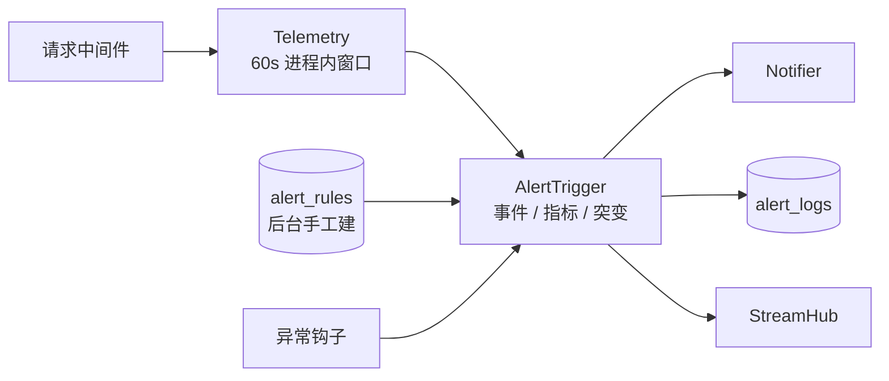

### 2.2 具体问题

- 事件规则、指标规则、限频、通知、落库全在 `AlertTrigger` 一个类里；
- 规则类型写死 `tech/business/metric/surge`，指标值写死在 `buildMetricValues()`；
- 指标只来自进程内 `Telemetry` 的 60 秒窗口，没有落库、没有历史，控制台看不到趋势；
- 规则是后台手工建的，代码里没有「这条规则应该存在」的声明，换环境要手工配；
- 多实例各自评估、状态在内存，重启就丢；
- `Telemetry` 的窗口是**懒滚动**：滚动发生在下一次写入或读取时，`windowStartAt` 取的是滚动那一刻，
  不是墙钟对齐的桶边界。按窗口落库前必须先改（§6.6）。

> 本仓库的 `alert_rules` / `alert_logs` 没有实际数据，可以按新结构直接重建；
> 现有 `AlertTrigger` 整体替换，不做历史规则迁移。其他部署如果已有数据，先导出，再按原列映射过来。

## 3. 总体架构

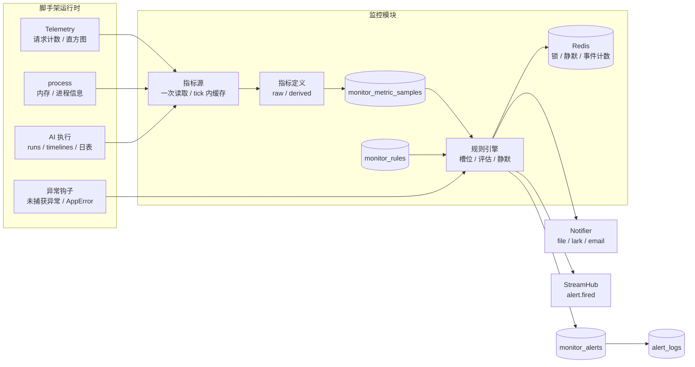

分成两层：

- **指标层**：指标源 → 原始指标 → 衍生指标 → 样本表。负责「现在怎么样、过去怎么样」，
  也是控制台趋势的数据来源。
- **规则层**：规则类型 + 规则实例 → 评估 → 命中 → 通知 / 审计 / SSE。负责「什么时候该告警」。
- **引擎**：时间槽、采集编排、leader 互斥、异常入口。它不 import 任何业务模块；
  业务模块把指标和规则注册进来。静默（`SilenceService`）、告警记录（`AlertLifecycleService`）、
  投递（`AlertDeliveryService`）、清理（`CleanupService`）都是引擎调用的独立 service，
  不写进 `MonitorEngine` 本身。

## 4. 运行模型：采集在所有实例，评估在 leader

自监控的数据在进程内，只有本进程能采到；但规则评估不能每个副本各跑一遍，否则会重复告警。
所以把两件事拆开：

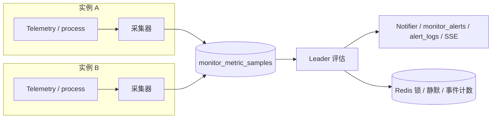

- 每个实例都采自己的进程指标，样本带 `instanceId`；
- 规则评估由抢到 `monitor:eval:<slot>` 锁的实例执行；
- AI 日表这类全局指标只由 leader 采，但所有实例都可以读；
- 事件规则由每个实例接收，用 Redis 计数 + 一次性 fire 键避免重复。

这样拆的原因：

1. `Telemetry`、`process.memoryUsage()` 这类进程内数据，别的实例读不到；
2. 通知必须去重，同一时刻只能有一个评估者；
3. 采集和评估解耦后，评估实例挂了下一轮换一个实例即可，不需要迁移内存状态。

## 5. 目录结构

> 现行清单（2026-11-13 按实际文件核对）。相对本文原稿的差异：删掉不存在的
> `definitions/schema.ts`、`api/schema.ts`、`sources/metric-source.ts`；补上
> `definitions/aggregate.ts`、`definitions/version.ts`、`config.ts`、`errors.ts`、
> `engine/instance.service.ts`、`engine/monitor.registry.ts`、`engine/monitor-rule.repository.ts`、
> `api/monitor-health.controller.ts`、`api/monitor-test.service.ts`、
> `rules/system/http-error-streak.rule.ts`；AI 监控目录改为实际文件名。

```text
apps/server/src/modules/monitor/
├── config.ts                    # MonitorConfig（enabled / emailTo / instanceId / retentionDays）
├── errors.ts                    # MonitorRuleNotFound / ConfigInvalid / MetricNotFound / AlertNotFound
├── definitions/
│   ├── metric.types.ts          # MetricSource / RawMetric / DerivedMetric / MetricWindow / MetricPoint
│   ├── rule.types.ts            # RuleType / MetricRuleType / EventRuleType / RuleContext / Hit / MonitorErrorEvent
│   ├── define.ts                # defineMetric / defineRule / defineThresholdRule / compare
│   ├── aggregate.ts             # aggregate(values, 'last' | 'sum' | 'avg' | 'max')
│   ├── version.ts               # definitionVersion(rule)（稳定序列化 → 摘要）
│   └── window.ts                # 窗口对齐、窗口 key、dayWindow 等公共纯函数
├── sources/
│   ├── telemetry.source.ts      # Telemetry.drainCompleted()
│   └── process.source.ts        # process.memoryUsage()
│   # 注：MetricSource 接口在 definitions/metric.types.ts，没有独立的 metric-source.ts
├── metrics/
│   ├── system/
│   │   ├── raw/
│   │   │   ├── request-count.metric.ts
│   │   │   ├── request-error.metric.ts
│   │   │   ├── request-duration-sum.metric.ts
│   │   │   ├── request-duration-count.metric.ts
│   │   │   ├── request-p95.metric.ts
│   │   │   ├── request-p99.metric.ts
│   │   │   ├── process-memory-used.metric.ts
│   │   │   └── process-memory-total.metric.ts
│   │   ├── derived/
│   │   │   ├── request-error-rate.metric.ts
│   │   │   ├── request-qps.metric.ts
│   │   │   ├── request-avg-duration.metric.ts
│   │   │   └── process-memory-ratio.metric.ts
│   │   └── index.ts
│   └── index.ts
├── rules/
│   ├── system/
│   │   ├── http-error-rate.rule.ts
│   │   ├── http-error-streak.rule.ts   # stream 驱动示例（连续 N 窗口越线，默认关闭）
│   │   ├── http-p99.rule.ts
│   │   ├── process-memory.rule.ts
│   │   ├── uncaught-exception.rule.ts
│   │   └── index.ts
│   └── index.ts
├── engine/
│   ├── monitor.engine.ts        # 启动对账 + 槽位编排 + 异常入口
│   ├── monitor.timeline.ts      # 周期槽注册（按 interval 精确到分钟，protect 防重入）
│   ├── monitor.registry.ts      # 业务模块注册入口（metrics / rules / sources）
│   ├── metric.registry.ts       # 指标定义 + 指标源登记与查询（rawForInterval / source）
│   ├── rule.registry.ts         # 规则类型登记、启动校验、intervals() / forInterval()
│   ├── instance.service.ts      # 本实例标识（MONITOR_INSTANCE_ID 或 hostname:pid）
│   ├── metric-collect.service.ts  # 只做「读源 → raw → 写 raw 样本」（collectInstance / collectGlobal）
│   ├── derived-metric.service.ts  # 只做「读 raw → derived → 写 derived 样本」
│   ├── metric-sample.repository.ts
│   ├── monitor-rule.repository.ts # 只做 monitor_rules 读写
│   ├── rule-evaluator.service.ts
│   ├── silence.service.ts       # 只做静默键
│   ├── stream-state.service.ts  # 只做 stream 规则状态（Redis hash monitor:stream:<ruleKey>）
│   ├── alert-lifecycle.service.ts # 只做告警记录：首次 / 最近 / 恢复 / 时长 / 快照
│   ├── alert.repository.ts        # 只做 monitor_alerts 读写
│   ├── alert-delivery.service.ts  # 只编排一次投递：静默 → 通知 → 发送记录 → SSE
│   ├── alert-log.repository.ts    # 只做 alert_logs 读写
│   ├── alert-stream.service.ts    # 只做 alert.fired SSE 推送（发布到 admin:all）
│   ├── event-rule.service.ts      # 只做事件匹配与计数
│   ├── cleanup.service.ts       # 只做样本保留期清理（monitor:cleanup 锁）
│   ├── seed.service.ts          # 只做启动校验与规则对账
│   └── stale.guard.ts
├── api/
│   ├── monitor.controller.ts          # 12 条 admin 接口（rule/alert/metric/engine/log/test）
│   ├── monitor-health.controller.ts   # POST /monitor/health（免鉴权，探 DB / Redis）
│   ├── monitor-rule.service.ts
│   ├── monitor-alert.service.ts
│   ├── monitor-metric.service.ts
│   ├── monitor-engine.service.ts
│   └── monitor-test.service.ts        # 测试通知：只验通道 + 写 alert_logs（alert_id / rule_id 为 null），不建 monitor_alerts
├── monitor.module.ts
└── index.ts

apps/server/src/modules/ai/monitoring/
├── ai-usage.source.ts
├── ai-usage.metrics.ts      # AI 指标定义（不是 metrics/raw/*.metric.ts 一指标一文件）
├── ai-usage.rules.ts        # AI 规则定义（4 条，默认关闭）
├── ai-monitoring.module.ts  # AiMonitoringModule：onModuleInit 注册进 MonitorRegistry
└── index.ts
```

> `monitor` 核心不依赖 AI。`AiMonitoringModule` import `MonitorModule`，在 `onModuleInit`
> 把 AI 的指标和规则注册进 `MonitorRegistry`；`MonitorModule` 不 import AI。

### 5.1 文件职责

除了**通用类型定义**（`*.types.ts`）和**公共纯函数**（如 `define.ts`、`window.ts`），
其余文件保持单一职责：一个文件只做一件事，不把「定义 + 查库 + 发通知」写在一起。

| 文件 / 目录 | 只负责 |
| --- | --- |
| `config.ts` | `MonitorConfig`（告警总开关 / 邮件收件人 / 实例 id / 样本保留天数），token 用 `Symbol.for('MonitorConfig')` |
| `errors.ts` | 监控模块的四个 `AppError` 子类（规则 / 配置 / 指标 / 告警记录） |
| `definitions/*.types.ts` | 通用类型、接口；不放业务逻辑 |
| `definitions/define.ts` / `window.ts` / `aggregate.ts` / `version.ts` | 公共纯函数（定义构造 / 窗口对齐 / 归并 / 定义版本）；可被多处复用 |
| `sources/*.source.ts` | 一个数据源的读取；不计算指标、不判定规则 |
| `metrics/**/*.metric.ts` | 一个指标的定义与采集；不查规则、不发通知 |
| `rules/**/*.rule.ts` | 一条规则的定义与判定；不查库、不发通知 |
| `engine/monitor.engine.ts` | 启动对账 + 槽位编排 + 异常入口；不判断规则、不发通知 |
| `engine/monitor.timeline.ts` | 只注册周期槽 |
| `engine/monitor.registry.ts` | 业务模块注册入口（`register({ sources, metrics, rules })`） |
| `engine/metric.registry.ts` | 指标定义 + 指标源登记、按周期 / scope 查询 |
| `engine/rule.registry.ts` | 规则类型登记、启动校验、`intervals()` / `forInterval()` |
| `engine/instance.service.ts` | 只提供本实例标识 |
| `engine/metric-collect.service.ts` | 只做「读源 → raw → 写 raw 样本」（`collectInstance` / `collectGlobal`） |
| `engine/derived-metric.service.ts` | 只做「读 raw → derived → 写 derived 样本」 |
| `engine/metric-sample.repository.ts` | 只做样本表的数据库读写 |
| `engine/monitor-rule.repository.ts` | 只做 `monitor_rules` 读写 |
| `engine/rule-evaluator.service.ts` | 只取样本、调用规则、产出 hit；不发送、不写告警记录 |
| `engine/silence.service.ts` | 只做静默键读写 |
| `engine/stream-state.service.ts` | 只做 stream 规则状态（Redis hash） |
| `engine/alert-lifecycle.service.ts` | 只做告警记录：首次命中、最近命中、恢复、时长、快照 |
| `engine/alert.repository.ts` | 只做 `monitor_alerts` 读写 |
| `engine/alert-delivery.service.ts` | 只编排一次投递：静默 → 通知 → 发送记录 → SSE；不判断规则 |
| `engine/alert-log.repository.ts` | 只做 `alert_logs` 读写 |
| `engine/alert-stream.service.ts` | 只做 `alert.fired` SSE 推送 |
| `engine/event-rule.service.ts` | 只做事件匹配与 Redis 计数 |
| `engine/cleanup.service.ts` | 只做保留期清理 |
| `engine/seed.service.ts` | 只做启动校验与规则对账 |
| `engine/stale.guard.ts` | 只判断样本是否陈旧 |
| `api/monitor.controller.ts` | 只做 HTTP 边界（校验 + 调 service + 返回），`AdminAuthGuard` |
| `api/monitor-health.controller.ts` | 只做 `POST /monitor/health`（免鉴权，探 DB / Redis） |
| `api/monitor-*.service.ts` | 只做读模型 / 用例编排，不直接发通知 |
| `monitor.module.ts` | 只做装配 |

判断标准：如果一个文件里同时出现「指标定义」「数据库查询」「通知发送」中的两类以上，
就拆开。`AlertTrigger` 那种一个类包办事件、指标、限频、通知、落库的写法不再出现。

## 6. 指标层

### 6.1 分类

- **原始指标（raw）**：从指标源直接得到的计数、求和、当前值、分位。不把比率和平均混进来。
- **衍生指标（derived）**：由同一窗口、同一维度的原始样本计算，声明 `dependsOn`。
- **采集周期与统计窗口分开**：
  - `evaluationIntervalSeconds`：多久评估一次（槽位）；
  - `windowSeconds`：评估时看多长的数据；
  - 例：日 token 规则每 300 秒评估一次，窗口是「当天 00:00 到现在」。

### 6.2 系统指标

| 指标 | 类型 | 含义 | 来源 | 窗口 |
| --- | --- | --- | --- | --- |
| `request.count` | raw | 窗口内完成的请求数（计数，不是 QPS） | `Telemetry` | 60s |
| `request.error` | raw | 窗口内 5xx 请求数 | `Telemetry` | 60s |
| `request.duration.sum` | raw | 窗口内请求耗时总和（ms） | `Telemetry` 直方图 | 60s |
| `request.duration.count` | raw | 窗口内请求耗时样本数 | `Telemetry` 直方图 | 60s |
| `request.p95` | raw | 窗口内 P95（ms） | `Telemetry` 直方图 | 60s |
| `request.p99` | raw | 窗口内 P99（ms） | `Telemetry` 直方图 | 60s |
| `process.memory.used` | raw | 堆已用（bytes） | `process.memoryUsage()` | 采集时点 |
| `process.memory.total` | raw | 堆总量（bytes） | `process.memoryUsage()` | 采集时点 |
| `request.errorRate` | derived | `request.error / request.count` | 上面两个 raw | 60s |
| `request.qps` | derived | `request.count / windowSeconds` | `request.count` | 60s |
| `request.avgDuration` | derived | `request.duration.sum / request.duration.count` | 两个 raw | 60s |
| `process.memoryRatio` | derived | `process.memory.used / process.memory.total` | 两个 raw | 60s |

> **P95/P99 定为 raw，不做「桶 + 维度」的衍生指标**：现有 `Telemetry` 只暴露
> `quantile()`，没有桶计数；把 16 个 `le` 桶都落成样本会让行数翻 16 倍，跨窗口合并桶也复杂。
> 分位数不是比率，不违反「raw 不做比率/平均」的约定。
>
> `request.count` 是计数；QPS、错误率、平均耗时都由衍生指标算，换窗口/换聚合不会混口径。

### 6.3 AI 用量指标

AI 指标来自 `ai_usage_daily` / `ai_usage_daily_dimension`（见 `ai-usage-stats.md`），
属于全局事实，`scope = global`，评估周期 300s，窗口是当天。

| 指标 | 类型 | 含义 |
| --- | --- | --- |
| `ai.usage.runs` | raw | 根 run 数 |
| `ai.usage.succeeded` / `failed` / `canceled` / `interrupted` | raw | 根 run 状态分桶 |
| `ai.usage.tokens.input` / `output` / `total` | raw | token 计数 |
| `ai.usage.tokens.cacheRead` / `cacheWrite` / `reasoning` | raw | 缓存 / 推理 token |
| `ai.usage.steps` | raw | 模型调用步数 |
| `ai.usage.conversations` / `activeUsers` | raw | 活跃会话 / 用户 |
| `ai.usage.tool.calls` / `succeeded` / `failed` / `denied` / `invalid` / `unknown` / `noResult` | raw | 工具调用与结果 |
| `ai.usage.firstToken.sum` / `count` | raw | 首字延迟总和 / 样本数 |
| `ai.usage.duration.sum` | raw | 轮耗时总和 |
| `ai.usage.failureRate` | derived | `failed / runs` |
| `ai.usage.successRate` | derived | `succeeded / runs` |
| `ai.usage.toolFailureRate` | derived | `tool.failed / tool.calls` |
| `ai.usage.cacheHitRate` | derived | `cacheRead / input`（input 含 cacheRead） |
| `ai.usage.avgFirstTokenMs` | derived | `firstToken.sum / firstToken.count` |
| `ai.usage.avgDurationMs` | derived | `duration.sum / runs` |
| `ai.usage.tokensPerRun` | derived | `tokens.total / runs` |

> 注意 key 用 `ai.usage.tokens.total`，不要写成 `ai.usage.tokens`；日 token 规则引用前者。

### 6.4 数据结构

```ts
/** 一个统计窗口：半开区间 [start, end)，key 用于唯一键 */
export interface MetricWindow {
  key: string
  start: Date
  end: Date
}

/** 指标文件返回的点：窗口和实例由引擎补，指标文件不自己编 key */
export interface MetricPoint {
  value: number
  dimensionType?: string // 默认 'total'
  dimensionKey?: string // 默认 ''
  labels?: Record<string, string>
}

/** 落库样本 */
export interface MetricSample {
  metricKey: string
  metricKind: 'raw' | 'derived'
  windowKey: string
  windowStart: Date
  windowEnd: Date
  instanceId: string // global 指标为 ''
  dimensionType: string // total / model / agent / tool / code
  dimensionKey: string // total 为 ''
  value: number
  labels?: Record<string, string>
}

/** 指标源：参数无关，一个 tick 内只读一次；失败用异常表达 */
export interface MetricSource<T = unknown> {
  key: string
  read(ctx: SourceContext): Promise<T>
}

export interface SourceContext {
  now: Date
  window: MetricWindow
  instanceId: string
}

interface MetricDefinitionBase {
  key: string
  title: string
  description: string
  category: 'system' | 'business'
  unit: 'ratio' | 'ms' | 'count' | 'tokens' | 'bytes'
  evaluationIntervalSeconds: number
  windowSeconds: number
  /** 最新样本超过这个时长没更新就视为陈旧；默认 2 × 评估周期，AI 日表可设 1200s */
  staleAfterSeconds: number
  scope: 'instance' | 'global'
}

export interface RawMetricDefinition extends MetricDefinitionBase {
  kind: 'raw'
  /** 只声明依赖哪个源；源自己负责连接/读取 */
  source: string
  collect(ctx: CollectContext): MetricPoint[] | Promise<MetricPoint[]>
}

export interface DerivedMetricDefinition extends MetricDefinitionBase {
  kind: 'derived'
  /** 第一版只允许依赖 raw，避免多级派生和循环 */
  dependsOn: readonly string[]
  derive(ctx: DeriveContext): MetricPoint[] | Promise<MetricPoint[]>
}

export interface CollectContext {
  window: MetricWindow
  instanceId: string
  /** 指标源读到的数据，结构由 source 决定 */
  data: unknown
  cache: Map<string, unknown>
}

export interface DeriveContext {
  window: MetricWindow
  instanceId: string
  dimensionType: string
  dimensionKey: string
  /** 同窗口、同维度的原始值；缺失返回 undefined，衍生指标应跳过而不是当 0 */
  raw(metricKey: string): number | undefined
}
```

约定：

- 指标文件只返回 `MetricPoint`；`windowKey` / `windowStart` / `windowEnd` / `instanceId` 由引擎填。
- 一个指标文件可以返回多个维度点（例如 AI 日表按模型/工具拆），但同一指标同一窗口的
  `(dimensionType, dimensionKey)` 不能重复。
- 源读取失败由引擎捕获，依赖它的指标和规则本轮跳过。

### 6.5 指标源

| 源 | 读什么 | 说明 |
| --- | --- | --- |
| `telemetry` | `Telemetry.drainCompleted()` | 一次拿到所有已结束窗口；按窗口逐个采集 |
| `process` | `process.memoryUsage()` | 当前值，不依赖窗口 |
| `ai-usage` | `ai_usage_daily` + 维度表 | P2；按 `stat_date` 读当天行 |

`MetricSource` 的三条约束：

1. **参数无关**：不带规则阈值、不带告警级别；阈值只出现在规则配置里。
2. **tick 内缓存**：同一槽内同一个源只读一次，多个指标共享。
3. **失败可见**：抛异常，由引擎记日志并跳过依赖它的指标/规则；不返回半截数据。

`telemetry` 源返回的是**窗口数组**：采集服务对每个已结束窗口构造一次 `CollectContext`，
再调用 raw 指标；`process` / `ai-usage` 源返回当前值，直接用当前窗口。这样「补采多个窗口」
和「只评估已结束且留出写入时间的窗口」可以同时成立。

> `TelemetrySource.read()` 是**消费型**：调用一次就把窗口取走。因此它只挂在 60 秒采集周期上，
> 300 秒槽不读它，否则会把 60 秒槽要用的窗口提前取走。采集服务按「指标所属评估周期」
> 过滤要读的源，同一个源在一个槽内只读一次并缓存。

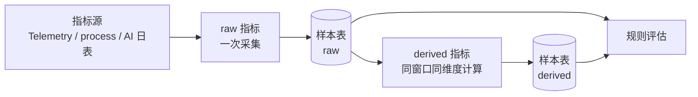

### 6.6 窗口口径与 Telemetry 改造

这是落库前必须先解决的事。

**现状**（`packages/kits/src/telemetry/telemetry.ts`）：

- `snapshot()` 先调用 `rollWindowIfNeeded()`；窗口到期是在下一次写入或读取时才滚动；
- 滚动时把当前计数归档到 `previousCounters` 并清零，`windowStartAt` 取滚动那一刻的 `now`；
- 直方图也一起清零，且不保留已结束窗口的桶计数。

**后果**：

- 窗口边界不是墙钟对齐的桶，长度会超过 60 秒（流量稀疏时可能长得多）；
- 如果窗口到期后没有流量先触发滚动，采集时的 `snapshot()` 自己触发滚动，返回的是
  **刚清零的新窗口**，上一窗口的数据只留在 `previousCounters` 里，采集器读不到；
- 一旦按 `windowKey` 落库，就是「看起来 60 秒、实际随机长度」的历史数据，趋势和告警都不可信。

**改造**：给 `Telemetry` 增加「取走已结束窗口」的接口，窗口按墙钟对齐。

```ts
export interface TelemetryWindow {
  windowStartAt: number
  windowEndAt: number
  counters: Record<string, number>
  gauges: Record<string, number>
  histograms: Record<string, TelemetryHistogram>
}

export class Telemetry {
  /**
   * 取走所有已结束窗口，按时间从旧到新返回。
   * 窗口按 floor(now / windowSeconds) 对齐；调用方负责逐窗口采集。
   */
  drainCompleted(now?: number): TelemetryWindow[]
}
```

实现要点：

1. 构造时把 `windowStartAt` 对齐到 `floor(now / windowMs) * windowMs`；
2. `drainCompleted()` 先把 `now` 之前所有已结束窗口切出来，再清空当前窗口；
3. 已结束窗口放进一个有上限的队列（例如 10 个），避免引擎长时间不取导致内存增长；
   超过上限丢最旧的窗口并记一条 warning，不能静默丢数据；
4. 队列里保留 `counters` / `histograms` / `gauges`，采集器逐窗口取；
5. 保留现有 `snapshot()` 给现有测试 / 其他消费方，新引擎不再用它；
6. 空窗口（没有计数、没有直方图）可以由采集器跳过，避免空闲时写入大量 0 样本。

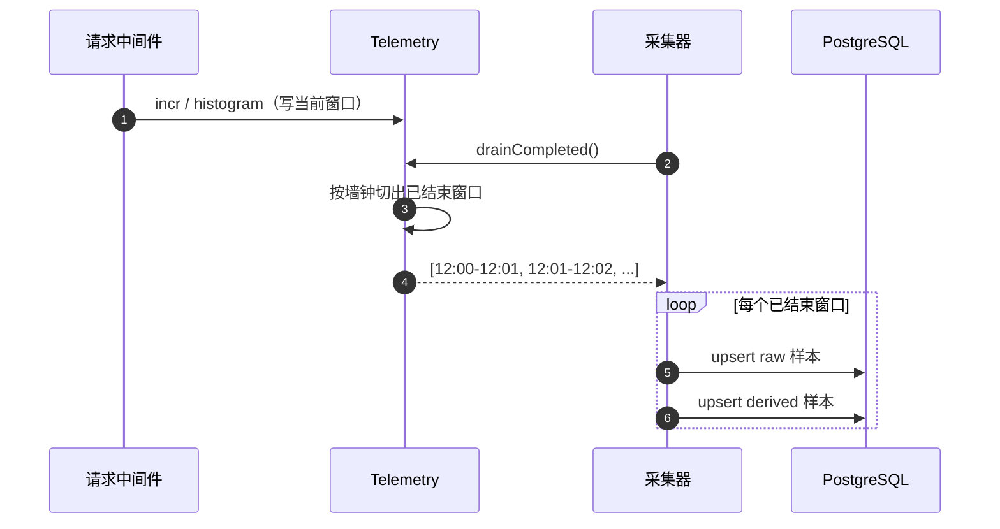

> 先按「一次 drain 可能拿到多个窗口」设计。上一轮卡顿、进程被挂起后恢复时，
> 下一轮可以把欠的窗口补采入库；**但只对已结束、且留出一个评估周期写入时间的窗口做规则评估**，
> 避免重启后补发一堆旧告警，也避免 leader 刚写完自己的样本就评估、漏掉其它实例。

### 6.7 采集、派生、存储

顺序固定：

```text
读指标源 → 计算 raw → upsert raw → 计算 derived → upsert derived → 评估规则
```

- `raw` 和 `derived` 都落 `monitor_metric_samples`；
- 衍生指标按 `(windowKey, instanceId, dimensionType, dimensionKey)` 对齐依赖样本；
  依赖 raw 出现过哪些维度组合，就逐个组合计算；没有对应 raw 的维度不产生衍生样本；
- 缺依赖就跳过（不拿 0 硬算）；
- 分母为 0、直方图样本数为 0 时不产生衍生/分位样本：没有流量不等于错误率 0%，
  也不等于 P99 = 0ms；让规则看到「没有样本」而不是一个假 0；
- 同一个 raw 窗口被更新（例如 AI 当天 token 涨了），对应 derived 重算并 upsert；
- 原始指标改名/删除，依赖它的 derived 启动时报错，不会静默失效。

### 6.8 样本表

见 §9.2。关键点：

- 唯一键 `(metric_key, window_key, instance_id, dimension_type, dimension_key)`；
- `window_key`：60 秒窗口用窗口起点的 ISO 时间；按天窗口用 `YYYY-MM-DD`；
- `instance_id`：实例指标写实例 id；全局指标写空串（不用 NULL，避免唯一键失效）；
- 保留期默认 30 天；清理只由 60 秒槽执行，并抢 `monitor:cleanup` 锁，
  避免两个槽的 leader 同时删同一批数据。

## 7. 规则层

### 7.1 规则类型与实例

- **规则类型**是代码：一个 `RuleType` 一个文件，定义逻辑、指标、评估周期、默认配置、可编辑字段。
- **规则实例**是数据：`monitor_rules` 一行，保存开关和配置（阈值、通道、静默期等）。
- 后台**不能新建规则**，只能改配置、启停、恢复默认；规则是否存在由代码决定。
- 规则 key 已经能唯一定位规则，不再维护一份手写的文件路径；后台显示 key、分类、指标即可。

```ts
export interface RuleTypeBase {
  key: string // 稳定 key，如 system.http.error-rate
  name: string
  description: string
  category: 'system' | 'business'
  kind: 'event' | 'metric'
  driver: 'batch' | 'stream'
  evaluationIntervalSeconds: number
  windowSeconds: number
  defaults: RuleConfig
  fields: RuleConfigField[]
  /** 后台配置的完整校验；defaults 必须能通过 */
  paramsSchema: ZodType<RuleConfig>
}

export interface MetricRuleType extends RuleTypeBase {
  kind: 'metric'
  metricKey: string
  instanceMode: 'per-instance' | 'aggregate'
  /** aggregate 模式下，多实例样本如何合成一个值 */
  instanceAggregation: 'max' | 'sum' | 'avg'
  /** 取最近多少个窗口样本 */
  lookback: number
  /** 多个窗口样本如何合成一个值 */
  aggregation: 'last' | 'sum' | 'avg' | 'max'
  nextState?(ctx: RuleContext, prev: RuleState): RuleState
  match(ctx: RuleContext, state: RuleState): Hit[]
}

export interface EventRuleType extends RuleTypeBase {
  kind: 'event'
  matchEvent(event: MonitorErrorEvent, config: RuleConfig): boolean
}

export type RuleLevel = 'warn' | 'error' | 'critical'

export interface RuleConfig {
  enabled: boolean
  operator: 'gt' | 'gte' | 'lt' | 'lte'
  threshold: number
  channels: ('file' | 'lark' | 'email')[]
  silenceSeconds: number
  /** 级别只影响通知文案、告警记录和页面筛选，不改变评估逻辑 */
  level: RuleLevel
  /** 连续多少个评估窗口不再命中后判定恢复；默认 2，避免抖动 */
  recoverAfterWindows: number
  /** 恢复时是否也发通知；默认只记录 */
  notifyOnRecovery?: boolean
  /** stream 规则：连续多少个窗口满足条件才算命中 */
  streakWindows?: number
  /** 指标规则：维度过滤；不填就是 total */
  dimensionType?: string
  dimensionKey?: string
  /** 事件规则 */
  matchCodes?: number[]
  keywords?: string[]
  [key: string]: unknown
}

export interface RuleConfigField {
  key: string
  label: string
  type: 'number' | 'text' | 'select' | 'switch' | 'multi-select'
  min?: number
  max?: number
  step?: number
  options?: Array<{ label: string; value: string | number }>
  description?: string
}
```

示例（系统错误率）：

```ts
export const httpErrorRateRule = defineMetricRule({
  key: 'system.http.error-rate',
  name: 'HTTP 错误率过高',
  description: '60 秒窗口内 5xx 占比超过阈值',
  category: 'system',
  driver: 'batch',
  metricKey: 'request.errorRate',
  evaluationIntervalSeconds: 60,
  windowSeconds: 60,
  instanceMode: 'per-instance',
  instanceAggregation: 'max',
  lookback: 1,
  aggregation: 'last',
  defaults: {
    enabled: true,
    operator: 'gt',
    threshold: 0.05,
    channels: ['file'],
    silenceSeconds: 300,
    level: 'error',
    recoverAfterWindows: 2,
  },
  fields: [
    { key: 'threshold', label: '错误率阈值', type: 'number', min: 0, max: 1, step: 0.01 },
    { key: 'silenceSeconds', label: '静默期（秒）', type: 'number', min: 0 },
    {
      key: 'level',
      label: '级别',
      type: 'select',
      options: [
        { label: '警告', value: 'warn' },
        { label: '错误', value: 'error' },
        { label: '严重', value: 'critical' },
      ],
    },
    { key: 'recoverAfterWindows', label: '连续未命中几轮后恢复', type: 'number', min: 1, max: 10 },
    {
      key: 'channels',
      label: '通知通道',
      type: 'multi-select',
      options: [
        { label: '文件', value: 'file' },
        { label: '飞书', value: 'lark' },
        { label: '邮件', value: 'email' },
      ],
    },
  ],
})
```

### 7.2 规则评估接口

```ts
export interface RuleContext {
  now: Date
  window: MetricWindow
  params: RuleConfig
  /** 每个主体最近 lookback 个样本，以及按 aggregation 归并后的值 */
  subjects: RuleSubject[]
  /** 仅 stream 规则使用 */
  state: RuleState
}

export interface RuleSubject {
  subjectId: string
  samples: MetricSample[] // 新到旧
  value: number
  labels?: Record<string, string>
}

export type RuleState = Map<string, unknown>

export interface Hit {
  ruleKey: string
  subjectId: string
  value: number
  threshold?: number
  windowStart: Date
  windowEnd: Date
  labels?: Record<string, string>
}
```

- `nextState` 只给 stream 规则用；P1 的 batch 规则由 `defineThresholdRule` 提供空实现。
- `match` 是同步纯函数：只读 `ctx`，不查库、不发通知；样本由引擎提前读好，
  这样规则可单测，也不会把 I/O 藏在判定里。
- `defineThresholdRule` 负责最常见的「按 operator + threshold 比较 `subject.value`」，
  自定义规则才需要自己写 `match`。

### 7.3 主体、维度、多实例

`subjectId` 的约定：

| 场景 | subjectId |
| --- | --- |
| 系统指标，逐实例 | `instance:<instanceId>` |
| 系统指标，聚合 | `system` |
| AI 总量 | `total` |
| AI 按模型 | `model:<provider/model>` |
| AI 按工具 | `tool:<toolKey>` |
| 事件规则 | `uncaught` 或 `code:<errorCode>` |

- `instanceMode = 'per-instance'`：每个实例一个主体，命中后产出多条 hit；
- `instanceMode = 'aggregate'`：先按 `instanceAggregation` 把多实例样本合成一个值，
  再用一个主体 `system` 评估；
- 通知按「规则 + 窗口」分组：同一规则同一窗口命中多个实例/多个工具时，只发一条，
  正文列出各主体和值，避免告警风暴。

### 7.4 去重、静默、失败

- 静默键：`monitor:silence:<ruleKey>:<subjectId>`，TTL = `silenceSeconds`；
  `silenceSeconds = 0` 表示不静默，直接跳过写键（不要用 `SET EX 0`，Redis 会报错）；
- **发送成功后才写静默键**；所有通道都失败就不写，下一轮还能重试；
- 多通道时，只要至少一个通道成功就写静默（避免对已成功的通道重复刷），
  失败的通道记 `alert_logs`，由管理员按需补发；
- 状态放 Redis：静默键、事件计数、stream 状态都在 Redis；告警事实看 `monitor_alerts`，
  发送记录看 `alert_logs`，不额外建状态表；
- 重启后静默键还在（Redis 持久化范围内）；Redis 被清空时可能重复一次，可以接受。

> 去重只保留一套机制：**每个主体一个静默键**。需要「持续越线每 5 分钟提醒一次」就把
> `silenceSeconds` 设为 300，不再额外配一个限频字段；两套机制容易互相打架。

### 7.5 告警记录与生命周期

告警记录不是「每发一条通知记一行」，而是一条告警从首次命中到恢复的完整生命周期；
逐通道的发送尝试单独记，两者用 `alert_id` 关联。

状态只有两个：`firing` / `resolved`。

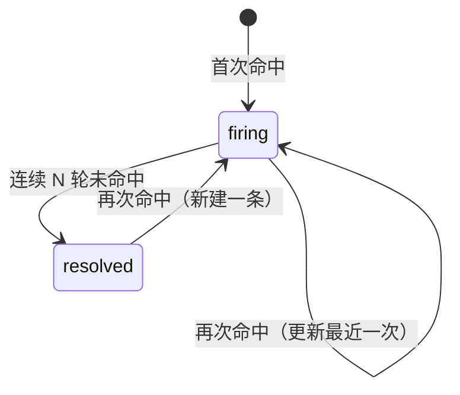

**首次命中**

- 创建 `monitor_alerts` 一行：`status='firing'`、`first_fired_at=now`、`level=规则级别`、
  `value / threshold / window_key`、`first_snapshot=触发数据`、`last_snapshot=同一份`；
- 同一规则同一主体同时只能有一条 `firing` 记录，用部分唯一索引
  `(rule_key, subject_id) WHERE status = 'firing'` 保证；
- 再次命中只更新 `last_fired_at / level / value / threshold / window_key / last_snapshot`，
  **不覆盖 `first_fired_at`**，并把 `miss_count` 归零。

**持续时长**

- `firing` 中：`now - first_fired_at`，查询时计算；
- `resolved` 时：写入 `duration_ms = recovered_at - first_fired_at`，列表直接用。

**恢复**

- 指标规则：每轮评估后，对该规则所有 `firing` 记录，未命中的主体 `miss_count + 1`；
  `miss_count >= recoverAfterWindows` 时置 `resolved`、`recovered_at=now`、写 `duration_ms`；
- 事件规则：60 秒槽扫一遍，`now - last_fired_at >= windowSeconds * recoverAfterWindows`
  就恢复；
- 规则被禁用 / 删除时，把该规则所有 `firing` 记录批量置 `resolved`，写 `recovered_at` 和
  `duration_ms`，避免留下永远不恢复的记录；
- 样本陈旧或指标源失败时，本轮**不累加 `miss_count`、也不恢复**，保持 `firing`，
  等数据恢复后再判定；否则采集故障会被误判成告警恢复；
- 恢复默认不发通知（P3 再考虑 `notifyOnRecovery`），但记录必须有。

**数据快照**

```ts
export type AlertSnapshot =
  | {
      kind: 'metric'
      value: number
      threshold: number
      operator: string
      window: { key: string; start: string; end: string }
      /** 最多 lookback 条；缺失样本不写 */
      samples: MetricSample[]
      labels?: Record<string, string>
    }
  | {
      kind: 'event'
      code?: number
      message: string
      /** 截断到 4KB */
      stack?: string
      path?: string
      requestId?: string
      at: string
    }
```

- `first_snapshot` 保留首次触发时的数据，回答「当时是什么情况」；
- `last_snapshot` 保留最近一次命中，便于看持续期间的变化；
- 快照有大小上限：`samples` 最多 `lookback` 条，`message` / `stack` 截断，禁止写密钥和请求头。

**级别**

- 三档：`warn` / `error` / `critical`；规则配置里可改，落 `monitor_alerts.level`；
- 通知标题带级别前缀（`[警告]` / `[错误]` / `[严重]`），告警列表可按级别筛选；
- 级别不改变评估逻辑和通道；P3 再做「critical 走全部通道」这类路由。

**与发送记录的关系**

- `monitor_alerts` 是告警事实；`alert_logs` 是逐通道发送尝试；
- 先落 `monitor_alerts`，再发通知；`alert_logs.alert_id` 指回告警；
- 所有通道失败：告警仍是 `firing`，`alert_logs` 记 `failed`，下一轮重试，不写静默键。

### 7.6 事件规则

事件规则不走指标槽，由异常入口直接驱动：

```ts
export interface MonitorErrorEvent {
  code?: number
  message: string
  stack?: string
  path?: string
  requestId?: string
  at: Date
}
```

`MonitorEngine.ingestError(event)`：

1. 取启用的事件规则；
2. 按 `matchCodes`（空=全部）和 `keywords`（空=不限）匹配；
3. 用 Redis 计数：`monitor:event:<ruleKey>:<windowKey>`，`INCR` + 首次设置 TTL；
4. 计数达到 `threshold` 后，用 `SET NX` 抢 `monitor:event:fire:<ruleKey>:<windowKey>`，
   抢到的实例负责处理；
5. 创建或更新 `monitor_alerts`：首次命中写 `first_fired_at`，后续只更新 `last_fired_at`、
   `last_snapshot`、级别和触发值；
6. 检查静默；发送成功后写静默键、写 `alert_logs`、推 SSE；
   所有通道失败就删掉 fire 键，允许下一次事件重试，告警仍是 `firing`；
7. 事件规则的恢复由 60 秒槽扫 `monitor_alerts`：
   `now - last_fired_at >= windowSeconds * recoverAfterWindows` 时置 `resolved`。

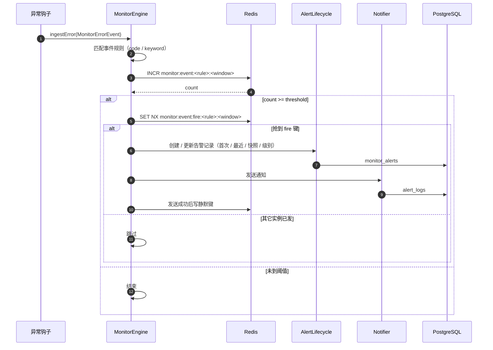

> 未捕获异常仍然是「发生即告警」：默认规则 `threshold=1`、`windowSeconds=60`。
> 5xx 不单独建事件规则，用 `system.http.error-rate` 的指标规则覆盖，避免重复。
>
> `windowKey` 用 `floor(now / windowSeconds)`；`INCR` 和首次 `EXPIRE` 用 Lua 保证原子，
> 避免计数键没有 TTL。现有 `common/error/error-alert-hook.ts` 和进程级未捕获异常处理
> 改为调用 `MonitorEngine.ingestError`，不再直接调 `AlertTrigger.notifyError`。

### 7.7 规则清单与默认值

| rule key | kind | 指标 | 评估周期 | 统计窗口 | 默认条件 | 级别 | 默认启用 |
| --- | --- | --- | --- | --- | --- | --- | --- |
| `system.http.error-rate` | metric | `request.errorRate` | 60s | 60s | `> 0.05` | error | 是 |
| `system.http.error-rate.streak` | metric（driver `stream`） | `request.errorRate` | 60s | 60s | `> 0.05` 连续 `streakWindows=3` 个窗口 | error | **否** |
| `system.http.p99` | metric | `request.p99` | 60s | 60s | `> 1000ms` | warn | 是 |
| `system.process.memory` | metric | `process.memoryRatio` | 60s | 60s | `> 0.85` | warn | 是 |
| `system.error.uncaught` | event | — | 事件驱动 | 60s | `>= 1` | critical | 是 |
| `ai.usage.daily-tokens` | metric | `ai.usage.tokens.total` | 300s | 当天 | `>= 1,000,000` | warn | 否 |
| `ai.usage.failure-rate` | metric | `ai.usage.failureRate` | 300s | 当天 | `>= 0.10` | warn | 否 |
| `ai.usage.tool-failure-rate` | metric | `ai.usage.toolFailureRate` | 300s | 当天 | `>= 0.20` | warn | 否 |
| `ai.usage.first-token` | metric | `ai.usage.avgFirstTokenMs` | 300s | 当天 | `>= 8000ms` | warn | 否 |

- 清单实况（2026-11-13）：系统 5 条（`rules/system/index.ts` 的 `SYSTEM_RULES`）+ AI 4 条
  （`ai/monitoring/ai-usage.rules.ts` 的 `AI_USAGE_RULES`）；本文原表漏了
  `system.http.error-rate.streak`（stream 驱动示例，默认关闭、`streakWindows=3`）；
- 默认通道 `['file']`（零配置可用），管理员再补 lark / email；
- 默认静默期：系统规则 300 秒，AI 规则 1800 秒；默认连续 2 轮未命中判定恢复（`recoverAfterWindows: 2`）；
- 默认水位只是起点，后台可改；AI 规则默认关闭，避免一上线就按不适配的阈值误报；
- 低流量时错误率/分位波动大；P1 先按单指标阈值，P2 可加「最小请求数」条件或改用更长窗口，
  避免 1 个请求 1 个错误就告警；
- 5xx 的告警由 `system.http.error-rate` 覆盖，不再单独建事件规则。

## 8. 引擎与时间轴

### 8.1 槽位

- 按**评估周期**注册槽位，不按规则注册：P1 只有 `60s` 和 `300s` 两个槽；
- 用 `Scheduler.scheduleCron`，croner 保证墙钟对齐；`60s` 用 `* * * * *`，`300s` 用 `*/5 * * * *`；
- `protect: true` 防止同一槽重叠；慢 tick 的下一轮会被跳过，下一轮再用
  `Telemetry.drainCompleted()` 把欠的窗口补采回来（评估看上一轮已结束窗口，见 §8.2）；
- 每个槽设超时（小于评估周期），超时记日志、结束本轮，不能让慢查询把槽一直占住
  —— **这一条尚未实现**：`monitor.engine.ts` 里没有超时控制，只有 croner 的 `protect`；
  慢 tick 期间该槽的后续轮次会被跳过（见 §8.4）；
- 不在规则配置里开放任意 cron：规则只能选 60s / 300s 两种评估周期（`MonitorTimeline.cronOf`
  只接受能整除 60 的秒数，且分钟数 1–59），避免 `*/1 * * * *` 和 `* * * * *` 这类等价写法
  产生两个槽、两把锁。

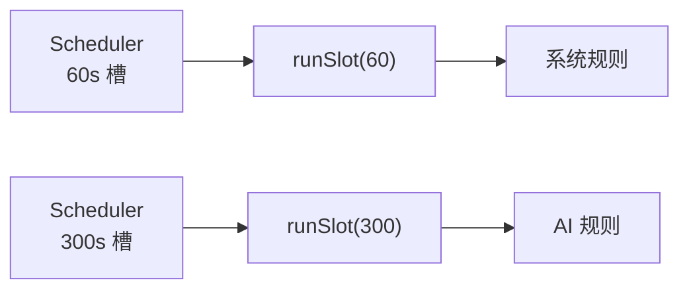

**`MonitorEngine` 的职责边界（2026-11-13 实况）**

`MonitorEngine`（`engine/monitor.engine.ts`）只做三件事，其余全部委托给单一职责的 service：

| 职责 | 实现 |
| --- | --- |
| 启动对账 | `onApplicationBootstrap`：先 `seed.sync()`（写 `monitor_rules`、校验定义），再 `timeline.start()` 注册槽位；seed 失败则不注册任何槽位、应用启动失败 |
| 槽位编排 | `runSlot(intervalSeconds)`：① `collector.collectInstance()`（所有实例）→ ② `redis.acquireLock('monitor:eval:<slot>', 30)` → ③ 抢到才 `collector.collectGlobal()` + 逐规则 `evaluator.evaluate()` + （60s 槽）`events.sweep()` + `cleanup.maybeCleanup()` → ④ `finally` 释放锁；`slotStatus()` 给 `/monitor/engine/status` 读 |
| 异常入口 | `ingestError(error, context)`：`MonitorConfig.enabled` 为 false 直接返回；否则匹配错误码 / 关键字 → Redis 计次 → 触发事件规则 |

它**不负责**：静默（`SilenceService`）、告警记录生命周期（`AlertLifecycleService`）、
逐通道投递（`AlertDeliveryService`）、样本清理细节（`CleanupService`）、规则判定
（`RuleEvaluatorService` / 各 `*.rule.ts`）。依赖注入的是 `MonitorConfig` / `MetricCollectService` /
`RuleRegistry` / `RuleEvaluatorService` / `EventRuleService` / `CleanupService` / `SeedService` /
`MonitorTimeline` / `RedisStore` / `AppLogger`，**不 import 任何业务模块**。

### 8.2 tick 流程

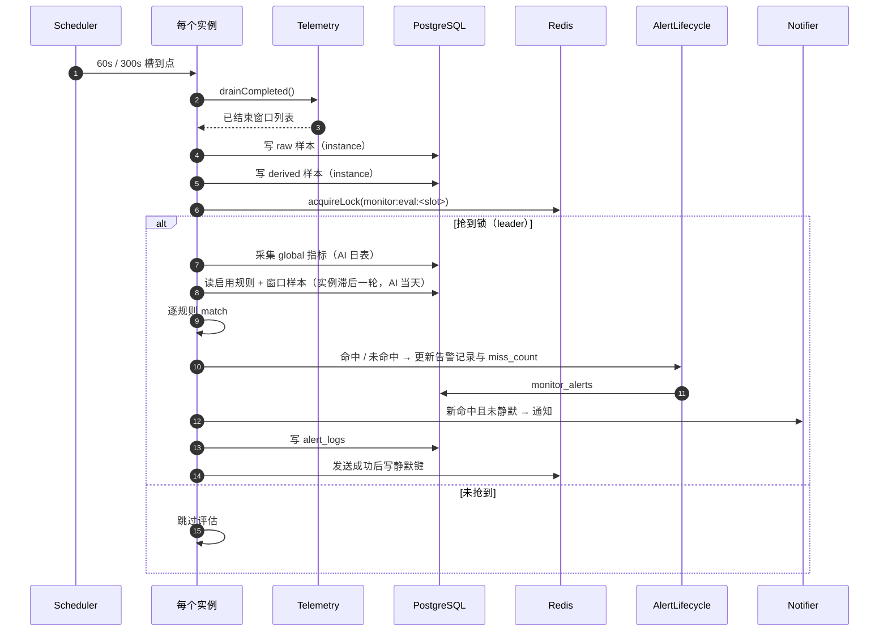

伪代码（与 `monitor.engine.ts` 的 `runSlot` 对齐；实际方法名：
`redis.acquireLock` / `redis.releaseLock`、`rules.forInterval`、`events.sweep`、`cleanup.maybeCleanup`）：

```ts
async runSlot(intervalSeconds: number): Promise<void> {
  // 1. 采集在所有实例执行（可能一次补采多个已结束窗口）
  await this.collector.collectInstance(intervalSeconds)

  // 2. 评估只在一个实例执行；没有窗口也要采全局指标（例如 AI 日表）
  const token = await this.redis.acquireLock(`monitor:eval:${intervalSeconds}`, 30)
  if (!token) return
  try {
    await this.collector.collectGlobal(intervalSeconds)

    const now = new Date()
    const rules = this.rules.forInterval(intervalSeconds)
    for (const rule of rules) {
      try {
        await this.evaluator.evaluate(rule, now)
      } catch (error) {
        this.logger.error('monitor.rule.failed', { ruleKey: rule.key, error })
      }
    }

    // 60 秒槽额外扫一次事件规则的 Redis 计数窗口，再按需清理样本
    if (intervalSeconds === 60) await this.events.sweep(now)
    await this.cleanup.maybeCleanup(now)
  } finally {
    await this.redis.releaseLock(`monitor:eval:${intervalSeconds}`, token)
  }
}
```

`RuleEvaluator.evaluate(rule, now)` 内部按指标的 `scope` 取窗口：

- 实例指标：取 `window_end <= now - interval` 的最新窗口，给所有实例留出一个周期的写入时间；
- 全局指标（AI 日表）：取当天最新样本，不受这个滞后影响；
- 没有样本就跳过该规则，不拿空数据判定。

关键点：

- 先采集、后抢锁：否则未抢到锁的实例不会采自己的指标；
- 采集可能返回多个窗口（补采），评估只看上一轮已结束、且留出写入时间的窗口；
- 评估窗口比当前时间滞后一个周期：60 秒规则最多晚 60 秒告警，换来的是不会漏掉
  其它实例在本轮写入的样本；AI 全局指标直接读当天最新值，不受这个滞后影响；
- 单条规则失败不影响其它规则；
- 命中结果先交给 `AlertLifecycle` 落 `monitor_alerts`，再由投递服务发通知；
  未命中的开放告警由 `AlertLifecycle` 累加 `miss_count`，达到阈值后恢复；
- 锁在 `finally` 释放，不靠 TTL 自然过期（否则下一轮可能抢不到）。

### 8.3 多实例

- `instanceId`：`MONITOR_INSTANCE_ID`，缺省用 `hostname:pid`（`MonitorInstanceService` 构造期生成一次，进程内不变）；
- 实例指标的采集在每个实例执行，样本带 `instanceId`；
- 全局指标（AI 日表）只由 leader 采；
- 规则评估只由 leader 执行；leader 锁 `monitor:eval:<slot>`，通过
  `RedisStore.acquireLock(key, 30)` 拿（`SET NX EX`，返回 token 即 leader），
  评估结束后在 `finally` 里 `releaseLock(key, token)`。**没有看门狗续期**（不存在
  `RedisLockService`）：评估耗时超 30 秒锁会自然过期，下一轮可能被另一个实例抢到；
- 事件规则在每个实例接收，Redis 计数 + fire 键保证一个窗口只发一次；
- 时钟：窗口按 `floor(now / interval)` 对齐，依赖 NTP；时钟偏差超过一个窗口时，
  聚合维度可能拆成两个窗口，需要监控实例时间同步（部署时保证）。

### 8.4 失败、超时、陈旧

| 情况 | 处理 |
| --- | --- |
| 指标源读取失败 | `monitor.source.failed` 记日志，跳过依赖它的指标/规则；不写半截样本 |
| 写库失败 | 记日志，本轮不评估依赖该样本的规则 |
| Redis 不可用 | 跳过评估（锁 / 静默不可用），采集可继续；记日志（`acquireLock` 抛错会被 Scheduler 吞掉并记日志） |
| 通知通道失败 | 逐通道记 `alert_logs`；告警仍是 `firing`，全部失败不写静默，下一轮重试 |
| 单条规则异常 | 记 `monitor.rule.failed` + `ruleKey`，继续下一条 |
| 样本陈旧 | 最新样本的 `window_end` 超过 metric 的 `staleAfterSeconds` 时跳过规则，状态标记 `stale`（`StaleGuard`）；系统指标默认 2 × 60s，AI 日表 1200s |
| 槽超时 | **尚未实现**：没有超时控制；慢 tick 时下一轮由 croner 的 `protect: true` 跳过，欠的窗口靠 `drainCompleted()` 补采 |

## 9. 数据模型

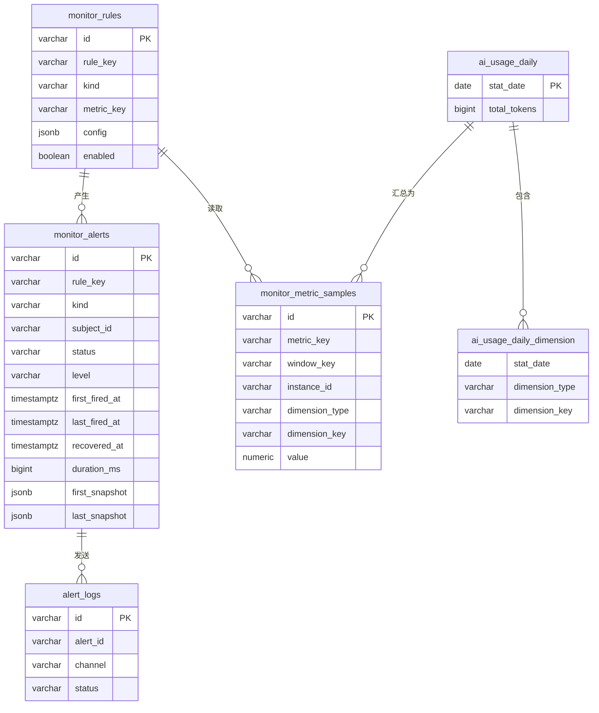

### 9.1 `monitor_rules`

| 列 | 类型 | 说明 |
| --- | --- | --- |
| `id` | varchar(20) | 主键（`BaseEntity`） |
| `rule_key` | varchar(100) | 代码里的稳定 key，唯一 |
| `name` / `description` | varchar | 展示用，启动时按代码更新 |
| `category` | varchar(16) | `system` / `business` |
| `kind` | varchar(8) | `metric` / `event` |
| `driver` | varchar(8) | `batch` / `stream` |
| `metric_key` | varchar(100) | 指标 key；event 规则为空 |
| `evaluation_interval_seconds` | int | 评估周期（槽） |
| `window_seconds` | int | 统计窗口 |
| `source` | varchar(16) | 固定 `code`；保留 `manual` 给以后扩展 |
| `config` | jsonb | 阈值、级别、通道、静默期、恢复轮数、维度等 |
| `definition_version` | varchar(64) | 代码定义哈希，用于提示「定义已更新」 |
| `enabled` | boolean | 启停 |
| `deprecated` | boolean | 代码里已删除的规则置 true，保留历史 |
| `created_at` / `updated_at` / `deleted_at` | timestamp | `BaseEntity` |

索引 / 约束：

- `uk_monitor_rule_key (rule_key)`；
- `idx_monitor_rule_category (category, enabled)`。

> 不复用现有 `alert_rules`：现有表字段是 `type/matchCodes/keywords/threshold...`，
> 和新模型对不上；本仓库没有数据，直接新建 `monitor_rules`、删除现有表更干净。
> 其他环境有数据时，先导出历史规则，按「type=metric/surge → metric；tech/business → event」
> 映射成 `config`，再导入。

### 9.2 `monitor_metric_samples`

| 列 | 类型 | 说明 |
| --- | --- | --- |
| `id` | varchar(20) | 主键 |
| `metric_kind` | varchar(8) | `raw` / `derived`，冗余便于查询 |
| `metric_key` | varchar(100) | 指标 key |
| `window_key` | varchar(64) | 60s 用窗口起点 ISO；按天用 `YYYY-MM-DD` |
| `window_start` / `window_end` | timestamptz | 窗口起止 |
| `instance_id` | varchar(64) | 实例；全局指标为空串 |
| `dimension_type` | varchar(16) | `total` / `model` / `agent` / `tool` / `code` |
| `dimension_key` | varchar(128) | 维度值；`total` 为空串 |
| `value` | numeric(20,4) | 指标值 |
| `labels` | jsonb | 其它标签（错误码、工具名等） |
| `created_at` | timestamp(3) | 写入时间 |

约束 / 索引：

- 唯一键 `(metric_key, window_key, instance_id, dimension_type, dimension_key)`；
- 查询索引 `(metric_key, window_end DESC)`；
- 维度索引 `(dimension_type, dimension_key, window_end DESC)`；
- 保留期 `MONITOR_SAMPLE_RETENTION_DAYS`，默认 30 天；清理按批删除（例如每批 1000 行），
  避免一个长事务锁住整张表。

### 9.3 `monitor_alerts`

一条告警从首次命中到恢复的完整记录。首次时间、恢复时间、持续时长、级别、快照都在这一张表上。

| 列 | 类型 | 说明 |
| --- | --- | --- |
| `id` | varchar(20) | 主键 |
| `rule_key` | varchar(100) | 规则 key |
| `rule_name` | varchar(100) | 规则名快照 |
| `kind` | varchar(8) | `metric` / `event`，事件规则恢复扫描用 |
| `level` | varchar(10) | `warn` / `error` / `critical` |
| `subject_id` | varchar(128) | 实例 / 模型 / 工具 / 错误码 |
| `instance_id` | varchar(64) | 执行评估的实例；被监控实例看 `subject_id` |
| `status` | varchar(12) | `firing` / `resolved` |
| `first_fired_at` | timestamptz | 首次告警时间，创建后不再覆盖 |
| `last_fired_at` | timestamptz | 最近一次命中时间 |
| `recovered_at` | timestamptz | 恢复时间；firing 时为空 |
| `duration_ms` | bigint | 持续时长；resolved 时写入，firing 时查询时计算 |
| `miss_count` | int | 连续未命中轮数，用于判定恢复 |
| `value` / `threshold` | numeric(20,4) | 最近一次触发值和阈值 |
| `window_key` | varchar(64) | 最近一次触发窗口 |
| `first_snapshot` | jsonb | 首次触发时的数据快照 |
| `last_snapshot` | jsonb | 最近一次命中的数据快照 |
| `created_at` / `updated_at` / `deleted_at` | timestamp | `BaseEntity` |

索引 / 约束：

- 部分唯一索引 `(rule_key, subject_id) WHERE status = 'firing'`：同一规则同一主体同时只有一条未恢复告警；
- 列表索引 `(status, level, first_fired_at DESC)`；
- 规则维度索引 `(rule_key, first_fired_at DESC)`。

> `first_fired_at` 只在创建时写；后续命中更新 `last_fired_at` 和 `last_snapshot`。
> 告警恢复后再次命中，新建一条记录，不复用旧记录。

### 9.4 `alert_logs`（发送记录）

`alert_logs` 只记「哪个告警通过哪个通道发了一次」，不再重复存首次/恢复/快照：

| 列 | 说明 |
| --- | --- |
| `alert_id` | 指向 `monitor_alerts.id`；默认告警或历史数据可为空 |
| `rule_id` / `rule_name` | 规则标识（保留，便于按规则查发送失败） |
| `title` / `message` | 发送内容快照 |
| `channel` | `file` / `lark` / `email` |
| `status` | `success` / `failed` |
| `error` | 失败原因 |
| `sent_at` | 发送时间 |

索引（实况）：`idx_alert_log_alert_id (alert_id, sent_at)`、`idx_alert_log_sent_at (sent_at)`、
`idx_alert_log_rule_id (rule_id)`（`alert-log-entity.ts`）。

> 所有通道失败时，`monitor_alerts` 仍是 `firing`，`alert_logs` 逐通道记 `failed`；
> 下一轮重试，不写静默键。

### 9.5 AI 日表

沿用 `ai-usage-stats.md` 的 `ai_usage_daily` / `ai_usage_daily_dimension`：

- 日表是业务口径，样本表是引擎时间序列，两者职责不同；
- AI 指标源读日表，再产出 `monitor_metric_samples`；
- 日表按 `stat_date`（Asia/Shanghai）唯一，维度表按 `(stat_date, dimension_type, dimension_key)` 唯一。

### 9.6 Redis key

| key | 用途 | TTL |
| --- | --- | --- |
| `monitor:eval:<interval>` | 评估锁（`RedisStore.acquireLock`） | 30s，评估结束主动释放（无看门狗） |
| `monitor:cleanup` | 样本清理锁 | 10min |
| `monitor:silence:<ruleKey>:<subjectId>` | 静默 | `silenceSeconds` |
| `monitor:event:<ruleKey>:<windowKey>` | 事件计数 | `2 × windowSeconds` |
| `monitor:event:fire:<ruleKey>:<windowKey>` | 事件只发一次 | `2 × windowSeconds` |
| `monitor:stream:<ruleKey>` | stream 规则状态（Redis hash，field = subjectId，值为该主体的规则状态 JSON） | 写入时按规则给定 `ttlSeconds`（`StreamStateService.set`） |

## 10. 启动对账

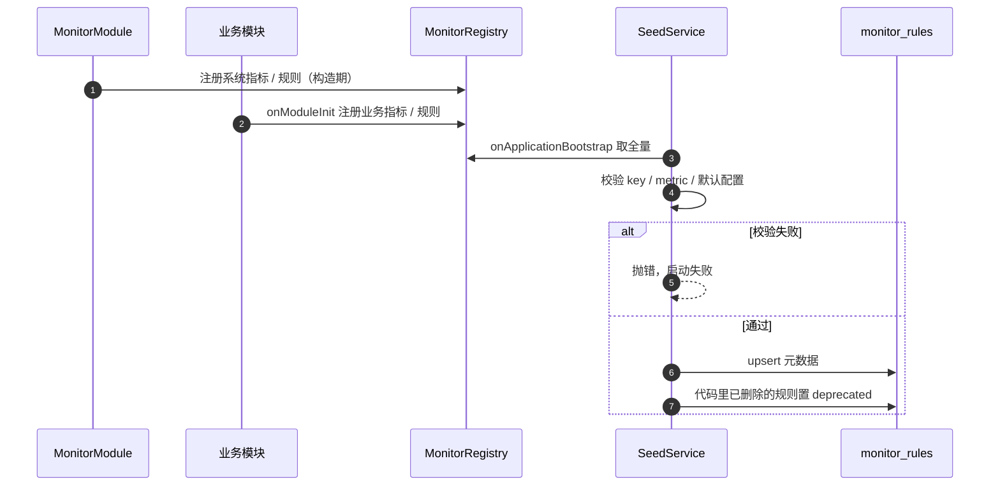

步骤：

1. 系统指标/规则由 `MonitorModule` 在构造期注册；
2. AI 等业务模块在 `onModuleInit` 里调用 `MonitorRegistry.register()`；
3. `SeedService.onApplicationBootstrap()` 在**所有模块初始化完成后**取全量定义；
4. 校验：
   - `rule_key` / `metric_key` 唯一；
   - metric 存在；rule 的 `evaluationIntervalSeconds` / `windowSeconds` 与 metric 定义一致；
   - global 指标的规则只能是 `aggregate`，instance 指标两种模式都可以；
   - derived 的 `dependsOn` 都是 raw；
   - `defaults` 能通过 `paramsSchema`；
   - `fields` 的 key 不重复；
   - `channels` 至少一个，`silenceSeconds >= 0`，`level` 是 `warn` / `error` / `critical`；
   - `recoverAfterWindows` 为正整数（建议 1..10）；
   - `evaluationIntervalSeconds` / `windowSeconds` / `staleAfterSeconds` 为正，
     且 `staleAfterSeconds` 不小于评估周期；
   - event 规则允许 `matchCodes: []` / `keywords: []`（表示匹配全部），但默认配置里要显式写出来，不能省略。
5. 按 `rule_key` upsert：
   - 不存在 → 插入（`source='code'`，`config=defaults`）；
   - 已存在 → **只更新元数据**（name / description / category / kind / metricKey /
     interval / window / definitionVersion），**不覆盖** `config` / `enabled`；
   - 代码里已删除的 `source='code'` 规则 → `deprecated=true` + `enabled=false`；
   - 代码里恢复的规则 → `deprecated=false`，保留原配置；
   - 查询要包含软删除记录（`withDeleted`）：命中已软删的行就 `restore`，否则唯一键会冲突。
6. 启动日志打印：新增 / 更新 / 停用 / 恢复数量；校验失败直接启动失败；
7. seed 成功后再启动 `MonitorEngine` 的时间轴；校验或 seed 失败不注册任何槽位，应用启动失败。

> 实现上让 `MonitorEngine.onApplicationBootstrap()` 依次调用 `seed.sync()` 和 `timeline.start()`，
> 不依赖多个 provider 的启动顺序，避免 seed 和槽位谁先谁后不确定。

> 为什么用 `onApplicationBootstrap`：Nest 会先跑完所有模块的 `onModuleInit`，再跑
> `onApplicationBootstrap`；这样业务模块注册完，再校验和写库，不会漏定义。

### 10.1 配置合并

- 读配置：`deepMerge(type.defaults, row.config)`；对象递归合并，数组整体替换；
- 存储值优先；代码新增字段在老库也能拿到默认值；
- `update` 只接受 `fields` 里声明的 key（加上 `enabled`），用 `paramsSchema` 校验；
- `reset` 把 `config` 恢复为 `defaults`，**不改 `enabled`**（避免恢复默认时意外停掉告警）；
- `definition_version` 用稳定序列化后的 SHA-1：
  `sha1(JSON.stringify({ key, kind, metricKey, interval, window, defaults, fieldKeys: fields.map((f) => f.key) }))`；
  不把字段的展示文案算进去，只用于提示「定义已更新」，不自动改配置。

## 11. API 与界面

### 11.1 接口

| 接口 | 说明 |
| --- | --- |
| `POST /monitor/rule/definitions` | 代码定义元数据（名称、描述、字段、默认值） |
| `POST /monitor/rule/list` | 规则列表：定义 + 库配置 + 级别 + 最近触发 |
| `POST /monitor/rule/update` | 只改 `config` / `enabled`，按 `fields` + schema 校验 |
| `POST /monitor/rule/reset` | 恢复代码默认配置（不改 enabled） |
| `POST /monitor/alert/page-query` | 告警记录：状态 / 级别 / 首次告警 / 最近命中 / 持续时长 / 恢复时间 |
| `POST /monitor/alert/detail` | 单条告警详情：首末快照 + 发送记录 |
| `POST /monitor/metric/definitions` | 指标定义元数据（指标页用） |
| `POST /monitor/metric/series` | 指标历史（key / 维度 / 实例 / 时间范围，最多 30 天） |
| `POST /monitor/metric/latest` | 最新值（控制台卡片） |
| `POST /monitor/engine/status` | 上次 tick、各指标采集时间、规则评估 / 触发时间 |
| `POST /monitor/log/page-query` | 发送记录（沿用，按 `alert_id` 查） |
| `POST /monitor/test` | 测试通知（沿用；`MonitorTestService`：逐通道发送并写 `alert_logs`（`alert_id` / `rule_id` 为 null），**不创建 `monitor_alerts`**） |
| `POST /monitor/health` | 健康检查（沿用；独立控制器 `MonitorHealthController`，**免鉴权**，探 DB / Redis，任一失败 `degraded`） |

> 现状核对（2026-11-13）：上表 13 条就是当前全部监控接口，控制器在
> `apps/server/src/modules/monitor/api/monitor.controller.ts`（前 12 条，类级 `AdminAuthGuard`）
> 与 `api/monitor-health.controller.ts`（`POST health`，无守卫）。SDK 在
> `packages/sdk/src/server.client.ts` 的 `monitor` 段，一一对应。

- 删除 `POST /monitor/rule/create` / `remove` / `detail`：规则由代码定义，后台不再新建；
- 所有 POST 接口显式 `@HttpCode(200)`，管理员鉴权沿用；
- 新增错误码（3xxx 段，实际取值以 `AppErrorCodes` 为准）：
  `MonitorRuleNotFound`=3103（规则不存在，404）、`MonitorRuleConfigInvalid`=3104（配置非法，400）、
  `MonitorMetricNotFound`=3105（指标不存在，404）、`MonitorAlertNotFound`=3106（告警记录不存在，404）；
- SDK 同步：`monitor.rule.definitions/list/update/reset`、`monitor.alert.page-query/detail`、
  `monitor.metric.definitions/series/latest`、`monitor.engine.status`、`monitor.log.pageQuery`、
  `monitor.test`、`monitor.health`；删除 create/remove/detail。

### 11.2 界面

- **规则页**：按 system / business 分组，显示规则 key、指标、当前级别、当前配置、最近触发、
  启用开关；只提供编辑配置 / 启停 / 恢复默认，不提供新建；
- **指标页**：分「原始指标 / 衍生指标」两组；衍生指标显示公式和依赖；
  点进去看最近值、趋势、命中规则；
- **引擎状态**：`/monitor/engine/status` 返回 `{ instanceId, leader, slots[], metrics[], rules[] }` ——
  各槽位最近 tick / 耗时 / 是否运行中、每个指标上次采集时间与是否 `stale`、每条规则上次评估与
  上次触发时间。原稿写的「待清理样本数」**没有**进入响应模型（`MonitorEngineStatusSchema`
  只有上述字段）。
- **告警记录**：列表展示级别、状态、首次告警时间、最近命中、持续时长、恢复时间；
  详情抽屉展示 `first_snapshot` / `last_snapshot` 和逐通道发送记录；
  支持按级别、状态、规则、主体、时间筛选；
- **控制台**：系统卡片读 `monitor_metric_samples`；AI 用量卡片读 `ai_usage_daily`，
  两者不混用，避免两套口径。

### 11.3 界面数据流

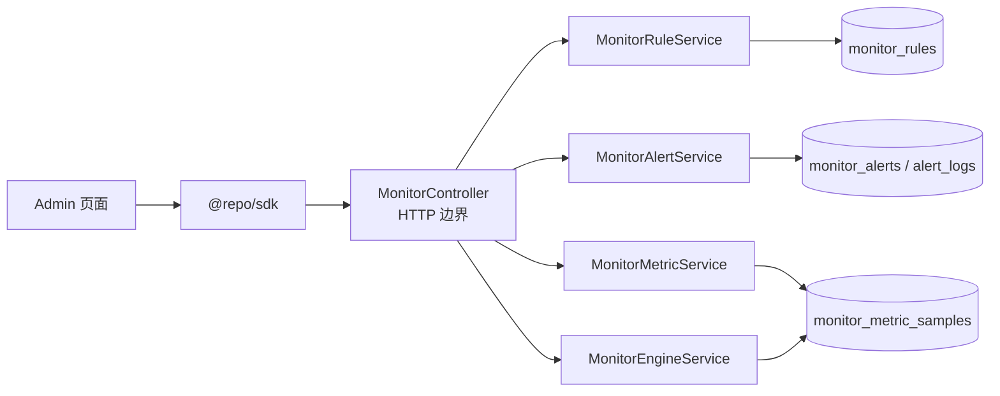

## 12. 分期

**P0：口径和表结构**

- 改 `Telemetry`：`drainCompleted()` + 墙钟对齐 + 单测；
- 新建 `monitor_rules`、`monitor_metric_samples`、`monitor_alerts`；
  现有 `alert_rules` 在 P1 新链路完成后删除，避免中间状态两套代码同时依赖不同表；
- `alert_logs` 补 `alert_id`，只作为发送记录。

**P1：系统自监控**

- 指标源（telemetry / process）、raw/derived 指标注册表；
- 采集服务、样本仓储、规则评估、时间槽、leader 锁、静默、事件入口；
- 告警生命周期：首次 / 最近命中 / 恢复 / 持续时长 / 首末快照；级别落库与展示；
- 系统规则 4 条 + seed + API + 规则页 + 告警记录页 + 引擎状态
  （**实况：系统规则 5 条**，多出 stream 示例 `system.http.error-rate.streak`，默认关闭）；
- 删除现有 `AlertTrigger` 与 create/remove 接口。

**P2：AI 用量**

- 先按 `ai-usage-stats.md` 的 P1 建好 `ai_usage_daily` / 维度表和汇总任务；
- AI 指标源、指标文件、规则文件；
- 控制台 AI 用量卡片 + 告警水位线；
- AI 规则默认关闭，管理员显式启用。

**P3：增强**

- stream 规则（连续越线、持续失败时长、按工具/模型的主体状态）；
- 恢复通知（从 firing 回到 normal 时发一条）；
- 趋势下钻、样本归档、P95/P99 业务分位；
- 成本（需要模型单价）。

## 13. 测试

**口径**

- `Telemetry.drainCompleted()`：墙钟对齐、一次返回多个窗口、空窗口、直方图分位、
  懒滚动不再丢窗口；
- 采集器：一次 tick 内同一源只读一次；源失败时依赖指标/规则跳过。

**指标层**

- 注册表：重复 key、缺 metric、derived 依赖不存在或依赖 derived、默认配置非法 → 启动失败；
- 派生：同窗口同维度对齐、缺依赖跳过、raw 更新后 derived upsert；
- 样本表：唯一键 upsert、全局指标 `instance_id=''`、保留期清理。

**规则层**

- seed：新库插入、已有库保留配置、删规则 deprecated、恢复规则、重复启动幂等；
- 评估：阈值命中、`lookback` 聚合、per-instance / aggregate、分组通知；
- 静默：发送成功后写、全通道失败不写、下一轮重试；
- 事件：code/keyword 匹配、Redis 计数窗口、fire 键只发一次、失败删 fire 键；
- 单条规则抛异常不影响其它规则。

**告警记录**

- 首次命中创建 `firing` 记录，`first_fired_at` 只写一次；再次命中只更新 `last_fired_at`；
- 连续 `recoverAfterWindows` 轮未命中后置 `resolved`，写 `recovered_at` 和 `duration_ms`；
- 恢复后再次命中新建一条记录，不复用旧记录；
- 同一规则同一主体同时只有一条 `firing`（部分唯一索引）；
- `first_snapshot` / `last_snapshot` 的 metric / event 两种结构，超长消息和 stack 截断；
- 级别 `warn` / `error` / `critical` 落库、通知标题、列表筛选；
- `alert_logs.alert_id` 关联发送记录；全通道失败时告警仍 `firing`、不写静默。

**引擎**

- 多实例：所有实例采集、只有一个实例评估、全局指标只由 leader 采；
- 锁：未抢到跳过、异常时释放、慢 tick 不双跑；
- 陈旧：样本过期跳过并标记 stale；
- 超时：慢源不会把槽一直占住（**该用例尚未落地**，见 §8.4）。

**接口 / 界面**

- definitions / list / update / reset 的校验；
- 指标 series / latest 的时间范围和维度；
- SDK 类型与控制台页面。

> 现有测试文件（2026-11-13）：`apps/server/test/monitor-lifecycle.test.ts`（告警生命周期）、
> `monitor-registry.test.ts`（指标 / 规则注册与校验）、`monitor-rule-service.test.ts`
> （规则读模型与 update / reset）、`monitor-window.test.ts`（窗口口径纯函数）。

## 14. 待确认

1. **`Telemetry` 改造方式**：推荐直接加 `drainCompleted()`（从根上解决口径）；
   备选是另写一个只给监控用的请求指标采集器，不改 `Telemetry`。后者会多一套计数，不推荐。
2. **评估周期**：P1 固定 60s / 300s，不开放后台改 cron；确认是否够用。
3. **系统指标多实例告警**：推荐「同一规则同一窗口只发一条，正文列实例」；确认是否要逐实例各发一条。
4. **AI 规则默认状态**：推荐默认关闭、管理员显式启用；确认是否要先按默认水位开几条。
5. **保留期**：60 秒样本 30 天；确认磁盘预算是否接受。
6. **事件规则范围**：P1 只做未捕获异常；5xx 由 errorRate 覆盖；确认是否还要对某类 `AppError` 单独建规则。
7. **级别**：暂定 `warn` / `error` / `critical` 三档；是否需要 `info`，以及 P1 是否就按级别做通道路由。
8. **恢复判定**：默认连续 2 轮未命中判定恢复；确认是否要改成 1 轮（更快恢复）或 3 轮（更抗抖）。
9. **快照范围**：`samples` 最多 `lookback` 条、消息/栈截断到 4KB；确认是否够排障。
10. **恢复通知**：P3 再做；确认是否 P1 就要「异常恢复」提示。

> 落定情况（2026-11-13）：1 已按 `drainCompleted()` 实施；2 保持 60s / 300s（`MonitorTimeline`
  只接受能整除 60 的秒数）；3 按 §7.3 的 `instanceMode`（`per-instance` / `aggregate`）实现；
> 4 AI 规则默认关闭；5 保留期默认 30 天（`MONITOR_SAMPLE_RETENTION_DAYS`）；6 只做未捕获异常；
> 7 级别三档；8 默认 `recoverAfterWindows: 2`；9 快照截断已实现；10 恢复通知已实现
> （`AlertDeliveryService.deliverRecovery`，`notifyOnRecovery` 默认 false，即默认只记录不通知）。

## 15. 术语

| 术语 | 含义 |
| --- | --- |
| 指标源 | 一次 tick 内读一次的数据来源，如 `Telemetry`、`process`、AI 日表 |
| 原始指标 | 直接取到的计数 / 求和 / 当前值 / 分位 |
| 衍生指标 | 由同窗口同维度的原始指标计算出的比率 / 平均 |
| 评估周期 | 规则多久跑一次，对应一个时间槽 |
| 统计窗口 | 规则一次评估看多长的数据 |
| 主体 | 被监控的对象：实例、模型、工具、错误码 |
| 静默期 | 同一规则同一主体在命中后多久不再重复通知 |
| 告警记录 | 一条告警从首次命中到恢复的记录，含首末时间、持续时长、快照 |
| 首次告警 | 创建告警记录的时间，后续命中不覆盖 |
| 恢复 | 连续若干轮不再命中后，告警置为 resolved 的时间 |
| 槽 | 按评估周期划分的时间片，到点触发该周期的规则 |
