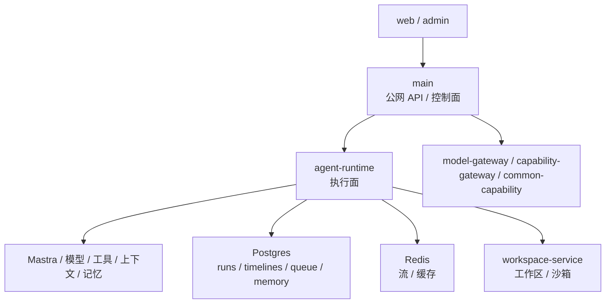
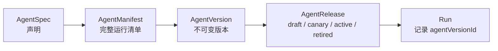

# 产品路线图

> 状态：草案（2026-11-27）
> 产品定位：可自托管、可版本化、可审计、可自我改进的 agent 平台。
> 阅读对象：产品、技术、设计、运营。
> RSI 的技术细节见 [rsi-roadmap.md](rsi-roadmap.md)。

## 0. 一页摘要

| 项目 | 内容 |
| --- | --- |
| 产品 | 给团队搭建、运行、治理 agent 的自托管平台 |
| 目标用户 | 需要数据可控、工具可接、行为可审计的平台团队与 agent 构建者 |
| 核心价值 | 可靠运行 → 像软件一样版本化 → 从经验中改进 |
| 第一阶段 | 把 runtime 做成稳定引擎，解决“能跑、能恢复、能接工具/工作区” |
| 第二阶段 | Agent 版本物化，解决“可复现、可比较、可回滚、可审计” |
| 第三阶段 | RSI L2，解决“从经验中改进，人审上线” |
| 第四阶段 | RSI L3，解决“沙箱内改工具/代码，人审合并” |
| 长期 | 平台化：多租户、SDK、生态、运营能力 |
| 关键指标 | 周成功任务数、版本化 agent 数、改进采纳率、回滚耗时、安全事件 |

## 0.1 现状

### 0.1.1 产品阶段

当前是**可运行的自托管 AI 应用基础工程**：

- 能完成会话、工具调用、工作区文件/命令、记忆、子 agent、后台管理；
- 有 typecheck、单测、verify 等工程检查；
- 尚无生产规模验证，无 e2e / 压测，界面与部署以人工验收为主。

### 0.1.2 已有能力

| 能力 | 现状 |
| --- | --- |
| 服务形态 | 6 个 Nest 服务 + web / admin：main、agent-runtime、model-gateway、capability-gateway、common-capability、workspace-service |
| 会话 / 运行 | 会话、run、时间线、SSE 流、停止、断线重连、快照、队列、子 agent 唤醒 |
| 工具 | 工具注册机、网关、配置、审计、工具效果台账 |
| 技能 | 技能库、授权、按 agent 挂载 |
| 上下文 | 窗口解析、裁剪、压缩、工具结果预算、每步再压缩 |
| 记忆 | 短期缓存 + 长期 `ai_memories`，注入与抽取 |
| 工作区 | host / docker / k8s 驱动，文件读写、命令执行、预览 |
| 运行恢复 | `runs` / `timelines` / `conversation_run_queue` / 租约 / 看门狗 / checkpoint |
| 管理后台 | 工具、技能、模型、记忆、用量、审计、工作区、凭据 |
| 工程检查 | `typecheck` 17 个包、`test` 19 组、`verify`；无 e2e / 压测 |
| 类型层 | 独立 `ai-core` 类型包已删除；S1 在 `agent-runtime` 内定义引擎与协议类型 |

### 0.1.3 当前架构

### 0.1.4 现状与目标差距

| 维度 | 现状 | 目标差距 |
| --- | --- | --- |
| 运行底座 | 以 Mastra + chat.service 为中心 | 缺 Engine/Host 协议、Conversation/Task 中心、ModelClient |
| 类型层 | 已有类型定义，未接入 | `AgentHarness` 公开类型多余；部分端口过薄 |
| 变更管理 | prompt / tool / skill 直接生效 | 缺 AgentVersion、Manifest、canary、rollback |
| 质量 | 单测 / typecheck / verify | 缺 trajectory、评测集、回归门、held-out |
| 自改进 | 只有人工改 prompt / 工具 / 代码 | 缺 MetaLoop、沙箱实验、晋级 / 回滚 |
| 平台化 | 自托管、单租户为主 | 缺多租户、SDK、生态、计费 |

### 0.1.5 基线指标

| 指标 | 现状 | 建立方式 |
| --- | --- | --- |
| 周成功任务数 | 未形成统一基线 | 从 `runs` / `timelines` 统计 |
| 崩溃恢复成功率 | 有恢复机制，未形成基线 | 从恢复日志与 run 终态统计 |
| 每任务成本 | 有用量记录，未按任务归集 | 关联 `model_gateway_usage` 与 run |
| p95 延迟 | 有流式耗时，未统一统计 | 从 run 开始 / 首 token / 结束时间统计 |
| 工具错误率 | 有工具审计，未聚合 | 从 `ai_tool_effects` / 工具结果统计 |
| 人工介入率 | 未统计 | 从挂起 / 审批 / 停止事件统计 |

### 0.1.6 约束

- 自托管优先，单租户为主；
- 无生产规模验证，无 e2e / 压测；
- 界面与部署以人工验收为主；
- 沙箱可关闭，关闭后只适合可信环境；
- 模型 key、工作区镜像、对象存储是外部依赖；
- 当前团队规模按 1–2 人估算。

## 1. 市场与用户

### 1.1 目标用户

| 用户 | 典型痛点 | 需要的能力 |
| --- | --- | --- |
| 平台团队 | 多个业务方要接 agent，模型、工具、工作区各不相同 | 统一 runtime、权限、审计、版本 |
| Agent 构建者 | prompt / 工具 / 技能改完无法复现，出问题难回滚 | Agent 版本、diff、canary、rollback |
| 运维 / 安全 | 不知道 agent 改了什么、为什么改、谁批准 | 审计、评测、人审、沙箱 |
| 业务团队 | 长任务容易断，失败后只能重来 | 会话/任务持久、恢复、工作区产物 |

### 1.2 产品定位

不是 coding IDE，也不是 workflow 画布，而是**团队自托管的 agent 运行与治理平台**：

- 会话 / 任务是第一等对象；
- 工具、模型、工作区、记忆是能力接缝；
- agent 的每次变更都可版本、可评测、可回滚；
- 长期支持 agent 从经验中改进。

### 1.3 差异化

| 维度 | 常见产品 | 本产品 |
| --- | --- | --- |
| 部署 | SaaS 为主 | 自托管优先，数据可控 |
| 变更 | 改 prompt / 工具直接生效 | Agent 版本 + canary + rollback |
| 质量 | 靠感觉 / 人工试用 | 评测集 + 回归门 |
| 长期 | 人工维护 | RSI L2/L3，人审 gate |
| 扩展 | 插件 / 工具市场 | 能力接缝 + 版本化 |

### 1.4 不做什么

- 不做通用 coding IDE；
- 不做纯 workflow 编排工具；
- 不做模型训练平台；
- 不做无人类 gate 的完全自主 RSI（L4）；
- 不在第一阶段做多租户 SaaS、市场、计费。

## 2. 产品目标与指标

### 2.1 产品目标

1. **可靠**：agent 能稳定跑完、断线能续、崩溃能恢复；
2. **可治理**：每次变更可版本、可审计、可回滚；
3. **可改进**：能从 trajectory 和评测中提出改进，并安全上线；
4. **可扩展**：模型、工具、工作区、宿主可替换。

### 2.2 非目标

- 不做“更聪明的模型”；
- 不做“更大的工具市场”；
- 不做“全自动无人值守”；
- 不追求一次性支持所有部署形态。

### 2.3 指标

**North Star**

- 每周成功完成的 agent 任务数。

**输入指标**

- 会话/任务恢复成功率；
- 版本化 agent 数；
- 评测覆盖的任务类型数；
- 改进提案数 / 采纳率；
- 回滚耗时。

**护栏指标**

- 每任务成本；
- p95 延迟；
- 安全事件数；
- 未版本化变更数；
- 生产自修改数（目标 0）。

## 3. 路线图总览

| 阶段 | 主题 | 用户价值 | 周期（2 人） | 退出标准 |
| --- | --- | --- | --- | --- |
| **S1 可靠运行** | Runtime 收口 | 能跑、能恢复、能接工具/工作区 | 4–6 周 | 两个宿主共用引擎；崩溃可恢复；`AgentHarness` 公开类型删除 |
| **S2 可版本化 Agent** | Agent 版本物化 | 可复现、可比较、可回滚、可审计 | 4–6 周 | 100% run 带版本；canary/rollback 可用 |
| **S3 可自我改进** | RSI L2 | 从经验中改进，人审上线 | 6–8 周 | 至少 1 个真实改进；held-out 无回归 |
| **S4 可自我修改** | RSI L3 | 沙箱改工具/代码，人审合并 | 8–12 周 | 至少 1 个改进合并；无安全事件 |
| **S5 平台化** | 多租户 / SDK / 生态 | 从项目变成平台 | 持续 | 多租户隔离、SDK、运营能力 |

## 4. S1：可靠运行（4–6 周）

### 4.1 用户价值

- 长任务断了能续；
- 换前端 / CLI / SDK 不用换引擎；
- 工具、工作区、模型可以独立替换；
- 失败有记录，不靠日志猜。

### 4.2 范围

- Engine/Host 协议：host 发命令，engine 发事件；
- Conversation / Task / Run：会话、任务、事件、产物；
- AgentLoop：保留为引擎接缝；
- ModelClient：替代引擎实例直传；
- 能力接缝：model / tool / context / memory / workspace / stream；
- 审批 / 沙箱：从占位变成独立层；
- 删除 `AgentHarness` 公开类型，`prepare/record/finish` 收回 runtime 内部。

### 4.3 交付

| 交付 | 验收 |
| --- | --- |
| Engine/Host 协议 | 两个 host 共用同一引擎 |
| Conversation / Task / Run 模型 | 进程重启后可恢复任务 |
| AgentLoop + ModelClient | 新增 loop / 模型不需要改 host |
| 工具 / 工作区 / 上下文接缝 | 替换实现不影响 loop |
| 审批 / 沙箱 | 高风险工具可拦截、可审计 |
| 删除 `AgentHarness` | 公开类型与导出移除 |

### 4.4 依赖与风险

- 依赖现有 `runs` / `timelines` / 队列 / 恢复；
- 风险：大改 runtime 影响现有对话；采用渐进替换，不一次性重写；
- 风险：抽象过度；只抽象会替换的部分。

## 5. S2：可版本化 Agent（4–6 周）

### 5.1 用户价值

- 同一个 agent 的每次变更都能复现；
- 两个版本能 diff；
- 新版本可以小流量 canary；
- 出问题 5 分钟内回滚；
- 谁改的、改了什么、评测如何，都能查。

### 5.2 范围

`AgentManifest` 包含：

- prompt：模板版本、渲染结果、变量；
- model：provider / model / reasoning / max tokens；
- tools：key、版本、配置、权限、启用状态；
- skills：key、版本、授权；
- policies：fileAccess、approval、sandbox、network；
- context / memory：策略与版本；
- runtime：镜像 / 依赖 / 入口；
- 内容 hash。

### 5.3 交付

| 交付 | 验收 |
| --- | --- |
| `AgentVersion` / `AgentRelease` 存储 | 所有 run 带 `agentVersionId` |
| Materializer | 从 `AgentSpec` 生成 manifest 与 hash |
| 版本 diff | prompt / model / tools / skills / policies 可对比 |
| canary / rollback | 10% canary；回滚 < 5 分钟 |
| 后台 | 版本列表、diff、发布、回滚、审计 |

### 5.4 依赖与风险

- 依赖 S1 的 Run / Conversation；
- 风险：版本粒度过细导致管理复杂；默认完整 manifest，按 agent 聚合；
- 风险：历史 run 无法回填版本；新 run 全量带版本，历史只读。

## 6. S3：可自我改进（6–8 周）

### 6.1 用户价值

- 失败不再靠人猜，系统能提出改进；
- 改进先评测，再人审，再上线；
- 不合适的改动能回滚；
- 改进过程可审计。

### 6.2 范围

- trajectory：每次 run 的经验记录；
- eval：评测集、rubric、回归；
- MetaLoop：提案 → 沙箱实验 → 评测 → 选择 → 人审 → 晋级；
- 范围：prompt / skill / 工具配置；
- 不包含代码自修改。

### 6.3 交付

| 交付 | 验收 |
| --- | --- |
| trajectory | 根 run 覆盖率 ≥ 95% |
| 评测体系 | 30–50 条任务；`pnpm eval` < 15 分钟 |
| 回归门 | 分数下降超阈值即失败 |
| MetaLoop | 至少 1 个真实改进，held-out 无回归 |
| 人审 / 回滚 | 全链路审计；回滚演练通过 |

### 6.4 依赖与风险

- 依赖 S2 的版本体系；
- 风险：评测过拟合；使用 held-out、人工抽检、成本约束；
- 风险：提案质量低；先限定 prompt / skill，再扩工具配置。

## 7. S4：可自我修改（8–12 周，试点）

### 7.1 用户价值

- agent 能在沙箱里改自己的工具/代码；
- 必须过测试、评测、人审；
- 不接触生产；
- 可回滚。

### 7.2 范围

- 独立工作区、基线快照、依赖隔离、预算；
- 代码 / 工具 diff、测试、构建、评测；
- 不可变基线、最小权限、网络/密钥隔离；
- 人审 diff 后合并；
- canary / rollback。

### 7.3 验收

- 自修改只在沙箱；
- 必须通过测试 + 评测 + 人审；
- 至少 1 个真实工具/代码改进合并；
- 无安全事件；回滚演练通过。

### 7.4 风险

- 沙箱逃逸；
- 供应链；
- prompt injection；
- 代码质量下降。

## 8. S5：平台化（持续）

### 8.1 方向

- 多租户隔离；
- 公开 SDK / API；
- 工具 / 技能生态；
- 用量、计费、配额；
- 运营后台与审计报表；
- 行业模板 / 解决方案。

### 8.2 前置条件

- S1–S3 稳定；
- 版本、评测、回滚成为常规能力；
- 有真实设计伙伴验证需求。

## 9. 交付计划与资源

### 9.1 工作流

| 工作流 | 内容 | 阶段 |
| --- | --- | --- |
| A Runtime | engine/host、conversation/task、loop、durable | S1 |
| B Agent 版本 | manifest、version、release、canary | S2 |
| C 评测 / RSI | trajectory、eval、meta-loop、sandbox | S3–S4 |
| D 产品界面 | 版本、评测、审计、回滚 | S1–S3 |
| E 运维 / 安全 | 权限、沙箱、成本、告警 | 全程 |

### 9.2 人员

- 后端 / runtime：2 人；
- 前端 / 后台：0.5–1 人；
- 产品 / 设计：0.5 人；
- 运维 / 安全：0.5 人。

单人投入时，周期按 1.5–2 倍估算。

### 9.3 发布节奏

| 阶段 | 发布形态 | 对象 |
| --- | --- | --- |
| S1 | 内部 alpha | 现有用户 / 内部环境 |
| S2 | 私有 beta | 3–5 个设计伙伴 |
| S3 | 设计伙伴试点 | 有评测需求的团队 |
| S4 | 高级试点 | 有沙箱 / 代码修改需求的团队 |
| S5 | 平台版 | 多团队 / 多租户 |

### 9.4 质量门

- 每阶段：`pnpm verify` / `typecheck` / `test` 全绿；
- S1：崩溃恢复测试；
- S2：canary / rollback 演练；
- S3：评测回归门 + 人审；
- S4：沙箱安全评审 + 代码审查；
- 所有阶段：迁移可回滚、审计可查。

## 10. 风险与应对

| 风险 | 影响 | 应对 |
| --- | --- | --- |
| Runtime 改造影响现有对话 | 回归 / 停机 | 渐进替换，双写/灰度，保留旧路径 |
| 版本粒度过细 | 管理复杂 | 默认完整 manifest，按 agent 聚合 |
| 评测过拟合 | 假提升 | held-out、人工抽检、成本约束 |
| RSI 成本失控 | 预算超支 | 提案 / 实验 / 评测三级预算 |
| 自修改安全 | 生产风险 | 沙箱、不可变基线、人审、canary |
| 用户不需要 RSI | 投入浪费 | S2 后找设计伙伴验证，再投 S3 |
| 范围膨胀 | 延期 | 每阶段只做支撑主线的能力 |

## 11. 开放问题

| 问题 | 候选 |
| --- | --- |
| 首个楔子用户 | 平台团队；agent 构建者；内部运维团队 |
| AgentVersion 粒度 | 仅 prompt；完整 manifest |
| 版本存储 | DB JSON；DB manifest + 文件引用 |
| 工具/技能版本 | 语义版本；内容 hash + 可读版本号 |
| canary 比例 | 5%；10%；按流量 |
| S3 首批范围 | prompt；skill；工具配置 |
| S4 范围 | 仅工具；工具 + runtime 代码 |
| 设计伙伴 | 内部团队；外部 3–5 家 |
