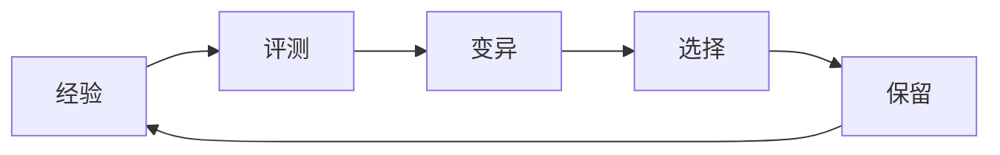
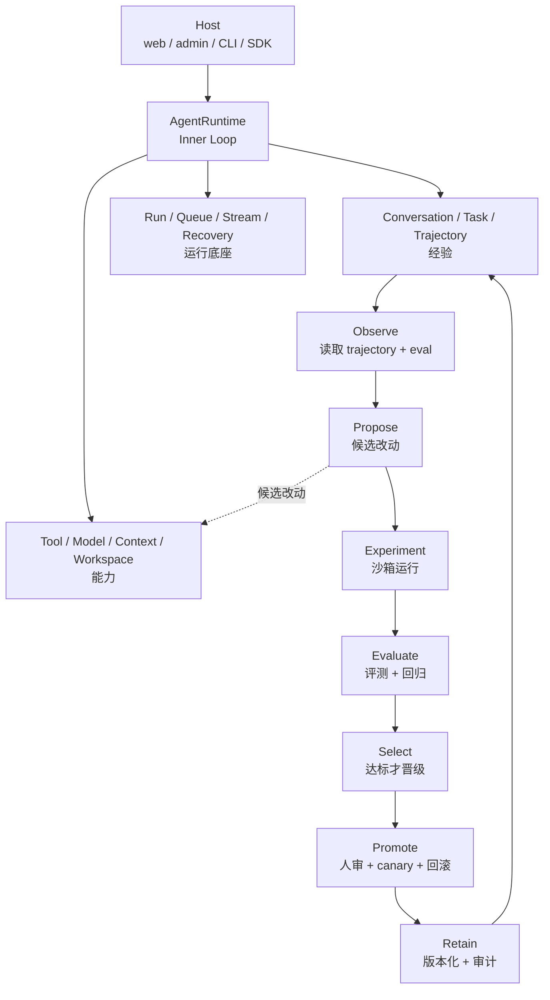

# Agent RSI 详细方案

> 状态：草案（2026-11-27）
> 产品总路线见 [product-roadmap.md](product-roadmap.md)。
> 范围：L2 为目标，L3 为试点；L4 不在范围内。

## 1. 目标与分级

### 1.1 目标

让 agent 能从运行结果中改进自身能力，并且改进结果满足：

- 可评测：评测集上可比较；
- 可回滚：坏改动能退回上一版；
- 可审计：能查到谁、何时、因为什么、改了哪个能力；
- 可运营：有预算、人审、安全边界。

改进闭环：

### 1.2 分级

| 层级 | 能力 | 本方案范围 |
| --- | --- | --- |
| L0 | 人工改 prompt / 工具 / 代码 | 已有 |
| L1 | 自动沉淀 memory / skill / 失败教训 | 已有基础，继续补充 |
| L2 | agent 提出 prompt / skill / 工具配置改动，沙箱实验，评测，人审上线 | 目标 |
| L3 | agent 在沙箱改工具/代码，过测试后人工合并 | 试点 |
| L4 | 无人类 gate 的完全自主 RSI | 不在范围 |

## 2. 现状

### 2.1 已有能力

| 能力 | 位置 |
| --- | --- |
| 会话 / run / 时间线 | `conversations`、`runs`、`timelines` |
| 运行队列 / 租约 / 恢复 | `conversation_run_queue`、`run_ownership`、`recovery.service.ts` |
| 工具 / 工具效果台账 | `ai_tools`、`ai_tool_effects`、`ai_tool_effect_attempts` |
| 技能 / 技能授权 | `ai_skills`、`ai_skill_grants` |
| 模型目录 / 用量 | `ai_models`、`model_gateway_usage` |
| 长期记忆 | `ai_memories` |
| 上下文 / 压缩 / 流式 | `context.service.ts`、`stream-*` |
| 子 agent | `agent-runner.ts`、`async-subagent.md` |
| 工作区 / 沙箱 | `workspace-service`、`workspace.md` |
| 后台管理 | `apps/admin` 的 tools / skills / models / memories / usage / audit |

### 2.2 缺口

| 缺口 | 影响 |
| --- | --- |
| 结构化 trajectory | 无法定位失败原因，无法从经验学习 |
| 评测集 / rubric / 回归 | 没有统一评分，自我改进容易漂移 |
| 能力版本化 | prompt / skill / tool / 配置不可对比、不可回滚 |
| MetaLoop | 只有 inner loop，没有提案、实验、评测、晋级 |
| 沙箱实验流程 | 候选改动缺少隔离验证 |
| 晋级 / 回滚 / 预算 / 审计 | RSI 不可运营 |
| held-out 评测 | 容易过拟合、刷指标 |

## 3. 结构

Inner loop 是现有 agent；MetaLoop 是 RSI 的增量。

## 4. 阶段

### Phase 0：基线与收口（1–2 周）

**目标**

建立可复现的基线，明确 L2 范围、评测 owner、审批人、预算。

**交付**

- 20–30 条真实任务集：聊天 / 工具 / 工作区 / 记忆 / 子 agent，覆盖成功与失败；
- 基线报告：成功率、p95 延迟、token / 成本、工具错误率、人工介入率；
- 数据地图：`runs` / `timelines` / `queue` / `effects` / `memories` / `skills` / `tools` / `models` 的关联；
- L2 范围、评测 owner、审批人、预算。

**验收**

- 基线报告可由另一人复现；
- 不改变现有产品行为；
- `pnpm verify` / `typecheck` / `test` 保持全绿。

**风险**

任务集不具代表性。先用真实会话，后续按失败类型扩充。

---

### Phase 1：经验轨迹（2–3 周）

**目标**

每次 run 都形成可查询、可比较的经验记录。

**交付**

- `trajectory` 数据结构：`id`、`conversationId`、`runId`、`taskType`、输入摘要、工具调用、结果、失败分类、usage、成本、人工介入、产物、评测标签；
- 写入点：`RunRecorder.finish` / `chat.service` 收尾 / `timelines` 关联；
- 查询 / 导出：内部 API、CLI、数据集导出；
- 脱敏：prompt 与工具出参中的密钥、用户隐私过滤。

**验收**

- 根 run 的 trajectory 覆盖率 ≥ 95%；
- 抽查 20 条，工具调用、结果、成本、失败分类一致；
- 支持按失败类型查询：模型 / 工具 / 上下文 / 权限 / 超时 / 用户取消；
- 不重复写入，不丢终态。

**风险**

字段过多。先存决策必需字段，原始数据保留在 `timelines`。

---

### Phase 2：评测体系（3–4 周）

**目标**

为“变好”提供可比较的分数。

**交付**

- `EvalCase` / `EvalSuite` / `EvalRun` / `EvalResult` / `Rubric`；
- 30–50 条评测任务：聊天、工具、工作区、记忆、子 agent；其中 20% 为 held-out；
- `pnpm eval`：本地可运行，输出总分、分项、成本、延迟、失败原因；
- CI 回归门：分数下降超过阈值即失败；
- 人工抽检：LLM judge 之外保留人工复核。

**验收**

- `pnpm eval` 单次 < 15 分钟（可并行）；
- 基线分数、成本、延迟落库；
- CI 能拦截明显回归；
- held-out 不参与提案与调参；
- Rubric 有明确通过 / 失败判据。

**风险**

Rubric 主观。采用确定性强断言、LLM judge、人工抽检三层。

---

### Phase 3：能力版本化（2–3 周，可与 Phase 2 并行）

**目标**

所有可被改进的对象都可版本、可对比、可回滚。

**交付**

- `CapabilityVersion`：`kind`（prompt / skill / tool / config / model）、`key`、`version`、内容 hash、父版本、状态（draft / canary / active / retired）、创建人、评测 run；
- 写入口：prompt / skill / tool 配置变更统一走版本；
- 后台：版本列表、diff、canary、promote、rollback；
- 审计：变更人、变更原因、评测结果、回滚记录。

**验收**

- 任一能力变更都有版本号与内容 hash；
- 支持 10% canary；
- 回滚 < 5 分钟；
- 没有未版本化的线上变更。

**风险**

版本数量膨胀。只对会被 RSI 修改的能力做版本，不是所有配置。

---

### Phase 4：L2 MetaLoop（4–6 周）

**目标**

agent 提出 prompt / skill / 工具配置改动，评测后由人批准上线。

**交付**

- `ImprovementProposal`：目标能力、诊断、候选 diff、假设、风险、预算；
- `Experiment`：候选版本、沙箱、评测集、基线、结果；
- `Selector`：有提升、无回归、成本可接受才晋级；
- `Approval`：人审 gate；
- `Promotion`：canary → active；失败回滚；
- 范围：prompt / skill / 工具配置，不含代码自修改。

**验收**

- 至少 1 个真实改进：评测提升达到阈值，held-out 无回归；
- 全链路可审计：提案、实验、评测、审批、晋级；
- 回滚演练通过；
- 没有绕过版本直接改线上。

**风险**

过拟合评测。使用 held-out、人工复核、成本约束。

---

### Phase 5：L3 沙箱自修改（6–8 周）

**目标**

agent 在沙箱内修改工具/代码，通过测试后由人合并。

**交付**

- 沙箱实验：独立工作区、基线快照、依赖隔离、预算；
- 代码/工具修改：diff、测试、构建、评测；
- 安全：不可变基线、最小权限、网络/密钥隔离、供应链检查；
- 审批：人审 diff 与评测结果；
- 合并：canary、回滚、审计。

**验收**

- 自修改只在沙箱，不直接改生产；
- 必须通过测试、评测、人审；
- 至少 1 个真实工具/代码改进合并；
- 无安全事件，回滚演练通过。

**风险**

沙箱逃逸、供应链、prompt injection。采用最小权限、网络隔离、代码审查。

---

### Phase 6：持续 RSI（持续）

**目标**

从单次改进升级为持续改进，并保持可控。

**交付**

- 定时 MetaLoop：按周或按失败量触发；
- 评测集刷新，防止老化；
- 漂移检测：能力、分数、成本异常；
- 对抗测试：prompt injection、工具滥用、数据泄漏；
- 预算、配额、告警、事故复盘；
- 指标看板。

**验收**

- 每周有提案、评测、复盘；
- 提案接受率、回归率、回滚率、单位改进成本可查；
- 安全事件为 0；
- 变更可追溯到版本与评测。

## 5. 指标

### 5.1 基线指标

- 任务成功率；
- p95 延迟；
- 每任务 token / 成本；
- 工具错误率；
- 人工介入率；
- 失败分类分布。

### 5.2 RSI 指标

- 每周提案数；
- 提案接受率；
- 评测提升幅度；
- held-out 回归率；
- 回滚率；
- 单位改进成本；
- 从发现到上线的时间；
- 安全事件数。

### 5.3 硬约束

- held-out 分数不下降；
- 成本不超预算；
- 权限违规 0；
- 密钥/隐私泄漏 0；
- 生产自修改 0（L3 只进沙箱）。

## 6. 安全与治理

- 不可变基线：自修改从固定基线开始；
- 沙箱：实验不接触生产，网络与密钥最小权限；
- 评测门：没有评测结果不晋级；
- 人审：L2 / L3 均需人批准；
- canary 与回滚：先小流量，异常即退回；
- 预算：提案、实验、评测均有上限；
- 审计：记录变更人、时间、内容、评测结果、审批人；
- 防刷分：held-out、对抗测试、人工抽检；
- 禁止：无人类 gate 的生产自修改；将评测集作为训练集；绕过版本直接改线上。

## 7. 范围外

- 不先补完独立类型层的所有端口再做 RSI；
- 不将 `AgentHarness` 做成公开类型；
- 不重写 Mastra；
- 不做模型权重训练；
- 不做 L4；
- 不为架构美观推迟评测与 trajectory。

## 8. 启动工作（前两周）

1. 选取 20 条真实任务，写清期望结果与失败判据；
2. 运行基线：成功率、成本、延迟、工具错误、人工介入；
3. 绘制数据地图：run、timeline、tool effect、memory、skill 的关联；
4. 编写 `trajectory` 字段草案，暂不迁移；
5. 用 3 条任务搭建 `pnpm eval` 骨架；
6. 确定 L2 范围、审批人、预算。

## 9. 开放问题

| 问题 | 候选方案 |
| --- | --- |
| L2 首批范围 | prompt；skill；工具配置 |
| 评测集维护 | 固定集；按失败类型滚动扩充 |
| 审批人 | 项目 owner；值班人 |
| L3 范围 | 仅工具；工具 + runtime 代码 |
| 预算上限 | 按提案；按周；按模型调用量 |
| held-out 防泄漏 | 独立存储；访问审计；定期轮换 |
