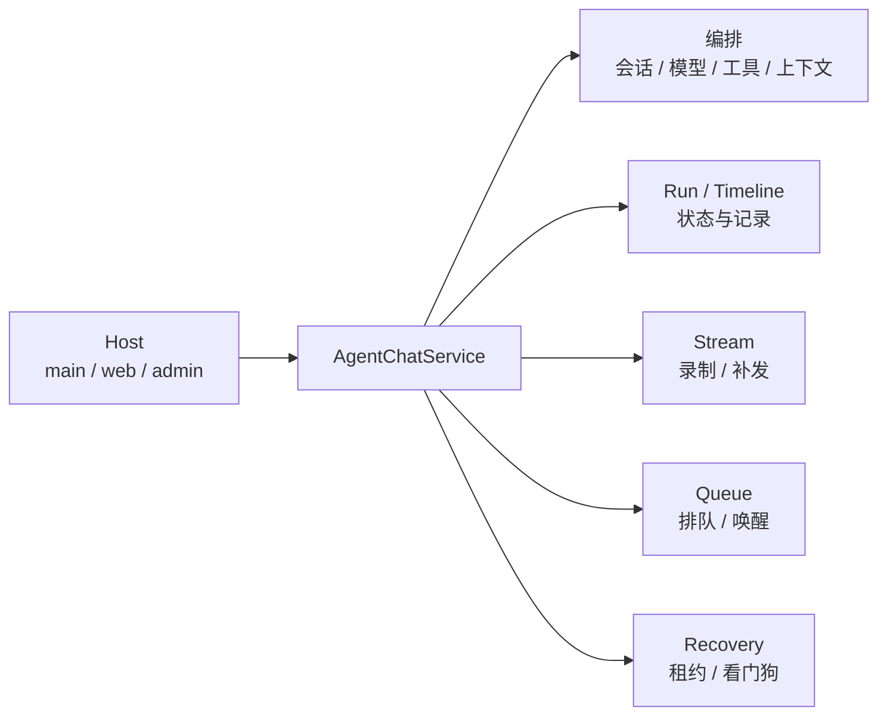
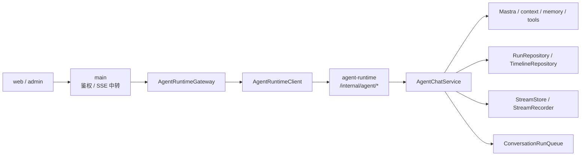
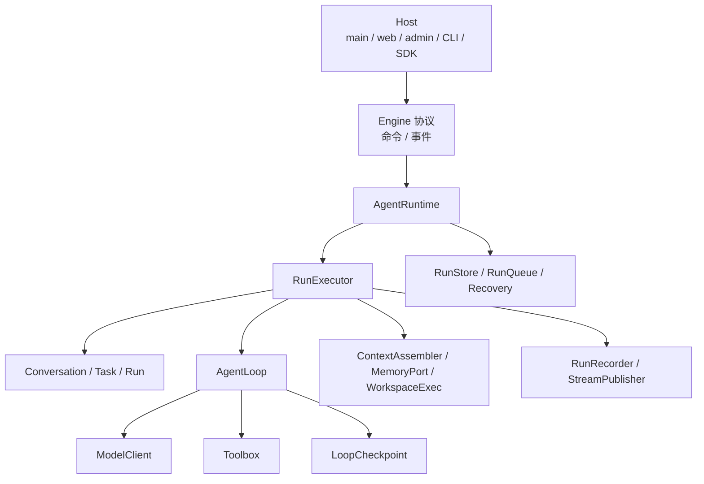
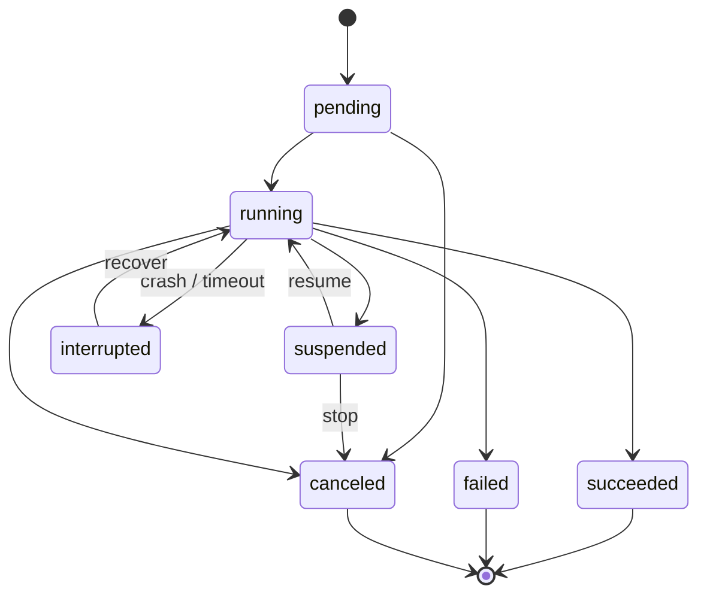
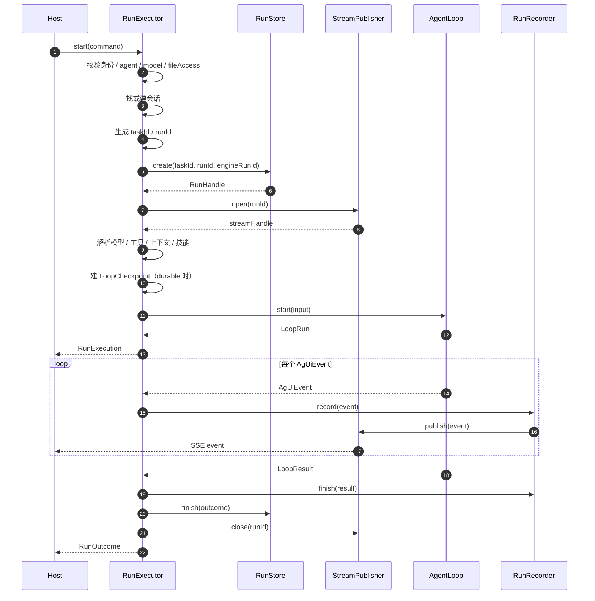
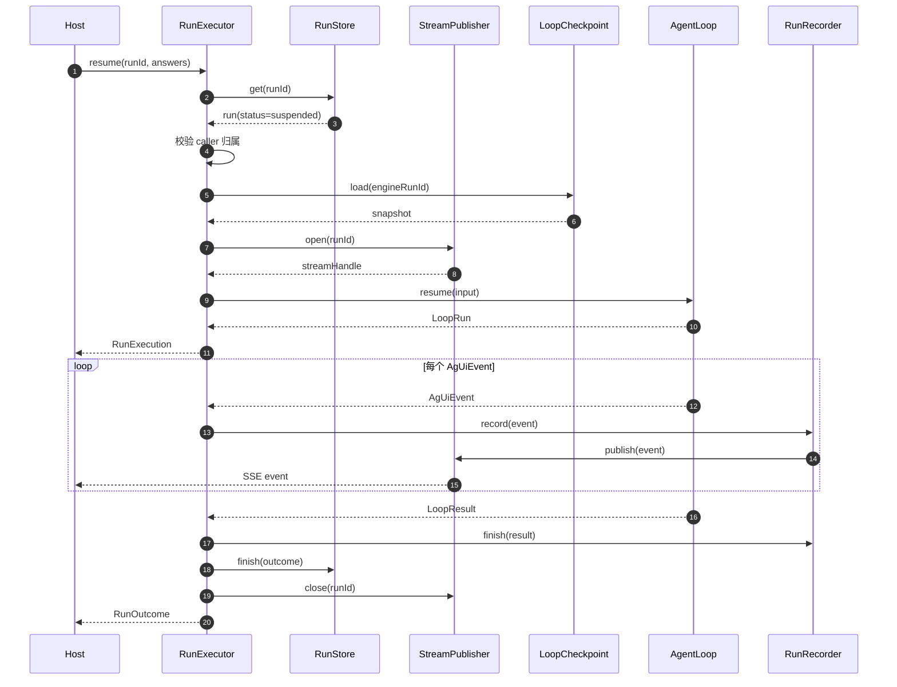
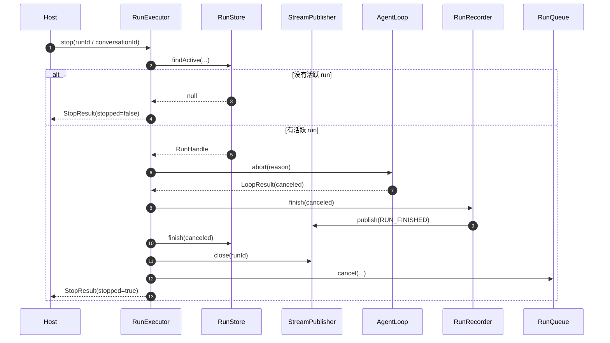
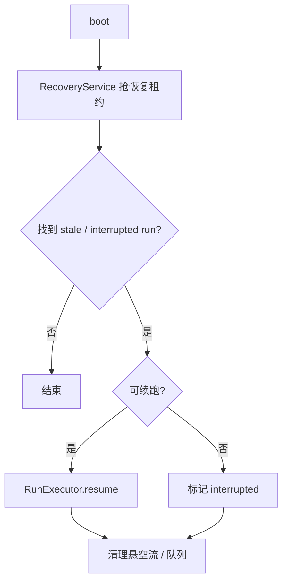

# Phase 1：Runtime 收口详细设计

> 状态：已实现（2026-11-27 设计，2026-11-28 落地；灰度开关 `AGENT_ENGINE_V2`）
> 对应产品路线图的 **S1 可靠运行**。
> 目标：把 `agent-runtime` 从“Mastra + chat.service 封装”收口为稳定引擎，为 S2 Agent 版本物化、S3 RSI 提供底座。

## 0. 背景

### 0.1 现状

当前 `agent-runtime` 已经能完成会话、工具、工作区、记忆、子 agent、流式、停止、重连、恢复，但执行链路集中在一个较厚的服务里：



`main` 通过 `AgentRuntimeGateway` / `AgentRuntimeClient` 调用 `/internal/agent/*`；`agent-runtime` 内部由 `AgentChatService` 同时承担编排、执行、记录和收尾。

### 0.2 痛点

| 痛点 | 表现 | 影响 |
| --- | --- | --- |
| 编排耦合 | `AgentChatService` 同时处理会话、模型、上下文、工具、流、收尾 | 改一处影响多条路径，回归面大 |
| Host/Engine 边界隐式 | Host 依赖内部 HTTP/SSE，没有命令/事件类型 | 新增 host 需要重新理解内部实现 |
| Run 生命周期分散 | `run.repository`、`run-queue`、`stream-store`、`recovery`、`chat.service` 各写一部分 | 状态不一致时难定位，恢复语义容易漂移 |
| Conversation/Task/Run 语义不清 | 只有 conversation 与 run，没有任务分组 | 版本、评测、RSI 缺少稳定对象 |
| 流/恢复靠隐含规则 | `sinceRev`、`204`、suspend、stop 分散在多个服务 | 断线重连、挂起续跑、停止容易回归 |
| 稳定接口缺失 | 独立类型包已删除，内部接口未收口 | 容易再次出现过度抽象或重复实现 |

### 0.3 为什么现在做

- **S2 依赖它**：Agent 版本物化要求每次 run 有稳定的 `taskId` / `runId` / `agentVersionId`，否则版本无法关联执行。
- **S3 依赖它**：RSI 需要 trajectory、评测、回滚；这些都必须建立在稳定的 run 生命周期和持久记录上。
- **现状已经在付成本**：新增能力往往要在 `chat.service`、stream、recovery 多处同时改，测试只能覆盖局部。
- **不先收口的代价**：每加一个能力就多一条分支，后续版本化与 RSI 会建在会漂移的底座上。

S1 是**适配与收口**，不是重写：保留现有接口、SSE 格式、快照与 `sinceRev` 语义，先把执行体从 `chat.service` 中拆出来。

### 0.4 成功标准

- 一个引擎能被至少两个 host 使用；
- Conversation / Task / Run 有单一写入口；
- 崩溃后可恢复，或明确标记 `interrupted`；
- SSE、快照、重连、停止、挂起续跑行为不变；
- `AgentHarness` 不再作为公开类型；
- `typecheck` / `test` / `verify` 全绿；
- 内部 alpha 观察一周无 P0。

## 1. 范围

### 1.1 本阶段做

- Engine/Host 协议：host 发命令，engine 发事件；
- Conversation / Task / Run 数据模型；
- `RunExecutor`：替代 `AgentHarness.prepare/record/finish`；
- `AgentLoop`：保留为引擎接缝；
- `ModelClient`：替代引擎实例直传；
- 能力接缝：model / tool / context / memory / workspace / stream；
- 审批 / 沙箱：从占位变成独立层；
- 崩溃恢复、流补发、停止、挂起续跑；
- 现有 `main` / `internal-sdk` / `agent-runtime` 的兼容接入。

### 1.2 本阶段不做

- Agent 版本 / Manifest / Release（S2）；
- Trajectory / Eval / MetaLoop / RSI（S3）；
- 多租户、公开 SDK、市场、计费；
- 重写 Mastra；
- 引入 Temporal；
- 前端页面重构。

## 2. 现状与改造点

### 2.1 现状调用链



### 2.2 现有入口

| 现有入口 | 作用 |
| --- | --- |
| `POST /internal/agent/chat` | 非流式一轮 |
| `POST /internal/agent/chat/stream` | 流式一轮 |
| `POST /internal/agent/chat/resume` | 挂起后续跑 |
| `POST /internal/agent/run/stop` | 停止 |
| `GET /internal/agent/run/stream` | 当前 run 重连 |
| `GET /internal/agent/run/:runId/stream` | 指定 run 重连 |
| `GET /internal/agent/run/snapshot` | 当前 run 快照 |
| `GET /internal/agent/run/:runId/snapshot` | 指定 run 快照 |
| `POST /internal/agent/conversation/cancel` | 取消会话 |
| `POST /internal/agent/run-queue/*` | 队列修改 / 删除 |

### 2.3 改造原则

- **不破坏现有 wire format**：SSE 仍然输出 AG-UI 事件；`sinceRev`、快照、`204` 语义保持不变；
- **先加适配层，再迁执行体**：现有 controller 作为 Host 适配器，内部调用 `RunExecutor`；
- **`chat.service` 逐步变薄**：从“编排 + 执行 + 记录”变成“Host 适配 + RunExecutor 调用”；
- **不新造平行入口**：S1 不新增 `/internal/engine/*`，先把现有入口映射成命令。

## 3. 目标结构



### 3.1 分层职责

| 层 | 职责 | 不负责 |
| --- | --- | --- |
| Host | 鉴权、HTTP/SSE、身份头、客户端连接 | loop、模型、工具执行 |
| Engine 协议 | 命令与事件的类型、错误码、取消、幂等 | 业务编排 |
| AgentRuntime | 组合根：RunExecutor、Store、Queue、Recovery、Stream | 具体模型 / 工具实现 |
| RunExecutor | 一次 run 的装配、执行、记录、收尾 | 进程生命周期、host UI |
| AgentLoop | 调模型、调工具、停/挂起、产出事件 | 持久化、队列、HTTP |
| 能力接缝 | model / tool / context / memory / workspace / stream | 业务决策 |

## 4. 数据模型

### 4.1 Conversation

- 复用 `conversations`；
- 一个 conversation 可以有多个 Task；
- conversation 级配置：agentKey、fileAccess、workspaceId、workdir；
- conversation 是长期对象，不随 run 结束而结束。

### 4.2 Task

S1 不新增 `agent_tasks` 表，Task 是 `runs.task_id` 形成的逻辑分组：

- 一次用户目标 = 一个 `taskId`；
- 一个 Task 可以有多个 Run（重试、恢复、子 agent）；
- Task 状态由最新 Run 派生，不单独维护状态机；
- 子 agent 的 Run 继承父 Task 的 `taskId`；
- 旧数据 `task_id = null`，只读兼容。

这样避免在 S1 引入新的任务表与状态机，同时保留“Run 是尝试、Task 是目标”的区分。

### 4.3 Run

在现有 `runs` 上增量字段：

| 字段 | 说明 |
| --- | --- |
| `task_id` | 逻辑任务 id；新 run 必填 |
| `agent_version_id` | S2 接入；S1 可为 null |
| `origin` | `user` / `subagent` / `wake` |
| `parent_run_id` | 子 agent 的父 run |
| `engine_run_id` | 引擎 run id；durable 快照按它认亲 |
| `status` | `pending` / `running` / `suspended` / `succeeded` / `failed` / `interrupted` / `canceled` |
| `usage` | token / 成本 |
| `error_stage` / `error_code` / `error_detail` | 失败分类 |
| `started_at` / `finished_at` | 时间 |



### 4.4 事件

- `timelines` 是对话与工具事实的持久记录；
- `stream-store` 是 Redis 的补发记录，按 `rev` 读取；
- `RunRecorder` 同时写两处：先时间线，再推流；
- `EngineEvent` 是 Host 看到的事件，S1 直接复用 AG-UI 事件。

## 5. Engine/Host 协议

### 5.1 命令

S1 先定义内部命令类型，由现有 HTTP 入口适配：

```ts
type EngineCommand =
  | { type: 'start'; input: StartRunInput }
  | { type: 'resume'; input: ResumeRunInput }
  | { type: 'stop'; input: StopRunInput }
  | { type: 'snapshot'; input: SnapshotInput }

interface StartRunInput {
  conversationId?: string
  taskId?: string
  agentKey?: string
  modelId?: string
  fileAccess?: 'read-only' | 'workspace-write'
  message: string
  attachments?: ChatAttachment[]
  clientId?: string
  requestId?: string
}

interface ResumeRunInput {
  runId: string
  answers?: AgentQuestionAnswer[]
  cancelled?: boolean
  clientId?: string
}

interface StopRunInput {
  runId?: string
  conversationId?: string
  reason: string
}

interface SnapshotInput {
  runId?: string
  conversationId?: string
}
```

身份不放进命令体：沿用内部 token + `x-user-id` / `x-admin-id` 头，Host 负责鉴权。

### 5.2 事件

S1 事件就是 AG-UI 事件，不新增 envelope：

```ts
type EngineEvent = AgUiEvent
```

SSE 规则不变：

- `RUN_STARTED` 开始；
- `TEXT_MESSAGE_*` / `REASONING_MESSAGE_*` / `TOOL_CALL_*` / `STEP_*` 增量；
- `CUSTOM` 承载 queue / usage / title / suspended / status；
- `RUN_FINISHED` / `RUN_ERROR` 结束；
- `sinceRev` 补发；
- 没有进行中的流返回 `204`。

### 5.3 错误

| 场景 | HTTP | 错误码 |
| --- | --- | --- |
| 内部令牌缺失 / 错误 | 401 | `internal_unauthorized` |
| 调用方身份缺失 | 401 | `caller_missing` |
| 会话不存在 / 无权 | 404 | `conversation_not_found` |
| agent / model 不可用 | 400 / 409 | `agent_unavailable` / `model_unavailable` |
| 同会话已有活跃 run | 409 | `conversation_busy` |
| run 不可恢复 | 409 | `run_not_resumable` |
| 上下文超长 | 422 | `context_too_long` |
| 上游模型失败 | 502 | `model_failed` |
| 内部异常 | 500 | `engine_internal` |

错误响应统一：

```ts
{
  code: string
  message: string
  runId?: string
  retryable?: boolean
}
```

## 6. RunExecutor

### 6.1 职责

```ts
interface RunExecutor {
  start(command: StartRunInput, caller: CallerIdentity): Promise<RunExecution>
  resume(command: ResumeRunInput, caller: CallerIdentity): Promise<RunExecution>
  stop(command: StopRunInput, caller: CallerIdentity): Promise<StopResult>
  snapshot(input: SnapshotInput, caller: CallerIdentity): Promise<RunSnapshot | null>
}
```

`RunExecution`：

```ts
interface RunExecution {
  runId: string
  events: AsyncIterable<AgUiEvent>
  result: Promise<RunOutcome>
}
```

### 6.2 启动流程



### 6.3 恢复流程



### 6.4 停止流程



### 6.5 崩溃恢复



## 7. AgentLoop

S1 保留现有循环语义，只收窄接口：

```ts
interface AgentLoop {
  start(input: LoopInput): Promise<LoopRun>
  resume(input: LoopResumeInput): Promise<LoopRun>
}

interface LoopInput {
  scope: LoopScope
  engineRunId: string
  messages: AgentMessage[]
  model: ModelClient
  tools: Toolbox
  limits: LoopLimits
  signal: AbortSignal
  checkpoint?: LoopCheckpoint
  hooks?: LoopHooks
}

interface LoopRun {
  events: AsyncIterable<AgUiEvent>
  result: Promise<LoopResult>
  abort(reason?: string): void
}
```

`LoopResult`：

```ts
interface LoopResult {
  status: 'succeeded' | 'failed' | 'canceled' | 'suspended'
  text: string
  reasoning: string
  steps: LoopStep[]
  usage: TokenUsage | null
  finishReason: string | null
  stopReason:
    | 'done'
    | 'error'
    | 'interrupted'
    | 'suspended'
    | 'max_steps'
    | 'cost_limit'
    | 'no_next_context'
  error?: LoopError
  suspend?: SuspendInfo
}
```

S1 新增 `stopReason`，便于 Host、Recorder、看门狗统一判断结束原因。

## 8. ModelClient

替代 `LoopModel.instance: unknown`：

```ts
interface ModelClient {
  readonly ref: string
  readonly contextWindow: number | null
  stream(input: ModelCallInput): AsyncIterable<ModelEvent>
}

type ModelEvent =
  | { type: 'text'; delta: string }
  | { type: 'reasoning'; delta: string }
  | { type: 'tool-call'; toolCallId: string; toolName: string; input: unknown }
  | { type: 'usage'; usage: TokenUsage }
  | { type: 'finish'; reason: string }
```

Mastra 适配器实现 `ModelClient`；Loop 不再接触 Mastra 实例。

## 9. 能力接缝

S1 只收口会被替换的接缝：

| 接缝 | 现有实现 | S1 接口 |
| --- | --- | --- |
| 模型 | `resolveRuntimeModel` / Mastra | `ModelClient` |
| 工具 | `ToolRegistry` / `ToolGateway` | `ToolFace.resolve` / `Toolbox` |
| 上下文 | `ContextService` | `ContextAssembler.assemble` |
| 记忆 | `MemoryService` | `MemoryPort.recall` / `extract` |
| 工作区 | `workspace-service` | `WorkspaceFiles` / `WorkspaceExec` |
| 流 | `StreamStore` / `StreamRecorder` | `StreamPublisher` / `RunRecorder` |
| 审批 | 工具网关 / 挂起 | `ApprovalPort`（S1 只接入 `ask-user-questions`） |

S1 不重写这些实现，只加接口与适配器。

## 10. 与现有代码的映射

| 现有 | 目标 |
| --- | --- |
| `AgentInternalController` | Host 适配器：命令 → `RunExecutor` |
| `AgentChatService.chatStream` | `RunExecutor.start` + SSE 输出 |
| `AgentChatService.resumeChat` | `RunExecutor.resume` |
| `AgentChatService.stopRun` | `RunExecutor.stop` |
| `AgentChatService.snapshotRun` | `RunExecutor.snapshot` |
| `RunRepository` | `RunStore` 适配 |
| `ConversationRunQueue` | `RunQueue` 适配 |
| `StreamStore` / `StreamRecorder` | `StreamPublisher` / `RunRecorder` 适配 |
| `RecoveryService` | Runtime 启动恢复 |
| `ContextService` | `ContextAssembler` 适配 |
| `MemoryService` | `MemoryPort` 适配 |
| `ToolRegistry` | `ToolFace` 适配 |
| `AgentRuntimeGateway` / `AgentRuntimeClient` | Host 客户端，协议不变 |

## 11. 迁移步骤

### Step 1：数据

- `runs` 增加 `task_id`、`agent_version_id`（nullable）；
- 新 run 写 `task_id`；
- 旧 run 不回填，只读兼容；
- 增加索引 `(conversation_id, task_id, created_at)`。

### Step 2：接口

- 在 `agent-runtime` 内定义 `EngineCommand` / `EngineEvent` / `RunExecutor`；
- `AgentInternalController` 改成 Host 适配器；
- `chat.service` 保留，但逐步委托给 `RunExecutor`。

### Step 3：执行体

- 提取 `RunExecutor`：会话解析、模型、工具、上下文、录制、收尾；
- 提取 `ModelClient`，Loop 不再直接拿 Mastra 实例；
- 保留 `AgentLoop` 现有行为，先不改算法。

### Step 4：开关与灰度

- 增加 `AGENT_ENGINE_V2` 开关；
- 新 run 走 `RunExecutor`；旧 run 仍走原路径；
- 先内部环境，再设计伙伴；
- 观察错误率、延迟、恢复率。

### Step 5：清理

- 删除 `AgentHarness` 相关公开类型；
- 删除重复的编排分支；
- 更新 `internal-sdk` 类型与文档。

## 12. 测试

### 12.1 单元

- Engine 命令映射；
- Run 状态机；
- 幂等：重复 stop / resume；
- 错误码映射；
- `task_id` 生成与继承。

### 12.2 集成

- start → SSE 事件 → finish；
- start → suspend → resume → finish；
- stop；
- 断线重连：`sinceRev` 补发；
- 进程重启：恢复 / 标记 interrupted；
- 同会话并发：409。

### 12.3 回归

- `pnpm typecheck` 17/17；
- `pnpm test` 19/19；
- `pnpm verify` 全绿；
- 现有 `chat` / `chat/stream` / `resume` / `stop` 行为不变。

## 13. 观测

| 事件 | 字段 |
| --- | --- |
| `engine.run.start` | runId, taskId, conversationId, agentKey, model |
| `engine.run.finish` | runId, status, stopReason, duration, usage |
| `engine.run.suspend` | runId, toolCallId, reason |
| `engine.run.recover` | runId, result |
| `engine.stream.error` | runId, stage, message |

指标：

- 活跃 run 数；
- 启动到首 token；
- run 成功率 / 失败分类；
- 恢复成功率；
- 流补发延迟；
- 同会话 409 次数。

## 14. 风险与应对

| 风险 | 应对 |
| --- | --- |
| 改 runtime 影响现有对话 | 开关 + 灰度 + 旧路径保留 |
| SSE wire format 变化 | S1 不改 AG-UI 事件格式与 `sinceRev` |
| `task_id` 迁移影响旧 run | nullable + 只读兼容 |
| RunExecutor 与 chat.service 双写 | 单一写入口；迁移期只允许一个路径写 |
| 恢复语义变化 | 复用现有 recovery/租约/checkpoint |
| 抽象再次膨胀 | 只收口会被替换的接缝；不建独立类型包 |

## 15. 验收清单

- [x] `runs.task_id` 迁移完成，新 run 全量写入；
- [x] Engine 命令 / 事件类型落地；
- [x] `AgentInternalController` 改为 Host 适配器；
- [x] `RunExecutor` 接管 start / resume / stop / snapshot 的**命令入口与事件流**（v2 返回 `RunExecution`）；具体编排仍在 `AgentChatService`，按 §2.3「先适配、再迁执行体」逐步下沉；
- [x] `ModelClient` 替换 `LoopModel.instance`（执行体经 `MastraModelClient` 取实例）；
- [x] SSE / 快照 / `sinceRev` 行为不变；
- [x] 进程重启后可恢复或标记 interrupted；
- [x] 两个 host（web / CLI 或 admin）共用同一引擎；
- [x] `AgentHarness` 公开类型删除；
- [x] `pnpm typecheck` / `test` / `verify` 全绿；
- [ ] 内部 alpha 观察一周，无 P0（需要真实运行观察，代码侧已具备观测事件与指标）。

## 16. 实现落地（2026-11-28）

| 设计 | 落地位置 | 说明 |
| --- | --- | --- |
| `runs.agent_version_id` | `packages/db` 迁移 `1795450000001-AddRunAgentVersionId` | S2 接入点；S1 只落字段、不写入 |
| Engine 协议 | `modules/ai/engine/protocol.ts` | `Start/Resume/Stop/Snapshot/Attach` 命令、`RunStopReason`、错误体 |
| 错误映射 | `modules/ai/engine/engine-errors.ts` | `AppError` → 协议码 + HTTP；可重试标记 |
| `RunExecution` | `modules/ai/engine/run-execution.ts` | `RunEventSink` 把执行体的 SSE 帧收成 `AsyncIterable`；结束标记原样透传 |
| `RunExecutor` | `modules/ai/engine/run-executor.ts` | `start/resume` 返回执行句柄；`stop/snapshot/attach` 保持；`AGENT_ENGINE_V2` 灰度；会话 / 模型 / 上下文 / 录制仍由执行体完成 |
| `AgentLoop` | `modules/ai/engine/agent-loop.ts` + `adapters/loop.adapter.ts` | 薄 loop（ModelClient + Toolbox）真实可运行；`resume` 不假装支持 durable |
| `ModelClient` | `modules/ai/engine/model-client.ts` + `adapters/model-client.adapter.ts` | AI SDK chunk → Loop 模型事件；执行体经它取 Mastra 实例 |
| 能力接缝 | `modules/ai/engine/ports.ts` + `adapters/*` | ToolFace / ContextAssembler / MemoryPort / StreamPublisher / RunRecorder / WorkspaceFiles·Exec / ApprovalPort |
| 观测 | `modules/ai/engine/engine-telemetry.ts` | `engine.run.*` 事件 + `engine_*` 指标（活跃 run / 成功率 / 耗时 / 409） |
| 测试 | `apps/agent-runtime/test/engine-*.test.ts` | 命令映射、错误码、事件流、v2 泵、ModelClient、薄 loop |

灰度：`AGENT_ENGINE_V2=true`（默认）走 v2；`false` 退回旧的直写 response 路径。
两条路径复用同一份执行体，wire format 与 `sinceRev` 语义一致。

## 17. S1 边界与后续

已实现 S1 的「协议 + 入口 + 接缝 + 观测 + 灰度」，以下明确留到后续（不是遗漏，是设计边界）：

| 项 | 现状 | 后续 |
| --- | --- | --- |
| 执行体下沉 | `AgentChatService` 仍承担会话解析 / 模型解析 / 上下文 / 录制 / 收尾 | S2 按 §6.2 逐步搬进 `RunExecutor`，删重复编排分支 |
| 薄 `AgentLoop` 切主路径 | 已实现并用单测覆盖，默认不接（S1 保留 Mastra 循环算法） | S2 评估切换，先补 durable / suspend / 记忆等价性 |
| `AgentLoop.resume` | 薄 loop 无 durable 快照，直接抛 `run_not_resumable` | 与 LoopCheckpoint 一起做 |
| `runs.agent_version_id` | 字段已加、S1 不写入 | S2 Agent 版本物化时写入 |
| 审批 / 沙箱接管 | `ApprovalPort` 记录挂起 / 续跑事实；沙箱执行在 workspace-service | 危险命令人工批准时替换 ApprovalPort 适配器 |
| 内部 alpha 观察 | 观测事件与指标已就绪 | 真实运行观察一周，无 P0 后把 `AGENT_ENGINE_V2` 固定为默认 |
| `runtime/` 目录与 `chat.service` 体积 | 已按域分目录；`chat.service` 约 2.6k 行，抽出首轮标题 / 摘要 / 步级落库 / AG-UI 发射 / 快照 / 用量 / 运行时上下文 / 看护 / chunk 泵 / 成功与失败收尾 | 下一轮收敛三条执行路径的 chunk 录制与收尾（先补 e2e 回归网） |
