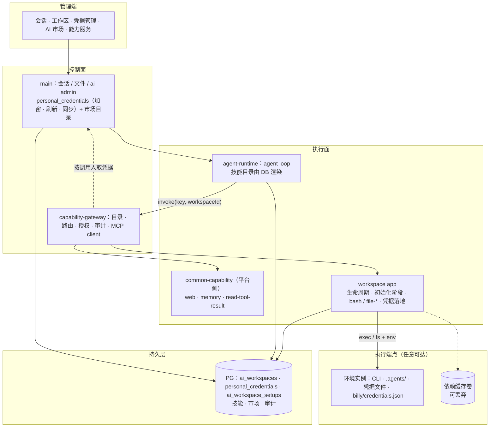
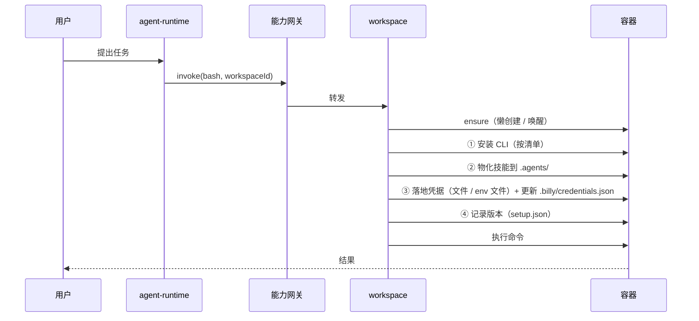
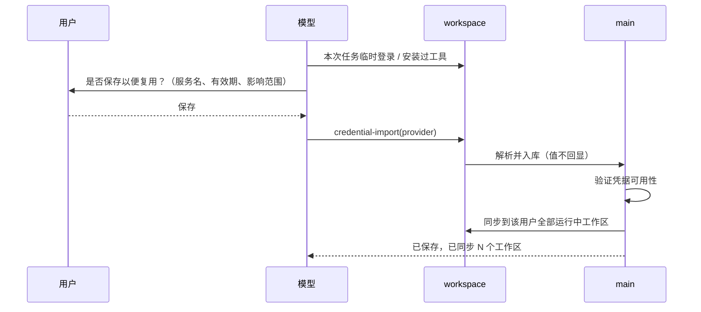
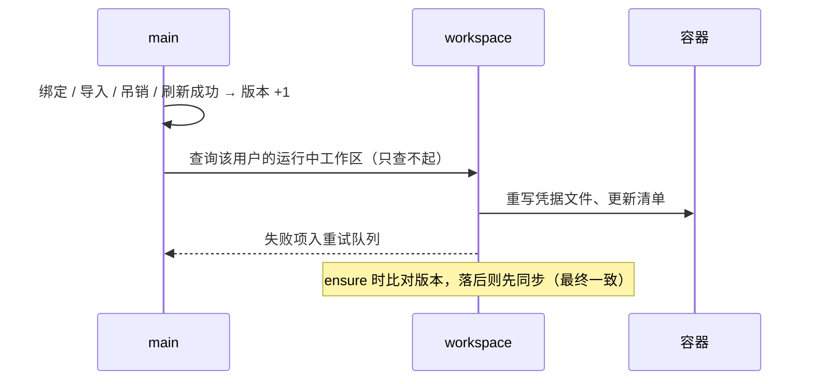

# 工作区执行环境、技能分发与个人凭据

| 项 | 内容 |
| --- | --- |
| 文档状态 | 设计稿（待评审），未实施 |
| 版本 | v3 · 2026-11-20 |
| 范围 | 工作区执行环境、初始化声明、个人凭据、CLI 接入、技能分发、AI 市场 |
| 相关文档 | [workspace.md](workspace.md)（执行环境）、[ai-skill-library.md](ai-skill-library.md)（技能库）、[capability-gateway.md](capability-gateway.md)（能力网关）、[service-authorization.md](service-authorization.md)（服务级授权）、[resource-isolation.md](resource-isolation.md)（用户级隔离，暂缓） |
| 代码现状 | `apps/workspace-service` 已合入（`a055c9e`）；`exec` 无 `env` 参数、无初始化阶段、工作区归属写死 `admin`、凭据模块未实现 |

---

## 1. 摘要

平台需要让 AI 在一次性容器环境中完成涉及外部系统的任务。这类任务依赖三样东西：能用的工具、知道怎么用的知识、以及**代表具体某个人**执行所需的凭据。

容器可随时销毁、可在不同驱动和不同机器上重建，而上述三样必须长期跟随用户。本设计以此为核心约束，将系统划分为**可丢弃的执行层**与**按人持有的声明层**，并通过一个统一的初始化阶段把声明还原成可用的环境。

设计重点在个人凭据：它以「一次初始化落地、变更时同步」的方式工作，而不是每次执行临时注入。托管两类东西——可撤销的 OAuth 授权，以及数据库口令、Redis 口令、云厂商 AK-SK 这类本就没有授权机制的静态凭据；后者只注入工作区，绑定需二次确认。

**核心结论**

1. 执行层（容器、装好的二进制）可丢弃；声明层（凭据、清单、技能）按人持有，永不依赖工作区存活。
2. 凭据在初始化阶段落地到容器，凭据变更推送到该用户的全部运行中工作区；**容器内的执行路径不再查询凭据**（平台侧 MCP 调用仍按请求取用）。
3. CLI 作为生态长尾的接入面，不进入能力网关；平台只负责环境、清单与凭据，不维护 CLI 目录、不逐个子命令声明。

---

## 2. 背景与问题

### 2.1 现状

工作区已从「会话级目录」演进为容器化执行环境，`bash` 与 `file-*` 均在容器内执行。现有能力接入方式分两条：平台内建能力（web / memory），以及经能力网关登记的 MCP 服务。

### 2.2 问题

| # | 问题 | 影响 | 证据 |
| --- | --- | --- | --- |
| P1 | 技能正文由 Mastra 从宿主机路径读取，带脚本的技能在宿主机执行 | 容器化后这些路径不可见，技能体系断链 | `skill.loader.ts`、`ai.mastra.ts` |
| P2 | 旧连接器模块（2026-11-18 删除）采用「平台为每个系统手写驱动」 | 无法跟上生态增速；删除后留下 sql / redis / 飞书 CLI 三个缺口 | 连接器模块历史 |
| P3 | 第三方能力多以 CLI 提供，且普遍为个人账号授权 | 登录态存于本机目录，工作区闲置两小时销毁后丢失，用户需反复授权 | 本设计第 6 节 |
| P4 | 已安装的 CLI 随容器销毁 | 重建时若由模型按技能重装，首条命令等待以分钟计，且版本不可控 | 本设计 6.3 |
| P5 | 技能存在三个加载来源，其中含宿主全局目录 | 多租户下会把部署者本地技能注入所有用户上下文 | `AI_SKILLS_DIRS`（默认 `~/.agents/skills`） |
| P6 | Mastra 自带的 `skill` / `skill_search` / `skill_read` 不经注册机 | 网关无法拦截，缺少开关、限额与审计 | `ai.mastra.ts` |

### 2.3 核心矛盾

**执行发生在临时环境中，而身份与知识需要长期跟随用户。**

该矛盾决定了后续所有设计取舍：凡将长期资产绑定在临时环境之上的方案，均不成立。

---

## 3. 目标与非目标

### 3.1 目标

| # | 目标 | 可验证口径 |
| --- | --- | --- |
| G1 | 资产位置无关 | 任意工作区、任意驱动、任意容器、重建后、换设备，首条命令即可用，无需重新登录或重新配置 |
| G2 | 执行路径不依赖控制面 | 已在运行的工作区，其命令执行不受控制面可用性影响 |
| G3 | 身份以正确的主体执行 | 任何一次外部系统操作，可追溯到具体的执行者与凭据，且不可越权 |
| G4 | 重建成本可控 | 清单 ≤ 3 个包；冷装 ≤ 90 秒；命中依赖缓存 ≤ 5 秒 |
| G5 | 生态可接入 | 新增一个 CLI 不需要平台改动；官方支持的工具通过适配器增强 |

G1 可作为全局判据：设计方案冲突时，以更接近 G1 者为准。

### 3.2 非目标

| 不做 | 原因 |
| --- | --- |
| 环境快照与持久化容器 | 快照会成为正确性依赖，引出归档、恢复、白名单、跨天续用等一整套机制；用「声明重放 + 依赖缓存」可达同等效果 |
| 组织、租户与可扩展角色体系 | 当前为个人级产品；管理员只区分 `normal` / `god` 两级，目的是跨主体查看时能归属到具体责任人，不做权限树 |
| 为 CLI 编写子命令级能力声明 | 等同于把无限供给压回有限供给，是连接器模式失败的原因 |
| 平台维护 CLI 目录与安装器 | 装什么、什么版本，应由用户声明决定 |
| 容器网络出口管控 | 可达性由用户防火墙决定；出口黑名单对 IP 可硬拦、对域名只能软拦，收益不足，本期不做 |

---

## 4. 设计原则

### 4.1 资产分层

按「丢失后果」而非「存放位置」分层：

| 层 | 内容 | 生命周期 | 丢失后果 |
| --- | --- | --- | --- |
| 声明 | 凭据、安装清单、技能（DB）、非凭据配置 | 绑定至吊销 / 入库至删除 | 用户需重做 |
| 缓存 | 已安装 CLI、包缓存、依赖目录 | 随时可丢 | 仅影响重建耗时 |
| 运行态 | 容器、`.agents` 副本、凭据文件、CLI 自身状态 | 随容器销毁 | 下次重新生成 |

### 4.2 不变量

1. **资产不依赖工作区存活。** 工作区删除、迁移、更换驱动，声明层不受影响。
2. **容器内只存放副本。** 凭据、技能、清单的真身在数据库与加密存储中。
3. **缓存可丢，声明不可丢。** 任何正确性不得建立在缓存存在的前提上。

### 4.3 实现约束

任何新机制须先回答：**能否用 `exec` / `fs` + `env` 表达？**

- 能：实现于端口之上，自动获得全部执行后端；
- 不能（宿主 tmpfs 挂载、`docker cp` 等）：下沉到具体驱动，并为其他驱动提供降级实现，或不予实现。

该约束是 G1 的直接推论：依赖某一驱动特性的机制，在切换驱动时必然失效。

### 4.4 托管边界

托管的目的有两个：**让 AI 能代表这个人执行**，以及**记录这份权限是谁的、谁用过**。后者是安全与排障的基础——出了事要能说清是哪个人、哪次执行。

| 类型 | 是否托管 | 边界与理由 |
| --- | --- | --- |
| OAuth 授权（access / refresh token） | 是 | 用户可在授权方系统内随时撤销；平台只持可失效的凭证 |
| 静态凭据（数据库口令、Redis 口令、API Key、AK-SK） | 是 | 这类资源本就没有 OAuth，不托管就等于不支持。代价是泄露后无法止损，因此：只注入工作区、不经由平台自带服务使用、绑定需二次确认 |
| 用户在本平台的登录密码 | 否 | 属于身份认证，存于 `users` 表，不进凭据库 |
| SSH 私钥 | v1 否 | 输入与轮换的交互成本高，`kind` 已预留 |
| 平台自身密钥（MCP 服务凭据、模型供应商 Key） | 不进个人表 | 归属为平台，与个人授权的生命周期不同 |

---

## 5. 总体设计

### 5.1 系统结构



### 5.2 工具面划分

| 路径 | 职责 | 执行位置 | 凭据 |
| --- | --- | --- | --- |
| 内置能力 | 环境原语（bash / file-*）与平台能力（web / memory） | 工作区 / 平台侧 | 无，或平台一份 |
| 网关 + MCP | 结构化外部服务，可治理 | 平台侧 | 平台一份，或按调用人一份 |
| CLI | 生态长尾，模型依据 `--help` 自主使用 | 工作区 | 个人一份，初始化时落地 |

### 5.3 关键流程

**流程一：环境初始化**



**流程二：任务收尾保存**



**流程三：凭据变更传播**



---

## 6. 详细设计

### 6.1 工作区与执行端点

沿用 [workspace.md](workspace.md) 的模型，本设计补充四点。

**独立服务。** `workspace` 为独立应用，对外提供两类接口：管理面（列表、启停、销毁、SSH 公钥）由 main 转发；能力面（`bash` / `file-*`）登记至能力网关。执行面对数据库只读。

**后端与端点解耦。** 端口仅暴露 `exec(cmd, { env, cwd })` 与 `fs`；驱动可插拔（local / docker / k8s / 后续 microVM）。端点为配置项，服务进程与执行端点可不在同一主机。

**运行态不落库。** `ai_workspaces.desired_status` 表示用户意图，实际运行状态由执行面实时查询，不回写。避免控制面与执行面双写冲突。

**孤儿容器回收。** 进程重启后内存中的运行句柄丢失，而容器仍在运行。执行面启动时及每次回收前执行一次认领（按数据库候选集探测容器存在性并重建句柄），否则这些容器不会被回收。

### 6.2 初始化清单

装好的 CLI 不属于资产；「需要哪些 CLI、什么版本、配了什么」属于资产。后者作为声明存储，前者由声明重放生成。

```sql
ai_workspace_setups                    -- 初始化清单（声明）
  id            varchar(20)  PK
  owner_type    varchar(8)   NOT NULL  -- admin | user
  owner_id      varchar(20)  NOT NULL
  name          varchar(64)  NOT NULL  -- 如 default、data
  packages      jsonb        NOT NULL  -- 安装项，见下
  files         jsonb        NOT NULL DEFAULT '[]'  -- 非凭据配置
  env           jsonb        NOT NULL DEFAULT '{}'  -- 非敏感环境变量
  status        varchar(16)  NOT NULL  -- active | disabled
  created_at / updated_at / deleted_at

  UNIQUE (owner_type, owner_id, name) WHERE deleted_at IS NULL

ai_workspaces
  + setup_id    varchar(20)  -- 引用清单；空值表示使用 owner 的 default
  + setup_extra jsonb        -- 本工作区追加的安装项
```

安装项结构：

```json
{ "manager": "npm", "spec": "@larksuite/cli@1.2.3", "verify": "lark --version", "cli": "lark" }
{ "manager": "apt", "spec": "default-mysql-client", "verify": "mysql --version" }
{ "manager": "apt", "spec": "redis-tools", "verify": "redis-cli --version" }
```

后两行是「不接适配器、只装二进制」的例子：数据库与 Redis 客户端不需要命令识别与凭据预检，凭据由模板注入，命令由模型按技能直接写。注意 Redis 客户端在 Debian 里是 `redis-tools`，`redis` 是服务端。

- `spec` 必须锁定版本，否则声明不具备可重放性；
- `verify` 必填，安装后执行一次，失败即记录明确原因；
- `cli` 指向代码中的适配器（见 6.5）。无适配器的包仍可安装，仅缺少命令识别、凭据检查与导入能力。

归属规则：**用户一份默认清单 + 工作区追加**。默认清单保证新工作区零准备可用；工作区追加项仅对该工作区生效。

镜像前提：工作区镜像须保证包管理器可用，且源可配成国内镜像。当前镜像（`billy-workspace:2026.11.1`）已内置 Python 3.13、Node 26、pnpm、uv，并把 apt、pip、uv、npm、pnpm 全部指向国内源，容器内可直接装包。

升级镜像后必须同步更新三处 `WORKSPACE_DEFAULT_IMAGE`（`docker-compose.yaml`、`k8s/14-configmap-workspace-service.yaml`、本地 `.env`），否则新镜像不会被使用；已在运行的工作区需销毁重建才会换镜像。

### 6.3 初始化阶段

容器首次创建后、模型执行首条命令前，执行面按固定顺序完成四件事：

| 顺序 | 动作 | 失败处理 |
| --- | --- | --- |
| ① | 按 `packages` 安装，逐项执行 `verify` | 单项失败不阻断其余项，汇总至 `setup_report` 回传会话 |
| ② | 物化技能至 `.agents/<skill>/` | 单技能失败仅跳过并告警 |
| ③ | 落地凭据（文件 / env 文件），对已有适配器的 provider 执行一次 `status` 校验，更新 `.billy/credentials.json` | 单个 provider 校验失败记入 `setup_report`，不阻断环境创建 |
| ④ | 写入 `.billy/setup.json`（setupId + hash + credentialVersion） | — |

约束：

- **幂等**：以 `.billy/setup/<setupId>@<hash>.done` 标记，重复 `ensure` 不重做；
- **顺序固定**：凭据最后落地，因其写入路径（如 `~/.config`）依赖 ①② 的结果；
- **总预算 5 分钟**：超时项标记 `timeout`，工作区仍可用；
- **依赖缓存**：按 owner 挂载缓存卷（docker `--mount` / k8s PVC / local 无），仅加速，不参与正确性。

冷启动策略：v1 仅实现 eager（初始化时全部安装），`lazy`（命令未找到时触发安装并重试）延后至 v1.5，因其需要「命令 → 包」映射与重试语义。

预算口径（与 §3.1 的 G4 对应）：

- **清单上限 3 个包**。单包冷装约 30 秒，3 个包约 90 秒，这是首条命令可接受的等待上限；
- 命中依赖缓存时应在 5 秒内完成；
- 超过 3 个包的场景应拆出专用工作区，而不是把同一个环境的初始化拖到数分钟；
- 初始化耗时超过 90 秒时打告警日志，便于发现清单失控。

安全约束：清单在每次重建时于模型执行前运行，等价于持久化代码执行。因此清单仅允许用户在管理端编辑，模型只能建议；变更留历史记录，支持整体禁用。

### 6.4 个人凭据

托管两类东西，各有适用面：

- **OAuth 授权**：可撤销、有范围、可刷新，交互上优先引导；
- **静态凭据**：数据库密码、Redis 密码、云厂商 AK/SK 这类「对方不支持授权」的资源，只能用这一种。它是主路径之一，不是兜底。

绑定静态凭据须二次确认并明示「泄露后只能手动吊销」。实现顺序上静态凭据先行打样，产品文案上引导用户优先选择授权方式。

#### 6.4.1 数据模型

```sql
personal_credentials
  id            varchar(20)  PK
  owner_type    varchar(8)   NOT NULL  -- user | admin
  owner_id      varchar(20)  NOT NULL
  provider      varchar(32)  NOT NULL  -- lark | github | mysql | redis | tencent-cloud …
  name          varchar(64)  NOT NULL  -- 用户命名，同一 provider 可绑定多个账号
  kind          varchar(16)  NOT NULL  -- static | oauth | ssh-key
  template      varchar(32)  NOT NULL  -- 字段模板标识，默认取 provider
  lifetime      varchar(16)  NOT NULL  -- long-term | temporary
  refresh       varchar(16)  NOT NULL DEFAULT 'none'  -- oauth | manual | external | none
  expires_at    timestamp(3)           -- temporary 时必填
  secret_enc    text         NOT NULL  -- 密文信封，见 6.4.2
  secret_hint   varchar(32)            -- 展示用标识（如 AKID…abcd），非完整值
  config        jsonb        NOT NULL DEFAULT '{}'::jsonb
  inject        jsonb        NOT NULL DEFAULT '[]'::jsonb
  status        varchar(16)  NOT NULL  -- active | expired | revoked
  last_used_at  timestamp(3)
  created_at / updated_at / deleted_at

  UNIQUE (owner_type, owner_id, name) WHERE deleted_at IS NULL
  INDEX  (owner_type, owner_id, provider)
  INDEX  (status, expires_at) WHERE lifetime = 'temporary' AND deleted_at IS NULL
```

字段语义：

| 字段 | 说明 |
| --- | --- |
| `provider` / `name` | 前者供代码匹配适配器与模板，后者供用户区分账号；合并将导致同一 provider 无法多账号 |
| `kind` | 只表达**生命周期语义**，不表达“是哪种资源”：`static` 不刷新、`oauth` 可刷新、`ssh-key` 是私钥。资源差异由模板表达 |
| `template` | 指向字段模板；同一 provider 可有多个模板（不同采集方式），缺省取 provider 同名模板 |
| `lifetime` | 描述库中记录的有效期；注入容器者始终为临时凭证 |
| `refresh` | 仅对 `temporary` 有意义：`oauth` 由平台续期，`manual` 需用户重新提供，`external` 由外部系统签发 |
| `status = expired` | 仅在确定性失败（`invalid_grant` / `invalid_token`）时写入；网络故障不得置为该状态 |

#### 6.4.1.1 字段模板

字段不由 `kind` 写死，而由**模板**描述。模板是平台侧的声明（代码或后台数据），决定表单长什么样、哪些字段加密、导入时映射到哪个字段：

```json
{
  "provider": "mysql",
  "kind": "static",
  "fields": [
    { "key": "host",     "label": "主机",   "type": "text",     "required": true, "scope": "config" },
    { "key": "port",     "label": "端口",   "type": "number",   "required": true, "scope": "config", "default": 3306 },
    { "key": "database", "label": "库名",   "type": "text",     "required": true, "scope": "config" },
    { "key": "username", "label": "用户名", "type": "text",     "required": true, "scope": "config" },
    { "key": "password", "label": "密码",   "type": "password", "required": true, "scope": "secret" }
  ],
  "hintField": "username"
}
```

`scope = config` 的字段进明文 `config`，`scope = secret` 的字段打包进密文。前端表单、后端校验、注入模板、导入映射全部由这一份模板驱动。

四类资源落在同一模型：

| 资源 | provider | config | secret |
| --- | --- | --- | --- |
| 腾讯云 AK/SK | `tencent-cloud` | `{ region }` | `{ secretId, secretKey }` |
| CLS 日志 | `tencent-cloud` | `{ region, topicId }` | 同上（可与上一条共用） |
| MySQL | `mysql` | `{ host, port, database, username }` | `{ password }` |
| Redis | `redis` | `{ host, port, db, username }` | `{ password }` |

由此得到的约束：

- **新增一种资源不需要改表、不需要加枚举**，只需新增一份模板；
- `oauth` 的模板固定为 `{ accessToken, refreshToken, expiresAt, scope }`，因为刷新逻辑依赖这几个字段；
- `secret_hint` 取模板的 `hintField`：数据库取用户名，云厂商取密钥尾部（`AKID…abcd`），界面据此辨认；
- 导入映射（6.4.5）里引用的字段名必须存在于模板的 `secret` 中，否则在入库前就报错，不会写入残缺记录；
- 模型只传 `provider`（+ 可选 `name`），不接触具体字段与值。

v1 首批模板：`tencent-cloud`、`mysql`、`redis`、`lark`、`github`。

#### 6.4.2 密文与密钥

密文采用带信封的格式：

```
v1:<keyId>:<iv_b64>:<tag_b64>:<ct_b64>
```

算法 AES-256-GCM，IV 每次随机 12 字节。`keyId` 用于密钥轮换期间的多版本共存，缺失将导致换密钥时须停机重写全表。

加密时以该行身份作为附加认证数据（AAD）：

```
AAD = `${id}|${owner_type}:${owner_id}|${provider}|${template}`
```

目的为防止密文整段搬运：缺少 AAD 时，将 A 行密文写入 B 行即可使 B 继承 A 的凭据。

密钥管理：

- 主密钥来自环境变量（32 字节 base64），启动时校验长度，不合法则拒绝启动；
- 支持多密钥并存，由 `PERSONAL_CREDENTIAL_KEY_CURRENT` 指定写入使用哪一把；
- 轮换为后台任务：逐行解密并以新密钥重加密，不改业务字段；
- 后续接入 KMS 时，只需替换「按 keyId 取密钥」的实现，表结构不变。

明文纪律：仅在单次函数调用内驻留内存；不进入日志、异常消息与序列化输出；绑定接口请求体需从请求日志中排除。

#### 6.4.3 注入方式

注入规则随凭据存储，由用户或市场模板提供：

```json
[
  { "type": "file", "path": "~/.config/gh/hosts.yml", "template": "github.com:\n  oauth_token: {{token}}\n" },
  { "type": "env",  "name": "GH_TOKEN" }
]
```

**以文件为主、环境变量为辅，由工具自身决定**：

- 多数 CLI 仅读取配置文件，使用 `file`；
- 少数仅读取环境变量，使用 `env`；
- 两者皆支持的工具（如 `gh`）可同时配置，优先级交由工具自身处理。

文件注入需满足四项要求：

1. **原子写入**：临时文件 + rename，避免并发读取到不完整内容；
2. **权限**：600，并确保属主为执行用户；
3. **幂等**：内容哈希一致时跳过写入；
4. **吊销即删除**：文件模式下凭据在容器内驻留至销毁，吊销同步动作必须包含删除文件。

模板须支持字段路径引用（如 `${secret.secretId}`、`${secret.password}`），以支持 AK-SK 拆分与 `Bearer` 拼接。字段名由模板定义，不在代码中硬编码。

#### 6.4.4 执行前检查

初始化阶段同时写入本地清单：

```json
// .billy/credentials.json
{
  "version": 7,
  "items": [
    { "provider": "lark", "name": "lark", "expiresAt": "2026-11-20T22:10:00Z" },
    { "provider": "github", "name": "gh", "expiresAt": null }
  ]
}
```

`bash` 执行前由执行面读取该清单，并按适配器的 `commands` 匹配命令：

| 情形 | 行为 |
| --- | --- |
| 命令命中某 provider，且对应凭据存在且未过期 | 正常执行 |
| 命令命中某 provider，但凭据缺失或已过期 | **拒绝执行**，返回「缺少 X 凭据」，由模型转告用户 |
| 命令未命中任何 provider | 正常执行 |

检查为纯本地读取，**不做任何 RPC、不查库、不比对版本**，因此拒绝策略不引入额外延迟，也不受控制面可用性影响。

版本比对只发生在 `ensure`（工作区创建或唤醒）时，不在每条命令前执行。由此存在一个窗口：凭据在会话进行中被修改、而该工作区尚未 `ensure`，本次执行仍使用旧副本。该窗口由 `ensure` 同步兜底，不通过逐条命令校验消除。

#### 6.4.5 从工作区导入

用户在完成任务后可能希望保留本次使用的凭据。导入分为三步。

**触发。** 模型依据自身执行历史（本次登录过哪个服务、安装过哪些工具）提出保存建议；平台侧提供兜底检测（容器内存在凭据文件而库中无同名记录）。

**候选从哪来。** 平台提供只读工具 `credential-candidates`，返回「本次用过、适配器声明了 `importFrom`、库中尚无同名记录」的 provider：

```ts
credentialCandidates() → [{ provider, displayName, longTerm, expiresAt }]
```

线索三条，强弱不同：本次执行过的命令命中适配器 `commands`（中）、初始化清单里带 `cli` 的包（弱）、`importFrom` 探测到凭据文件/命令确实可读（强）。候选为空时不追问用户；`longTerm=false` 的条目在提问时须明示有效期很短，并给出走授权的入口。

**执行。** 模型调用 `credential-import`，**仅传 provider，不传路径**：

```
credential-import { provider: "lark" }
  → 查适配器获取 importFrom
  → 在容器内读取文件或执行命令
  → 解析取值
  → 校验 owner == caller
  → 加密入库
  → 以适配器的 status 命令验证可用性
  → 同步至该用户全部运行中工作区
```

路径由平台掌握，模型不接触文件位置。适配器的导入声明支持两种形态：

```ts
{ kind: 'file',    path: '~/.config/lark-cli/config.json', jsonPath: '$.token' }
{ kind: 'command', command: 'gh auth token' }
```

命令形态用于凭据不可直接读取的工具（`gcloud` 的凭据存于 SQLite，`az` 使用加密缓存）。

无适配器的工具允许显式传入路径，但须满足：路径位于工作区白名单目录内、大小受限、由用户确认后方可读取。

**有效性判定。** 导入须判断取得的是长期还是短期凭据：若仅为 access token（约两小时），保存价值受限，须在确认界面明示，并引导用户通过平台 OAuth 获取可长期复用的授权。

保存确认界面同时对三类对象询问：

| 对象 | 存储位置 | 归属 | 不保存的后果 |
| --- | --- | --- | --- |
| 凭据 | `personal_credentials` | 个人 | 需重新登录 |
| 安装项（含版本） | 初始化清单 | 个人（可选追加到工作区） | 需重新安装，版本可能变化 |
| 本次沉淀出的做法 | 个人技能（`skill-save`） | 个人，仅本人可见 | 需下次重新摸索 |

第三类往往是用户最需要的：经过多轮交互才得到的正确做法，保存后下次可直接复用。

交互约束：同一 provider 的选择需被记住；拒绝时须说明「环境销毁后需重新登录」；保存个人技能后明确告知仅本人可见；保存成功后回执同步范围。

#### 6.4.6 刷新与同步

刷新置于 main，原因是执行面不连接 Redis，无法实现分布式锁，而「按用户串行刷新」是并发场景下避免 refresh token 相互作废的前提。

```
POST /internal/credentials/resolve        （internal token 鉴权）
{ ownerType, ownerId, names: ["lark"] }
→ { items: [{ name, status, secret: {...}, expiresAt }] }
```

main 侧流程：查库 → 解密 → 对 oauth 且临近过期的记录加锁 → 锁内二次查询 → 刷新 → 写回 → 返回。

刷新触发采用提前量（到期前 15 分钟）而非周期性全表扫描，成功后立即触发同步。

失败分类：

| 失败类型 | 处理 |
| --- | --- |
| `invalid_grant` / `invalid_token` | 置 `expired`，全工作区拒绝，提示重新授权 |
| 超时 / 连接失败 / 上游 5xx | 重试，不降级；不得因单次故障将凭据置为过期 |

同步流程：

```
凭据变更 → 按 owner 查询工作区候选 → 批量查询运行状态（只查不起）
        → 对运行中的工作区落地凭据并更新清单 → 版本 +1
```

三项约束：

1. **只查不起**：不得使用 `ensure` 探测，否则每次凭据变更会唤醒全部闲置工作区；
2. **以容器存在性判定运行状态**，不依赖内存句柄（参见 6.1 孤儿回收）；
3. **推送尽力而为，最终一致**：`ensure` 与执行前比对版本号，落后则先同步。

吊销需单独加权：普通更新失败可等待兜底；吊销失败意味着旧凭据仍可用，因此吊销采用「推送 + 失败重试 + 重试期间拒绝执行」。

两点补充：

- **部署前提**：当前 `workspace-service` 为单副本，运行集合在本进程内即可确定。多副本时 `reconcile` 会把同一容器认领到多个实例，须先引入按实例划分的归属标记（容器标签），再扩副本；
- **两个真相的优先级**：运行时以 `expires_at` 为准；`status` 只表达确定性失效（吊销、`invalid_grant`）。即 `status='active'` 但 `expires_at` 已过，按不可用处理。

#### 6.4.7 消费方

| 消费方 | 位置 | 注入通道 | 更新时机 |
| --- | --- | --- | --- |
| 容器内 CLI | 容器，一次性进程 | 文件 / 环境变量 | 初始化与每次同步 |
| 容器内 MCP | 容器，常驻进程 | 启动参数（env / 文件） | 仅能通过重启进程 |
| 平台侧 MCP | 网关，请求时建立 | 请求头 / URL | 每次请求 |

因此采用**一份存储 + 一个解析入口 + 两个注入适配器**，而非为 CLI 与 MCP 分别建设。容器内 MCP 因常驻，其「同步」的实际含义是重启进程，须在实现中明确。

**数据库 / Redis 走容器内的客户端**（`mysql`、`redis-cli`），不新增消费方。网络可达性由用户负责：放通了就能连，没放通就连不上，平台不做限制，也不做网络代理。

由此产生的边界必须写清：

- 容器能连到的网段 = 用户放通的全部网段，**不只是那个库**；容器里由模型生成的任意命令都能到达同一范围；
- 平台不解析、不拦截 SQL 与 Redis 命令（它们由客户端直接发出，不经网关），因此「只读」只能靠用户提供的只读账号保证，不靠平台；
- 审计记录的是「执行了什么命令」，不是「执行了什么语句」。

平台侧 MCP 按调用人取凭据的前提是服务声明需求：

```
{ credential: { name: 'lark', inject: ['header:Authorization: Bearer ${secret.accessToken}'] } }
```

#### 6.4.8 审计表

凭据的每一次读取、刷新、导入、吊销与拒绝都要留痕，且**记录中不含凭据值**：

```sql
personal_credential_audits
  id            varchar(20)  PK
  credential_id varchar(20)  NULL       -- 拒绝类事件可能没有对应记录
  owner_type    varchar(8)   NOT NULL
  owner_id      varchar(20)  NOT NULL
  action        varchar(16)  NOT NULL   -- issue | refresh | revoke | import | resolve | deny
  consumer      varchar(32)  NOT NULL   -- workspace-service | capability-gateway | web
  request_id    varchar(64)  NULL       -- 关联到具体那次执行
  detail        jsonb        NOT NULL DEFAULT '{}'::jsonb  -- 失败原因等，绝不含凭据值
  created_at    timestamp(3) NOT NULL

  INDEX (credential_id, created_at)
  INDEX (owner_type, owner_id, created_at)
```

说明：

- 独立成表而不是塞进主表：审计是追加写，混入主表会让热行持续膨胀，也会拖慢每次解析；
- `deny` 用于记录被拒绝的调用（越权、缺凭据、吊销后仍尝试使用），这类事件没有 `credential_id` 时也必须有记录；
- 记录只追加，不提供删除接口；保留期与归档策略另行确定。

### 6.5 CLI 适配器

官方支持的工具以代码实现统一接口，平台据此获知「如何安装、需要哪份凭据、凭据位于何处、如何登录」。

```ts
export interface CliAdapter {
  readonly key: string                    // 'lark'
  readonly commands: readonly string[]    // ['lark-cli', 'lark']，用于命令命中判断
  readonly install: { spec: string; verify: string }
  readonly auth?: {
    mode: 'device-code' | 'token' | 'platform' | 'none'
    login?: string
    logout?: string
    status?: string                       // 无副作用的登录态检查
  }
  readonly credential?: {
    name: string
    kind: 'static' | 'oauth'
    template?: string            // 字段模板标识，缺省取 provider 同名模板
    inject: InjectRule[]
  }
  readonly importFrom?:
    | { kind: 'file'; path: string; jsonPath?: string }
    | { kind: 'command'; command: string; extract: 'json' | 'line' }
}
```

字段源自主流 CLI 的实际差异：

| 工具 | 登录方式 | 凭据位置 | 适配方式 |
| --- | --- | --- | --- |
| `gh` | device code / token | `~/.config/gh/hosts.yml` | `command`: `gh auth token` |
| `gcloud` | 无浏览器登录 | SQLite（不可直接解析） | `command`: `gcloud auth print-access-token` |
| `aws` / `az` | device code / SSO | 文件或加密缓存 | `command` |
| `vercel` / `stripe` / `netlify` | 浏览器 + localhost 回调 | 文件 / 系统钥匙串 | **不支持自动登录**：服务方不会为平台注册 client，只能由用户在本机登录后手工导入 |
| `datadog` / `terraform` | 无登录，仅 API Key | 环境变量 | `auth` 省略 |

**无适配器的 CLI 仍可正常使用**，仅缺少命令识别、凭据预检与导入能力。适配器为增强项，非准入门槛；设置门槛将使平台退化为白名单。

### 6.6 CLI 与能力网关的边界

CLI 不纳入能力网关的连接类型。网关的 `source`（code / manual）与 `protocol`（capability / mcp）不扩展枚举。原因：

- CLI 无可路由的服务实例，无法探活；
- 调用路径为 `bash` 而非 `invoke`；
- 强行登记只能产生空壳条目。

两条路径共享的是凭据层，而非网关。

### 6.7 技能

**来源统一。** 内置技能改以种子数据入库（`source='builtin'`）；技能库保留，数据库为唯一事实源；删除 `AI_SKILLS_DIRS`，不再读取任何宿主目录。

#### 6.7.1 归属

技能分为平台级与个人级，个人级归属于具体的人。

```sql
ai_skills
  + scope       varchar(8)   NOT NULL DEFAULT 'platform'  -- platform | personal
  + owner_type  varchar(8)   NULL      -- personal 时必填：user | admin
  + owner_id    varchar(20)  NULL

  CHECK (scope = 'platform' AND owner_type IS NULL
      OR scope = 'personal' AND owner_type IS NOT NULL)
```

`SkillSource` 字典增加 `builtin`，与 `online` / `import` / `agent` 并列。

**`skill_key` 的唯一边界是「可见集合」，不是全库**：

```sql
-- 删除现有的全库唯一索引（uk_skill_key），它会让个人技能与平台技能互相挤占
DROP INDEX IF EXISTS uk_skill_key;

-- 平台技能之间唯一
CREATE UNIQUE INDEX uk_skill_platform ON ai_skills (skill_key)
  WHERE scope = 'platform' AND deleted_at IS NULL;
-- 同一 owner 的个人技能之间唯一
CREATE UNIQUE INDEX uk_skill_personal ON ai_skills (owner_type, owner_id, skill_key)
  WHERE scope = 'personal' AND deleted_at IS NULL;
```

理由：物化按 caller 过滤，别人的个人技能不会进入我的容器；全库唯一既不必要，还会让先占名字的人影响其他人的命名。

同名冲突只出现在「个人技能与已授权的平台技能」之间（两者会同时进入容器）。处理方式为个人优先：物化时个人技能覆盖同名平台技能目录，并在目录内写入来源标记；技能目录展示名附带来源后缀，避免用户误以为自己改的是平台技能。

**写入目标由调用方身份决定，不由入参决定**：用户调用一律落到 `personal` + 自身 owner，入参中的 `scope` 被忽略；管理员在管理端可指定 `platform`。否则任意调用方均可污染平台技能库。

#### 6.7.2 授权

平台技能默认不对外开放，需显式授予；个人技能仅本人可见。

| 类型 | `source` | 默认可见性 |
| --- | --- | --- |
| 内置技能 | `builtin` | 全员（随版本发布，内容在研发评审范围内） |
| 平台导入 / 在线创建 | `import` / `online` / `agent` | 默认不可见，需授予 |
| 个人技能 | 任意 | 仅 owner |

```sql
ai_skill_grants
  id             varchar(20)  PK
  skill_key      varchar(64)  NOT NULL
  principal_type varchar(8)   NOT NULL   -- user | admin | all
  principal_id   varchar(20)  NOT NULL   -- principal_type='all' 时固定 '*'
  granted_by     varchar(20)  NULL
  created_at / deleted_at

  UNIQUE (skill_key, principal_type, principal_id) WHERE deleted_at IS NULL
```

`principal_type='all'` 用于「对所有人开放」，避免按用户逐条插入。

#### 6.7.3 目录与正文分离

| 部分 | 位置 | 生成方式 |
| --- | --- | --- |
| 目录（name + description） | 系统指令 | runtime 从 DB 读取，按 caller 过滤后渲染，不经 Mastra |
| 正文与附件 | 容器 `.agents/<skill_key>/` | 初始化阶段从 DB 物化，同样按 caller 过滤 |

模型选中技能后以 `file-read` 读取正文，脚本以 `bash` 直接执行。`.agents/` 为数据库投影，可随时重建，容器内修改不回写。

#### 6.7.4 变更传播

技能集合同样需要同步，否则容器内的副本会与授权状态不一致：

| 变更 | 同步动作 |
| --- | --- |
| 新增个人技能 | 物化 `.agents/<key>/` |
| 停用 / 删除技能 | 删除对应目录 |
| 撤销授权 | 删除对应目录 |
| 更新正文 | 覆盖目录内容 |

同步复用 6.4.6 的推送通道，并新增 `skillSetVersion`（与 `credentialVersion` 并列写入 `.billy/setup.json`）。`ensure` 时比对版本，落后则先同步。

删除目录是必须项：若不删除，被撤销授权的用户仍可通过 `file-read` 读取技能正文，授权形同虚设。

#### 6.7.5 配额与隐私

- 个人技能设数量与单文件大小上限（建议 50 个 / 单文件 1 MB），避免技能目录膨胀占用上下文；
- **普通管理员不可见个人技能正文**，仅可见元数据（归属、数量、占用）；`type='god'` 的管理员可见正文，但每次访问落审计。个人技能常包含自有业务细节，默认可见会抑制使用。

#### 6.7.6 代价

读取任何技能正文均需环境存在，纯查询类任务亦会拉起容器。

正文必须经数据库物化进容器，**不采用「runtime 从库直读正文」的方案**：正文与脚本必须处于同一环境，否则技能里写的脚本路径和相对位置全部失效。该取舍已定，不再作为可选优化。代价通过依赖缓存与清单预算控制（见 6.3）。

### 6.8 工具面调整

| 工具 | 用户 | 管理员 | 落点 |
| --- | --- | --- | --- |
| `skill-save` / `skill-file-save` / `skill-file-append` | 可用 | 可用 | 用户强制 `personal`；管理员可指定 `platform` |
| `skill-delete` / `skill-enable` | 仅本人技能 | 平台技能 + 本人技能 | 按 owner 校验 |
| `skill-list` | 本人技能 + 已授权平台技能 | 全部 | 按授权过滤 |
| `skill-import`（URL 导入） | v1 不开放 | 可用 | 服务端拉取外部 URL，属独立风险面 |
| 授权管理 | — | 可用 | `ai_skill_grants` |
| Mastra `skill` / `skill_search` / `skill_read` | 退役 | 退役 | 读取宿主路径，且不经注册机 |
| 正文读取与检索 | 可用 | 可用 | 由 `file-read` / `file-search` 承接 |
| `credential-candidates` | 可用 | 可用 | 只读，返回本次可保存的 provider 清单（见 6.4.5） |
| `credential-import` | 可用 | 可用 | 新增（见 6.4.5），经注册机与网关，带审计 |

现有实现中该工具组为 `@ToolGroup({ scope: 'admin' })`，需改为 `scope: 'all'` 并在运行时校验归属，否则用户侧无法使用。

超管（`admins.type='god'`）在上述基础上多两项能力：查看他人个人技能正文（落审计）、停用或删除他人个人技能。完整权限矩阵见 6.10。

系统指令同步调整（`core/prompts/templates/partials/requirements.eta`）：

- 技能加载动作改为读取 `.agents/<skill>/SKILL.md`；
- 禁止手写 `.agents/`，技能变更统一走技能库工具；
- 新增任务收尾动作：本次存在临时登录、现场安装或已落地的方法时，询问是否保存；
- 保存个人技能后，明确告知仅本人可见。

退役须在 6.7.3 的物化机制就位之后执行，否则技能链路中断。

### 6.9 AI 市场

市场为统一分发入口，底层机制不变，按类型分发：

| 类型 | 安装动作 | 落点 | 归属 | 权限 |
| --- | --- | --- | --- | --- |
| MCP | 登记服务、同步工具清单、自检 | 能力网关 | 平台资产 | 管理员 |
| CLI | 导入技能、向初始化清单追加安装项、预填注入模板 | 技能库 + 清单 + 凭据 | 个人资产 | 用户 |
| 技能 | 导入技能库 | 技能库 | 个人 / 平台 | 用户 / 管理员 |

```sql
ai_market_items
  key          varchar(64)  PK
  name         varchar(64)  NOT NULL
  description  text
  category     varchar(32)
  type         varchar(8)   NOT NULL    -- mcp | cli | skill
  scope        varchar(8)   NOT NULL    -- platform | personal
  payload      jsonb        NOT NULL
  icon         varchar(255)
  created_at / updated_at / deleted_at

  CHECK (type IN ('mcp','cli','skill'))
  CHECK (scope = CASE WHEN type = 'mcp' THEN 'platform' ELSE 'personal' END)
```

约束：

- CLI 条目的安装不起容器、不装二进制，仅准备声明；
- 前台统一，但归属与权限分叉，避免诱导用户重复登记同一 MCP；
- 市场不是白名单，未收录的 CLI 同样可在清单中声明。

v1 范围：仅实现 MCP 区（管理员收录）。个人区随用户端开放。

### 6.10 后台菜单与数据权限

角色只有三种，不设层级树：

| 角色 | 判定 | 定位 |
| --- | --- | --- |
| 用户 | `users` 表存在 | 使用产品 |
| 普通管理员 | `admins.type = 'normal'` | 管平台配置，个人资源只碰自己的 |
| 超管 | `admins.type = 'god'` | 在普通管理员之上，可跨主体查看数据 |

`admins` 增加字段：

```sql
ALTER TABLE admins ADD COLUMN type varchar(8) NOT NULL DEFAULT 'normal';
CREATE INDEX idx_admin_type ON admins (type);

-- 字典 packages/shared/src/dicts/admin-type.dict.ts
export const AdminType = createDict({
  Normal: { label: '普通管理员', value: 'normal' },
  God:    { label: '超级管理员', value: 'god' },
})
```

**命名约定**：JWT 的 `type` 已表示 token 类型（`ADMIN_TOKEN_TYPE`），因此会话与 claim 中管理员类型记为 `adminType`，实体属性同名，避免两个 `type` 混淆。

**身份来源**：登录时把 `adminType` 写入服务端会话；变更 `type` 时撤销该账号全部会话，避免旧 token 携带旧身份。首个超管由 `GOD_ADMIN_EMAIL` 环境变量在初始化时指定，不在迁移中硬编码。

**归属过滤唯一入口**：

```ts
const scopeOf = (ctx) =>
  ctx.adminType === 'god' ? {} : { ownerType: ctx.ownerType, ownerId: ctx.ownerId }
```

所有按 owner 过滤的查询均从该函数取条件，禁止在业务代码中散写 `if (isGod)` 分支。

#### 6.10.1 超管初始化

迁移只需加列，**不得在迁移中写入具体账号**：邮箱与密码无法跨环境复用，且账号被删除后无法再次初始化。

初始化沿用现有的环境变量种子机制（`AiModelSeedService`：`OnApplicationBootstrap` + env 驱动 + 幂等 + 失败不阻塞启动），新增 `AdminSeedService`：

```ts
@Injectable()
export class AdminSeedService implements OnApplicationBootstrap {
  async onApplicationBootstrap(): Promise<void> {
    if (!this.config.seedFromEnv) return
    const email = process.env.GOD_ADMIN_EMAIL?.trim()
    const password = process.env.GOD_ADMIN_PASSWORD?.trim()
    if (!email || !password) return

    try {
      const alive = await this.admins.count({ where: { type: 'god' } })
      if (alive > 0) return                     // 已有超管：不覆盖密码
      const ever = await this.admins.countIncludingDeleted({ type: 'god' })
      if (ever > alive) {                        // 曾经存在、现已删除
        this.logger.warn('admin.god.removed', { message: '检测到超管被删除，请人工恢复' })
        return
      }
      await this.admins.upsertGod({ email, password })
      this.logger.log('admin.god.seeded', { email })   // 日志只记邮箱
    } catch (error) {
      this.logger.error('超管种子初始化失败（已跳过，不影响启动）', { error })
    }
  }
}
```

触发条件：

| 条件 | 行为 |
| --- | --- |
| `ADMIN_SEED_FROM_ENV` 为假 | 跳过 |
| `GOD_ADMIN_EMAIL` / `GOD_ADMIN_PASSWORD` 任一为空 | 跳过，不报错 |
| 存活超管数 > 0 | 跳过，不覆盖密码 |
| 存活为 0、含软删计数 > 0 | 告警，不自动重建（避免覆盖运维意图） |
| 从未存在超管 | 创建或升级为超管 |

其他约束：

- 密码走注册同款强度校验，不达标则拒绝种子并告警；
- 失败捕获后不阻塞启动（后台不可登录属可接受状态，启动失败不可接受）；
- 生产环境的 `GOD_ADMIN_EMAIL` / `GOD_ADMIN_PASSWORD` 放 Secret，不放 ConfigMap；
- 迁移与种子服务必须同版本发布，否则既有管理员全部为 `normal`，「管理员管理」无人可用；
- 超管被误删的恢复通道为运维脚本（复用同一段创建/升级逻辑），不依赖重启。

#### 6.10.2 菜单权限

菜单可见性仅是交互层，**每个接口须独立校验**，两者一一对应；菜单隐藏不等于接口拦截。

| 菜单 | 路由 | 普通管理员 | 超管 |
| --- | --- | --- | --- |
| 控制台 | `/main/dashboard` | 可见 | 可见 |
| AI · 模型管理 | `/main/ai/models` | 可见 | 可见 |
| AI · 网关用量 | `/main/ai/usage` | 可见 | 可见 |
| AI · 上游 Key | `/main/ai/keys` | 可见 | 可见 |
| AI · 技能库 | `/main/ai/skills` | 可见 | 可见 |
| AI · 记忆 | `/main/ai/memories` | 可见 | 可见 |
| AI · 文件管理 | `/main/ai/files` | 可见 | 可见 |
| AI · 工作区 | `/main/ai/workspaces` | 可见 | 可见 |
| AI · 能力服务 | `/main/ai/capabilities` | 可见 | 可见 |
| AI · 服务授权 | `/main/ai/authorizations` | 可见 | 可见 |
| AI · 凭据管理（新增） | `/main/ai/credentials` | 可见 | 可见 |
| AI · 审计与复盘 | `/main/ai/audit` | 可见 | 可见 |
| AI · AI 市场（新增） | `/main/ai/market` | 可见 | 可见 |
| 运维监控 · 实时告警 / 规则 / 记录 / 指标 / 状态 | `/main/monitor/*` | 可见 | 可见 |
| 系统设置 · 用户管理 | `/main/system/users` | 可见（脱敏） | 可见（全量） |
| 系统设置 · 管理员管理 | `/main/system/admins` | **不可见** | 可见 |
| 按主体浏览（新增） | `/main/god/subjects` | **不可见** | 可见 |

菜单层面的差异只有两项：管理员管理与按主体浏览。其余差异由数据权限承担。

#### 6.10.3 数据权限

| 资源 | 用户本人 | 普通管理员 | 超管 |
| --- | --- | --- | --- |
| 会话与消息 | 本人 | 本人 | 全部（只读，落审计） |
| 工作区 | 本人 | 本人 | 全部（可启停） |
| 个人凭据 | 本人（值不回显） | 本人 | 全部元数据 + 可吊销 + 触发验证；**不可见值** |
| 个人技能 | 本人 | 本人 | 全部（正文可见，落审计） |
| 平台技能 | 内置 + 已授权 | 全部 | 全部 |
| 记忆 | 本人 | 本人 | 全部 |
| 文件 | 本人 | 本人 | 全部 |
| 用量 | 本人 | 本人 | 全部 |
| 审计 | 本人操作 | 本人操作 | 全部 |
| 能力服务 / 市场 / 模型 / 上游 Key | 不可见 | 全部可改 | 全部可改 |
| 管理员账号 | — | 不可见 | 全部可改 |
| 用户账号 | — | 列表（脱敏） | 全部 |

三条硬边界：

1. **凭据明文对任何角色不开放**，包括超管。超管可吊销、可触发可用性验证，但接口从不返回明文；
2. **超管的每次跨主体访问落审计**（谁、看了哪个主体、什么资源、何时），该审计记录不可删除；
3. **不允许降级最后一个超管**；`type` 字段只有超管可改，普通管理员修改一律拒绝。

#### 6.10.4 超管本身的约束

- 数量控制在 1–2 个，使用独立账号，不与日常管理员混用；
- 不参与日常业务操作；
- 跨主体访问须为显式操作（进入某主体视图），不得默认订阅他人的实时频道；
- 后续如需更强保障，可对超管账号强制二次验证（不在本期范围）。

---

### 6.11 前端归属与迁移

**目标形态**：会话界面属于用户端（`apps/web`），管理后台（`apps/admin`）只承载配置、审计与监控。

**当前形态**：会话界面位于 `apps/admin/src/app/(app)/(standalone)/main/ai/chat/`（40 个文件），原因是此前仅管理员可创建会话；这是阶段性状态，不是最终定位。

迁移分三步，前置条件是 9.1 的归属修正：

| 步骤 | 内容 | 依赖 |
| --- | --- | --- |
| 1 | 组件与传输层解耦：UI 组件不感知身份，`transport` 由外层注入（admin 提供 admin token，web 提供 user token） | 无，可立即开始 |
| 2 | `apps/web` 新增会话路由，复用组件 + 用户侧 transport | 9.1 归属修正完成 |
| 3 | `apps/admin` 只保留管理能力；如需「以管理员身份复现用户问题」，须单独设计越权审计，本期不做 | — |

约束：**不得复制两份会话代码**。组件共享、传输层各自实现，是唯一可持续的形态。

SSE 侧无需改造：`stream-auth.guard.ts` 已支持 `auth: 'user' | 'admin' | 'both'`，用户端直接复用。

## 7. 决策记录

| # | 决策 | 备选方案 | 理由 |
| --- | --- | --- | --- |
| D1 | CLI 不纳入能力网关 | 作为第三种连接类型 | 无实例可路由、无法探活、调用路径不同，登记后只能形成空壳 |
| D2 | 平台不维护 CLI 目录与安装器 | 平台提供 CLI catalog | 平台无法跟上生态增速；装什么由用户声明决定 |
| D3 | 「已安装二进制」不作为资产 | 环境快照 / 持久容器 | 快照会成为正确性依赖，引出归档、恢复、白名单等机制 |
| D4 | 初始化时落地凭据，变更时同步 | 每次执行临时注入 | 每命令需查询控制面；常驻进程无法获取新凭据 |
| D5 | 注入以文件为主、env 为辅 | env 全局优先 | 多数 CLI 仅读配置文件；env 适用于少数只读环境变量的工具 |
| D6 | 凭据刷新置于 main | 执行面自行刷新 | 执行面不连接 Redis，无法加锁；并发刷新会使 refresh token 相互作废 |
| D7 | 执行前检查使用本地清单 | 每次执行向控制面查询 | 本地读取无延迟，且不依赖控制面可用性 |
| D8 | 托管两类：OAuth 授权与静态凭据 | 只托管可撤销的授权 | 数据库口令、AK-SK 本就没有 OAuth，不托管等于不支持；代价是泄露后无法止损，故限制使用范围（仅注入工作区）并要求二次确认 |
| D9 | 凭据导入由模型传 provider，路径由平台掌握 | 模型直接提供文件路径 | 避免模型获得「读取任意文件并写入平台库」的能力 |
| D10 | 技能正文物化进容器 | runtime 从 DB 直读正文 | 正文与脚本需处于同一环境，保证执行一致性 |
| D11 | 技能分平台级与个人级，平台级需显式授权 | 全部技能平台级、全员可见 | 平台导入的技能内容不可控；个人技能含自有业务细节 |
| D12 | 技能写入目标由调用方身份决定 | 由入参 `scope` 决定 | 否则任意调用方可污染平台技能库 |
| D13 | 设 `god` / `normal` 两级管理员 | 不设超管；或设角色树 | 排障与合规需要跨主体查看；两级足够，字符串类型便于后续扩展 |
| D14 | 归属隔离优先，超管例外 | 管理员一律可见全部 | 管理员之间也应隔离个人凭据与技能；「看全部」限定在元数据与经审计的内容 |
| D15 | 凭据明文对任何角色不开放 | 超管可解密查看 | 一旦明文可读，加密存储只剩形式；排障用可用性验证替代 |
| D16 | 不对用户网络做限制，容器直连可达地址 | 平台代查 / 网络代理 / 端口白名单 | 网络只有通与不通两种状态，细粒度限制须由平台代理全部流量，成本高于收益；可达性由用户防火墙决定 |

---

## 8. 风险与对策

| 风险 | 影响 | 对策 |
| --- | --- | --- |
| 凭据在容器内驻留（文件模式，最长至容器销毁） | 泄露窗口变长 | 600 权限、容器边界、闲置销毁、吊销即删文件 |
| 模型误用 CLI（参数错误、输出解析错误） | 任务成功率下降 | 技能正文提供可直接复用的命令；关键工具以适配器补充 `status` 校验 |
| 静态凭据无时效止损 | 泄露后长期有效 | 仅注入工作区、外传类命令直接拒绝、绑定页明示风险 |
| 控制面不可用 | 新建工作区、刷新、平台侧 MCP 调用不可用 | 容器内已落地的工作区不受影响；平台侧 MCP 每次请求取凭据，仍依赖控制面 |
| 初始化安装耗时 | 首条命令等待 | 依赖缓存、清单上限 3 个包、超时降级并告警 |
| 镜像源不可达 | 安装失败，G1 不成立 | 镜像契约要求包管理器可用且源可配置 |
| 推送失败 | 工作区间状态不一致 | 版本号比对兜底，`ensure` 时先同步 |
| 适配器随 CLI 版本失效 | 导入失败 | 导入失败明确报错，不写入空值；降级为用户手工提供 |
| 多副本部署 | 同一容器被多个实例认领，回收相互干扰 | 扩副本前先引入按实例划分的归属标记（见 6.4.6） |
| 容器可直达用户放通的网段 | 模型生成的任意命令都能访问该范围，不止目标库 | 由用户以只读账号与网络 ACL 控制；审计记录完整命令，事后可追 |

---

## 9. 实施计划

### 9.1 前置：修正工作区归属

当前 `ownerOf()` 与「会话查找默认工作区」两处将 `ownerType` 写死为 `admin`，且不存在创建 `ownerType='user'` 工作区的路径。用户登录后可创建会话，但无法获得工作区，`bash` 返回「会话还没有绑定工作区」。

须先完成：

1. 增加「身份 → owner」换算（存在 `userId` 即为 `user`，仅有 `adminId` 才为 `admin`），替换全部写死位置；
2. `ensureDefault` 按 owner 懒创建；
3. `admins.type`（`god` / `normal`）+ 会话携带 `adminType` + `scopeOf` 归属过滤收敛。

技能的 owner 字段属于 P9，不在此列。

工作量约 1.5 人日（含 `admins.type` 与种子服务），对应 9.2 的 P0。该项是所有按人归属设计的基础，须先于凭据模块实施。

### 9.2 阶段划分

| 阶段 | 内容 | 依赖 | 估时 |
| --- | --- | --- | --- |
| P0 | 归属修正（9.1）：身份 → owner、`admins.type`、`scopeOf` 收敛、`AdminSeedService` | — | 1.5 天 |
| P1 | `exec` 端口增加 `env`（docker 直传 / k8s 前缀包装，纯函数单测） | — | 0.5 天 |
| P2 | 凭据表、字段模板与校验、密文信封、AAD、密钥管理，加密工具下沉至 kits | P0 | 1.5 天 |
| P3 | 凭据管理面：列表 / 绑定 / 修改映射 / 吊销（值不回显） | P2 | 0.5 天 |
| P4 | 解析与刷新：内部接口、按人加锁、提前量刷新、审计 | P2 | 1 天 |
| P5 | 初始化阶段：安装 → 物化技能 → 落地凭据 → 记录版本 | P1 | 2 天 |
| P6 | 同步：批量状态查询、按 owner 推送、版本兜底、吊销加权 | P5 | 1 天 |
| P7 | 执行前检查（本地清单 + 拒绝策略） | P5 | 0.5 天 |
| P8 | 导入与保存流程：`credential-import`、适配器、收尾指令 | P4 | 1.5 天 |
| P9 | 技能入库与授权：`scope` / owner、`ai_skill_grants`、按授权过滤、撤销同步、种子化、删除 `AI_SKILLS_DIRS` | P0 | 3.5 天 |
| P10 | 工具面退役与系统指令改造 | P5 | 1 天 |
| P11 | OAuth 适配器（飞书）：P4 完成后即可开始，与 P5–P10 并行，不阻塞 CLI 链路 | P4 | 2 天 |
| P12 | AI 市场（MCP 区） | P3 | 2 天 |

P1–P4 与 P5–P10 可并行。

---

## 10. 验收标准

| # | 场景 | 期望 |
| --- | --- | --- |
| C1 | 已绑定飞书凭据，在工作区 A 执行 lark-cli | 无需登录即可调用；审计记录一次落地，无凭据本体 |
| C2 | 同一用户新建工作区 B 后执行 | 无需重新绑定，直接可用 |
| C3 | 工作区闲置销毁后重建 | 初始化阶段自动完成安装与凭据落地，首条命令可用 |
| C4 | 他人会话使用该凭据 | caller 与 owner 不一致，拒绝 |
| C5 | 两个会话并发触发 OAuth 刷新 | 仅刷新一次，另一次取得新值，绑定不失效 |
| C6 | 吊销后执行 | 命令被拒；容器内凭据文件被删除；提示重新授权 |
| C7 | 容器内 CLI 改写配置文件 | 下次同步覆盖，平台记录不变 |
| C8 | 系统指令中的技能目录 | 仅包含内置技能、已授权的平台技能与本人技能 |
| C9 | 模型选中技能 | 以 `file-read` 读取 `.agents/<skill>/SKILL.md`，脚本可执行 |
| C10 | 容器内手改 `.agents/` | 不回写数据库；下次物化恢复 |
| C11 | 远程端点上的工作区 | 凭据经文件 / env 落地成功，端点宿主机磁盘无凭据文件 |
| C12 | 普通用户安装市场中的 MCP 条目 | 拒绝，提示需管理员 |
| C13 | 同一用户由 docker 工作区切换至 k8s 工作区 | 零准备可用；缓存未命中仅影响耗时 |
| C14 | 手动安装清单外的包后重建 | 该包不存在；清单内包全部恢复 |
| C15 | 清空依赖缓存后重建 | 可用性不变，耗时由秒级回到分钟级 |
| C16 | 任务中临时登录，收尾选择保存 | 凭据、安装项、技能一并入库；回执显示同步范围 |
| C17 | 保存后切换至另一运行中工作区 | 无需重新登录，直接可用 |
| C18 | 导入对象仅为 access token | 确认界面明示有效期，并提供授权入口 |
| C19 | 适配器与 CLI 版本不匹配 | 明确报错「读取到文件但未找到目标字段」，不写入空值 |
| C20 | 变更凭据时另一工作区已销毁 | 不唤醒；其下次 `ensure` 时按版本比对同步 |
| C21 | 用户在会话中说「把刚才这套做法记下来」 | 存为个人技能，仅本人可见；与平台技能同名时按 6.7.1 的规则处理 |
| C22 | 管理员撤销某用户对平台技能的授权 | 该用户活跃工作区内的 `.agents/<key>/` 被删除，模型下一轮不可见 |
| C23 | 用户 A 与用户 B 各自保存同名技能 | 两者均使用原 key，各自可见、互不干扰（唯一性按 owner 划分） |
| C24 | 超管查看某用户的凭据 | 可见元数据与状态，可吊销，接口不返回明文 |
| C25 | 尝试降级最后一个超管 | 拒绝，提示至少保留一个 |
| C26 | 普通管理员调用管理员管理接口 | 拒绝（菜单不可见 + 接口拦截） |
| C27 | 超管查看他人会话 | 只读可见，落一条跨主体访问审计 |
| C28 | 首次部署配置超管种子后重启 | 创建唯一超管；再次重启不覆盖已有密码 |
| C29 | 超管被删除后重启 | 仅告警，不自动重建；运维脚本可恢复 |
| C30 | 绑定 MySQL 连接（清单含 `mysql-client`），在另一工作区查询 | 表单按模板渲染；config 明文、密码密文；新工作区落地后 `mysql` 命令可直接用注入的口令连上；网络不通时由客户端报连接超时 |
| C31 | 模板字段改名后执行导入 | 入库前即报错（字段不存在），不写入残缺记录 |

---

## 11. 开放问题

| # | 问题 | 当前倾向 | 待定原因 |
| --- | --- | --- | --- |
| Q1 | v1 首批提供哪些 provider 模板 | `tencent-cloud` / `mysql` / `redis` / `lark` / `github` 五份 | 模板决定表单与校验，加模板是纯增量，可以按实际场景逐步补 |
| Q2 | 执行位置是否仅限云端容器 | v3 仅云端 | 若需支持用户本机执行，凭据模块须准备两套形态 |
| Q3 | 导入时同名凭据已存在 | 先确认再覆盖 | 覆盖为敏感操作 |
| Q4 | 刷新失败的降级策略 | 仅确定性错误置过期 | 需与可用性要求权衡 |
| Q5 | `ssh-key` 是否纳入 | v1 不纳入（`kind` 已预留） | 私钥输入与轮换的交互成本较高 |
| Q6 | 多身份（aws profile 等） | v1 单身份，多账号以 `name` 区分 | 复杂度较高 |
| Q7 | 静态凭据的风险确认交互 | 未定 | 需产品确认提示与确认形态 |
| Q8 | 网络策略分档的端点配置格式 | 未定 | 见 workspace.md §4.3 |
| Q9 | 远程端点下 file 工具的性能阈值 | 未定 | 需实测 exec 往返开销 |
| Q10 | 容器内 MCP 的凭据更新方式 | 未定 | 仅能重启进程，重启触发方待定 |
| Q11 | 个人技能配额与管理员可见范围 | 建议 50 个 / 1 MB，管理员仅见元数据 | 需产品确认，避免上下文膨胀与隐私争议 |
| Q12 | 同一自然人跨 admin / user 两端的凭据是否绑定 | v1 不绑定 | 两套账号、两套 id，绑定需单独设计 |
| Q13 | 超管账号是否强制二次验证 | 建议后续加 | 属安全模块，不在本期范围 |

---

## 附录 A：与现有代码的差距

| 项 | 现状 | 目标 |
| --- | --- | --- |
| `exec` 端口 | `{ command, cwd, timeoutMs, stdin }` | 增加可选 `env` |
| 初始化阶段 | 无，创建后直接执行 | 安装 → 物化 → 凭据 → 版本 |
| 工作区归属 | `ownerOf()` 写死 `admin` | 由身份推导 |
| 凭据 | 未实现 | `personal_credentials` + `personal_credential_audits` + 字段模板 |
| 管理员类型 | `admins` 无 `type` 列 | `type`（`god` / `normal`）+ `AdminSeedService` |
| 技能归属 | `ai_skills` 无 owner，`uk_skill_key` 全库唯一 | `scope` / `owner_type` / `owner_id`；唯一索引改为按可见集合 |
| 技能授权 | 未实现 | `ai_skill_grants` |
| 技能来源 | 含宿主目录 | 仅数据库 |
| 技能工具 | Mastra 自带仍在用 | 已退役，改由 `file-*` 承接 |
| 孤儿容器回收 | 已修复（启动与回收前认领） | — |
| 运行镜像 | 无 uv；apt 已换源，npm / pip 仍用境外默认源 | 已升级为 `2026.11.1`：uv + apt / pip / uv / npm / pnpm 四个国内源 |

## 附录 B：市面对标

依据 2026-11 检索的公开文档，WorkBuddy 开放平台连接器规范已阅读正文，其余为官方检索摘要。

| 维度 | LobeHub | WorkBuddy（腾讯） | 本设计 |
| --- | --- | --- | --- |
| 连接器形态 | 服务 OAuth 连接，与技能联动 | 包结构：`connector-meta.json` + `mcp.json` 或 `cli.json` + `SKILL.md` + 图标 | 网关登记服务 + 独立凭据层 |
| 凭据存放 | 云端托管，按用户 | CLI 与 token 模式均在用户电脑；仅 server-side OAuth 存云端 | 云端托管，按人存储 |
| 执行位置 | 平台侧 | 平台侧；桌面版为本地 shell | 平台侧（网关）+ 工作区（CLI） |
| CLI 接入 | 非接入面 | `cli.json` 声明 init / auth / unAuth / status，凭据由 CLI 自管 | 同四项 + 命令名、凭据规则、导入声明 |

结论：凭据模型与主流一致（云端托管、个人授权、以授权人身份执行）。WorkBuddy 无需托管原始密钥，源于其执行位置在用户本机；本设计的执行位置在云端容器，因此须由平台完成凭据托管与落地，这是两者的根本差异。

## 附录 C：变更历史

| 版本 | 日期 | 主要变化 |
| --- | --- | --- |
| v1 | 2026-11-19 | 初稿：CLI 接入、凭据跨工作区复用、技能与新工作区衔接 |
| v2 | 2026-11-20 | 以「资产位置无关」为判据重构；引入资产三层与初始化清单 |
| v3 | 2026-11-20 | 凭据改为初始化落地 + 变更同步；表更名为 `personal_credentials`；补充密文格式、类型与有效期、导入与同步流程；注入改为文件为主 |
| v3 修订 | 2026-11-20 | 成本预算与清单上限对齐；技能唯一性改为按可见集合；OAuth 排期与对外口径对齐；长尾 CLI 不再假设平台代做 OAuth；新增前端归属与迁移（6.11）；补执行前检查与状态优先级的边界 |
| v3 修订二 | 2026-11-20 | 凭据字段改为模板驱动：`kind` 收敛为 `static` / `oauth` / `ssh-key`，新增 `template` 列与 6.4.1.1 字段模板；数据库 / Redis / 云 AK-SK 归一为同一模型 |
| v3 修订三 | 2026-11-20 | 确定容器直连用户放通的网络、平台不做代理（D16）；网络出口黑名单评估后暂不做，记入非目标；补 `credential-candidates` 工具与候选线索；镜像升级（uv + 四个国内源）写入前置条件 |
